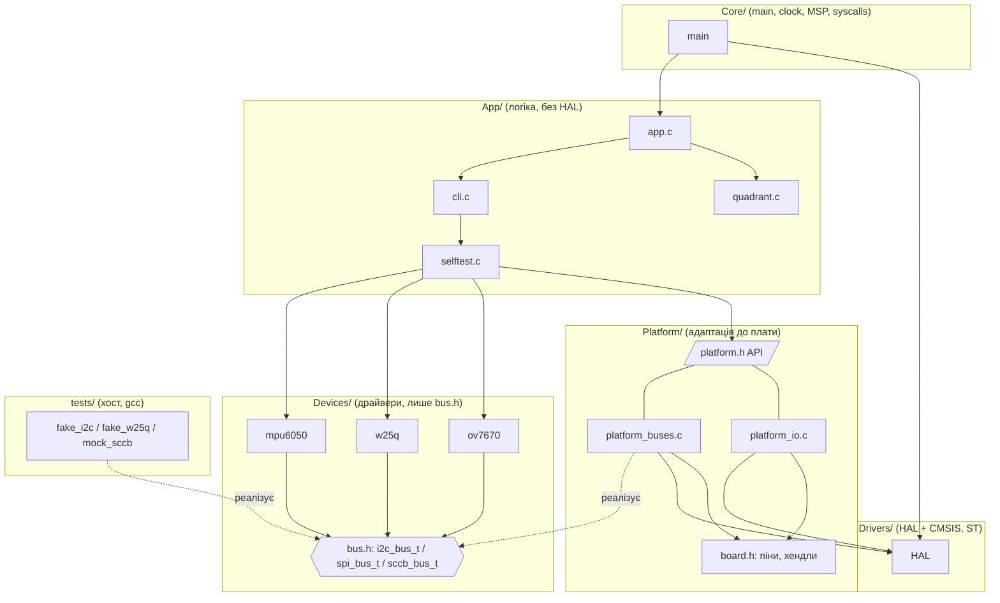

# Архітектура прошивки (ЛР2)

## Шари

```
firmware/
├── Core/       main, тактування, MSP, IRQ, syscalls (printf → USART2). Знає про HAL і всі шари.
├── Drivers/    CMSIS + HAL від ST (вендорені, версії — docs/versions.md). НЕ редагуються.
├── Platform/   адаптація до плати: board.h (піни, хендли), реалізації шин поверх HAL / bit-bang,
│               ADC, серво (TIM3), UART RX. API для верхніх шарів — platform.h (без HAL).
├── Devices/    драйвери пристроїв: MPU-6050, W25Q64, OV7670. Залежать ЛИШЕ від bus.h.
└── App/        логіка продукту: квадрант, серво-математика, selftest, CLI, головний цикл.
tests/          хостові тести (gcc), fake/mock шин, вектори, покриття (gcov).
```

### Component diagram



Стрілка = «залежить від / включає». Пунктир = реалізація інтерфейсу (залежність інвертовано через вказівники на функції).

## Правила залежностей

| Шар | Може включати |
|-----|----------------|
| Devices | лише заголовки `Devices/Inc` (`bus.h`, власні) та стандартні `<...>` |
| App | `Devices/Inc`, `App/Inc`, `Platform/Inc/platform.h`; **не** HAL, `main.h`, `board.h` |
| Platform | HAL/CMSIS, `board.h`, `Devices/Inc/bus.h`; **не** App |
| Core | усе |

Додатково в Devices/ та App/ заборонені апаратно-залежні ідентифікатори (`HAL_*`, `hi2c1`, `GPIOA`, `TIM3` …) у коді (коментарі не рахуються).

**Автоматична перевірка:** `python3 scripts/check_deps.py` (`make check-deps`) аналізує `#include` і заборонені символи, падає з кодом 1 при порушенні;
запускається в CI на кожен PR перед збіркою й тестами. Це формальна перевірка, а не домовленість «на честь».

## Як драйвер отримує доступ до шини

Драйвер тримає вказівник на структуру інтерфейсу (`i2c_bus_t`, `spi_bus_t`, `sccb_bus_t` з `Devices/Inc/bus.h`): `ctx` + функції `read/write`
(або `begin/xfer/end` для SPI). Він ніколи не викликає `HAL_I2C_Mem_Read`. На платі структуру створює Platform (`platform_i2c1()` тощо),
у тесті — fake (`tests/fakes/`). Це дозволяє виконувати **той самий код драйвера** на хості без заліза.

## Де живе знання про плату

В одному місці: `Platform/Inc/board.h` (піни, канали ADC, межі серво, extern-хендли HAL) — відповідає `docs/pinout.md`.
Шари вище не знають жодного номера піна.

## CubeMX і USER CODE

Проєкт ЛР1 писався вручну на HAL (`.ioc` у репозиторії немає), тому повторна генерація CubeMX нічого не перезапише. Якщо команда перейде на CubeMX,
згенерований код треба лишити в `Core/` (секції `USER CODE BEGIN/END` зберігаються), а Platform/Devices/App не чіпати: CubeMX генерує лише
`Core/` і `Drivers/`. Обмеження: код поза `USER CODE` секціями CubeMX перезаписує.

## Збірка та якість

* `make build` у Docker: власний код з `-Wall -Wextra -Werror` (нуль попереджень), вендорський (HAL/CMSIS) — `-w` (придушено свідомо тільки для нього),
  заголовки ST підключені через `-isystem`.
* Підключено лише потрібні модулі HAL, кожен із коментарем «навіщо» в `stm32f4xx_hal_conf.h`; у `firmware/Makefile` явно перелічені `.c` файли HAL.
* Версії залежностей: `docs/versions.md`.
* `make test` / `make coverage` — хостові тести (розд. тестування у звіті), `make check-deps` — правило залежностей.
