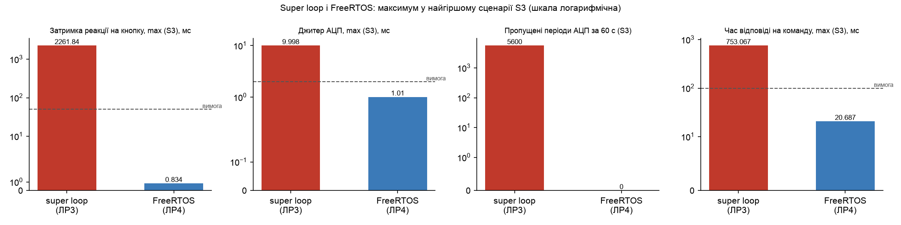
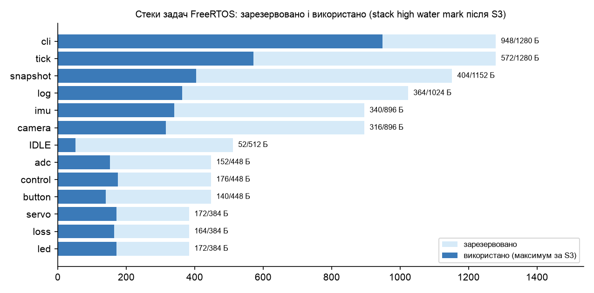
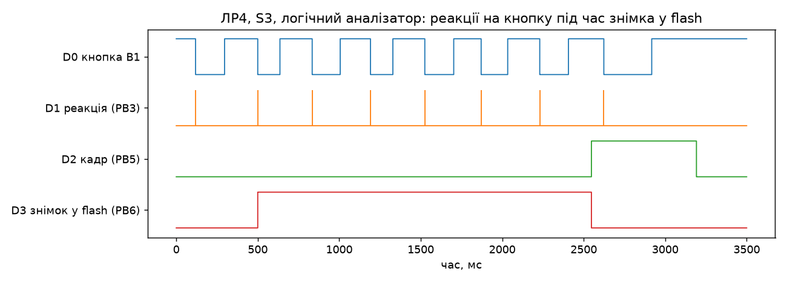

# Порівняння super loop (ЛР3) і FreeRTOS (ЛР4)

Усі числа — з логів `docs/metrics/lr3_*.log` і `docs/metrics/lr4_*.log`, які пише `tools/measure_all.py` (прошивка друкує `STAT`, `LOAD`, `TASK`, `OSCOST`, скрипти лише збирають). Таблиці нижче збирає `python3 tools/compare_lr3_lr4.py`, рисунки — `tools/make_figures_lr4.py`.

## 1. Умови вимірювань

| Параметр | Super loop (ЛР3) | FreeRTOS (ЛР4) |
|---|---|---|
| Збірка | гілка `lab3-measure` (код з тега `lab3` плюс імітатор кнопки `BTNSIM` і інжекція `FAULT SDA`), `git=62b4b88` | гілка `lab4-dev`, `git=83f936c` |
| Стенд, частота ядра, UART | NUCLEO-F411RE, SYSCLK 100 МГц, USART2 115200, ті самі з'єднання і лампа | те саме |
| Периферія | вивід UART — `HAL_UART_Transmit` (чекає кожен байт), прийом — переривання RXNE у кільце; SPI, I²C, камера, АЦП, таймери — ті самі драйвери | те саме: налаштування периферії не змінювали |
| Вимірювальний код | DWT, `STAT`, `LOAD` (ЛР3) | той самий формат; додано `TASKS`, `STACK`, `HEAP`, `OSCOST` |
| Сценарії | S1 без камери, S1, S2 ×3, S3 ×3, `break_adc`, `break_cam`, SDA, старт ×3 | ті самі, ті самі команди і тривалість (60 с на прогін) |
| S3 | кадр у flash кожні 3,2 с (`SNAP`) + потік `MODE` ≈ 20 Гц + програмна подія кнопки кожні 700 мс (`BTNSIM`), серво вимкнені | те саме |

**Попередні версії ЛР4.** Логи першої версії (до виправлення тайм-ауту SPI, тесту стека і `HardFault`) лежать у `docs/metrics/lr4_v1/`. Ще була проміжна версія, де ми перевели UART на DMA (`docs/metrics/lr4_v2/`). Її ми прибрали: методичка вимагає порівнювати прошивки з однаковими налаштуваннями периферії і переписувати організацію виконання, а не драйвери. Тому в ЛР4 UART працює так само, як у ЛР3, а проблеми, які від цього лишились, описані в `docs/problems.md` (27, 32).

**Подія кнопки без людини.** У ЛР3 кнопку натискав студент, повторити це для ЛР4 з тим самим ритмом неможливо. Тому `BTNSIM` запускає TIM2, який кожні 700 мс ставить програмну EXTI-подію на лінії B1 (`EXTI->SWIER`): це той самий ланцюжок `EXTI15_10_IRQHandler` → callback, що й від справжнього натискання, лише без брязкоту контактів. В обох прошивках доданий однаковий код.

**Дві метрики реакції.** `btn_latency` — як у ЛР3: від входу в ISR до початку реакції в задачі. Але ISR сама може чекати, поки вимкнені переривання (у ЛР3 під час кадру — до 0,8 с). Тому додано `evt_latency` — від *апаратної* події (переповнення TIM2, момент береться з `TIM2->CNT` при вході в його ISR) до початку реакції. Вимога PRD (50 мс) перевіряється за `evt_latency`.

**Що саме означають числа.**
* Запізнення (джитер) і пропущені періоди — однакова семантика в обох прошивках (як у `sched.c`): запізнення = час від запланованого моменту до початку роботи; період, пропущений повністю, не наздоганяється, а додається до `missed`; у запізненні лишається залишок у межах періоду.
* У FreeRTOS «час виконання» задачі міряється від пробудження до наступного очікування і **включає час, коли її витісняли** (п. 6.1 методички). Для чистого часу виконання — `TASKS`/`cpu_us`.
* Максимум береться за всі три повтори сценарію, у дужках — по повторах. Лічильники `uart_rx_overflow` і `cam_err` у прошивках не скидаються між прогонами, тому в дужках вони наростають.

## 2. Зведена таблиця

| Метрика | Сценарій | Super loop (ЛР3) | FreeRTOS (ЛР4) | Різниця | Вимога PRD | Інструмент | Хто кращий |
|---|---|---|---|---|---|---|---|
| Затримка реакції: від події до початку реакції, max | S3 | 2261.84 мс (1556.41, 2261.84, 1490.89) | 0.834 мс (0.834, 0.699, 0.788) | -2261.01 мс, ÷2712 | ≤ 50 мс | DWT + апаратний момент події (TIM2) | FreeRTOS |
| Затримка реакції: від події до початку реакції, середня | S3 | 509.556 мс (462.009, 509.556, 428.501) | 0.038 мс (0.034, 0.038, 0.038) | -466.65 мс, ÷12728 | — | DWT + апаратний момент події | FreeRTOS |
| Затримка реакції: від входу в ISR до початку реакції, max | S3 | 1620.8 мс (877.048, 1620.8, 875.802) | 0.019 мс (0.017, 0.017, 0.019) | -1620.78 мс, ÷85305 | — | DWT (як у ЛР3) | FreeRTOS |
| Подій кнопки втрачено | S3 | 74 (25, 51, 74) | 0 (0, 0, 0) | -74.00 | 0 | лічильник | FreeRTOS |
| Джитер АЦП (запізнення старту), max | S3 | 9.998 мс (9.996, 9.998, 9.833) | 1.01 мс (1.01, 0.944, 0.949) | -8.99 мс, ÷10 | ≤ 2 мс | DWT | FreeRTOS |
| Джитер АЦП, max | S2 | 9.956 мс (9.956, 9.811, 9.9) | 0.926 мс (0.897, 0.915, 0.926) | -9.03 мс, ÷11 | ≤ 2 мс | DWT | FreeRTOS |
| Пропущені періоди АЦП за 60 с | S3 | 5600 (5600, 5392, 5359) | 0 (0, 0, 0) | -5600.00 | 0 | DWT | FreeRTOS |
| Пропущені періоди АЦП за 60 с | S2 | 1614 (1535, 1614, 1490) | 0 (0, 0, 0) | -1614.00 | 0 | DWT | FreeRTOS |
| Джитер IMU, max | S3 | 99.581 мс (98.957, 89.663, 99.581) | 99.999 мс (75.999, 28.999, 99.999) | +0.42 мс | ≤ 2 мс | DWT | жоден не виконує вимогу |
| Час відповіді на команду, max | S3 | 753.067 мс (753.067, 51.565, 636.811) | 20.687 мс (20.687, 16.387, 17.44) | -732.38 мс, ÷36 | ≤ 100 мс (FR-09) | DWT: Enter у ISR → початок команди | FreeRTOS |
| Втрачені байти UART | S3 | 130 (46, 89, 130) | 269 (88, 172, 269) | +139.00, ×2.1 | 0 | лічильник | super loop (вимога не виконана) |
| Захоплення кадру (довга операція), max | S3 | 755.7 мс (697.687, 755.7, 624.95) | 1842.38 мс (1842.38, 1404.17, 1452.51) | +1086.68 мс, ×2.4 | — | DWT | super loop |
| Знімок у flash (кадр + запис), max | S3 | 1639.7 мс (1627.11, 1639.7, 1626.71) | 3282.19 мс (3177.84, 2365.76, 3282.19) | +1642.49 мс, ×2.0 | — | DWT | super loop |
| Завантаження CPU (середнє за прогін) | S1 | 20 % | 25 % | +5.00 % | — | DWT | super loop |
| Завантаження CPU (середнє за прогін) | S2 | 26 % (24, 26, 24) | 24 % (24, 23, 22) | -1.67 % | — | DWT | FreeRTOS |
| Завантаження CPU (середнє за прогін) | S3 | 76 % (76, 76, 76) | 73 % (73, 70, 71) | -4.67 % | — | DWT | FreeRTOS |
| Помилки захоплення кадру (cam_err) | S3 | 0 (0, 0, 0) | 1 (0, 1, 1) | +1.00 | 0 | лічильник | super loop |
| Втрачені записи журналу (pend_lost) | S3 | 0 (0, 0, 0) | 0 (0, 0, 0) | +0.00 | 0 | лічильник | обидва виконують |

Що тут видно. У super loop кнопка, АЦП і команди чекають, поки закінчиться найдовша операція в циклі (кадр камери, запис у flash, друк `STATS`). У FreeRTOS ці задачі мають вищий пріоритет і витісняють довгі операції, тому реакція впала з секунд до часток мілісекунди, АЦП перестав пропускати періоди, а відповідь на команду вклалась у 100 мс.

Платимо за це тим, що довгі операції самі стали довшими: кадр у 2,4 раза, знімок у 2 рази. Їх постійно перебивають, а найдовше — задача `cli`, яка друкує відповіді через `HAL_UART_Transmit` і на цей час займає процесор очікуванням UART (до 0,3 с на `STATS`).

Дві вимоги PRD не виконує жодна з прошивок:
* джитер IMU ≤ 2 мс — у ЛР4 задача `imu` (пріоритет 2) голодує, поки `cli` (пріоритет 3) друкує (проблема 27);
* UART без втрат — у ЛР4 байтів втрачено навіть більше, ніж у ЛР3 (проблема 32).

Обидві причини — у блокуючому друці й прийомі UART, які ми лишили як у ЛР3.

Одна помилка захоплення кадру (`cam_err`) за три прогони S3: `platform_cam_capture` повернула тайм-аут. Тайм-аут кадру 1500 мс рахується за годинником, а кадр у S3 з витісненнями триває до 1,84 с. Найімовірніше, це та сама причина, що в проблемі 29 (тайм-аут SPI), але окремо ми цього не доводили. У годинному прогоні без S3 (розділ 9) `cam_err` = 0.

**Перша версія ЛР4 і поточна** (обидві без DMA, S3, max за три повтори): втрачені байти UART 286 → 269, джитер IMU 81,0 → 100,0 мс, відповідь на команду 15,7 → 20,7 мс, знімок 3,66 → 3,28 с, `flash_err` 1 → 0. Змінилось лише одне — тайм-аут SPI 100 → 1000 мс (проблема 29). Решта різниці — розкид між прогонами: картина та сама.

Метрики пам'яті, часу старту і складності — розділи 6–8.

## 3. Задачі: запізнення і пропуски

### S3 (найгірший сценарій)

| Задача | LR3 запізнення max, мкс | LR4 запізнення max, мкс | LR3 пропущено | LR4 пропущено | LR3 час виконання max, мкс | LR4 час виконання max, мкс |
|---|---|---|---|---|---|---|
| button | 999 | 0 | 171516 | 0 | 2 | 5 |
| cli | 999 | 0 | 171437 | 0 | 340361 | 312422 |
| adc | 9998 | 1010 | 16351 | 0 | 154 | 168 |
| control | 9987 | 1178 | 16349 | 0 | 4 | 14 |
| servo | 19575 | 1122 | 7954 | 0 | 0 | 34 |
| loss | 99578 | 99999 | 1463 | 13 | 1 | 1014 |
| imu | 99581 | 99999 | 1462 | 13 | 843 | 29057 |
| led | 99802 | 75999 | 1463 | 14 | 0 | 5 |
| log | 4996 | 0 | 33595 | 0 | 65548 | 1655 |
| snapshot | 99547 | 0 | 1455 | 0 | 1639698 | 3282190 |
| camera | 1506698 | 771999 | 0 | 0 | 758423 | 3763914 |
| tick | 789105 | 199999 | 66 | 0 | 18888 | 37163 |

У S3 задачі `loss`, `imu`, `led` (пріоритети 2 і 1) пропускають 13–14 періодів за три прогони. Коли `cli` (пріоритет 3) друкує відповідь на `STATS` (до 312 мс), вони не можуть працювати. Вищі задачі (`adc`, `control`, `servo`) цього не відчувають. Так влаштовані пріоритети: менш важливе поступається. Але для IMU це порушення вимоги PRD (проблема 27).

### S2 (номінальний)

| Задача | LR3 запізнення max, мкс | LR4 запізнення max, мкс | LR3 пропущено | LR4 пропущено | LR3 час виконання max, мкс | LR4 час виконання max, мкс |
|---|---|---|---|---|---|---|
| button | 985 | 0 | 49239 | 0 | 0 | 0 |
| cli | 988 | 0 | 49084 | 0 | 39446 | 38312 |
| adc | 9956 | 926 | 4639 | 0 | 153 | 167 |
| control | 9965 | 1114 | 4632 | 0 | 4 | 12 |
| servo | 19902 | 1099 | 2250 | 0 | 0 | 35 |
| loss | 98459 | 23625 | 392 | 3 | 1 | 875 |
| imu | 98462 | 23642 | 392 | 3 | 842 | 1830 |
| led | 99307 | 23502 | 392 | 3 | 1 | 5 |
| log | 4984 | 0 | 9533 | 0 | 2954 | 0 |
| snapshot | 99312 | 0 | 392 | 0 | 0 | 0 |
| camera | 9665 | 13 | 0 | 0 | 787778 | 729840 |
| tick | 740810 | 302999 | 0 | 0 | 18887 | 18644 |

## 4. Пошук точки зламу

Серія `break_adc` (період `adc` 10 → 1 мс, по 10 с на точку) і `break_cam` (період кадру 3000 → 1000 мс, по 20 с):

**АЦП, період 10 → 1 мс** (пропущені періоди і найбільше запізнення за 10 с на точку):

| Період АЦП | ЛР3 пропущено | ЛР3 запізнення max, мкс | ЛР4 пропущено | ЛР4 запізнення max, мкс | ЛР4 CPU, % |
|---|---|---|---|---|---|
| 10 мс | 208 | 9796 | 0 | 897 | 22 |
| 5 мс | 707 | 4914 | 0 | 969 | 23 |
| 3 мс | 963 | 2855 | 0 | 854 | 25 |
| 2 мс | 1452 | 1794 | 0 | 897 | 33 |
| 1 мс | 2893 | 864 | 0 | 897 | 39 |

**Камера, період кадру 3000 → 1000 мс** (пропуски АЦП, 20 с на точку):

| Період кадру | ЛР3 пропущено АЦП | ЛР3 запізнення АЦП max, мкс | ЛР4 пропущено АЦП | ЛР4 кадрів / пропущено | ЛР4 CPU, % |
|---|---|---|---|---|---|
| 3000 мс | 503 | 9801 | 0 | 7 / 0 | 26 |
| 2000 мс | 1230 | 9801 | 0 | 10 / 0 | 30 |
| 1500 мс | 1153 | 9587 | 0 | 15 / 0 | 44 |
| 1000 мс | 3035 | 9893 | 0 | 22 / 0 | 62 |

У super loop точка зламу АЦП є вже на 10 мс (пропуски на кожному кадрі). У FreeRTOS за 1 мс і кадрі раз на секунду АЦП не пропустив жодного періоду, запізнення лишається меншим за 1 мс (це крок тіка). Межу для FreeRTOS у цих серіях ми не знайшли: CPU до 62 %, запас є. Обмеження зверху — частота тіка 1 кГц: період, менший за 1 мс, задачею з `vTaskDelayUntil` не зробити.

## 5. Відмова шини: SDA замкнено на землю (FAULT SDA)

SDA I²C1 (PB9) програмно замкнено на землю на 20 с (`FAULT SDA 1`), потім відпущено. Те саме, що дріт на GND у ЛР3, але повторюється командою.

| Метрика за 20 с з SDA на землі | ЛР3 | ЛР4 |
|---|---|---|
| АЦП: пропущені періоди | 1493 | 0 |
| АЦП: запізнення max | 9,69 мс | 0,90 мс |
| IMU: час виконання max (очікування тайм-ауту I²C) | 43,3 мс | 43,9 мс |
| IMU: запізнення max / пропущено | 46,2 мс / 134 | 0,89 мс / 0 |
| Відповідь на команду, max | 0,86 мс | 0,02 мс |
| `imu_err` | 0 | 0 |

Сама операція I²C в обох прошивках однакова: на замкненій SDA драйвер чекає тайм-аут ≈ 43 мс. Різниця в тому, кого це зачіпає. У super loop ці 43 мс стоїть увесь цикл: АЦП пропускає 1493 періоди, IMU — 134. У FreeRTOS чекає лише задача `imu` (пріоритет 2), а поки вона чекає, `adc` і `control` працюють без пропусків. Чекає довше лише `led` (пріоритет 1, запізнення до 43 мс), бо вона нижча за `imu`.

## 6. Пам'ять

| | ЛР3 (super loop) | ЛР4 (FreeRTOS) | Різниця |
|---|---|---|---|
| Flash (text + data) | 49 184 Б (9,4 % з 512 КБ) | 68 684 Б (13,1 %) | +19,5 КБ |
| RAM статично (data + bss, без стека) | 25 612 Б | 63 036 Б (48 % з 128 КБ) | +37,4 КБ |

Звідки різниця (з `.map`, `docs/metrics/memory_lr4.txt`):
* код ядра FreeRTOS ≈ 16,9 КБ flash: `tasks.c` 9,2 КБ, `queue.c` 3,1 КБ, `stream_buffer.c` 2,3 КБ, `port.c` 1,0 КБ, `heap_4.c` 1,1 КБ;
* heap ОС 24 КБ (`ucHeap`). З нього стеки і TCB 12 задач, черги, м'ютекси займають 12 144 Б (найбільше використання), тобто вільно ≈ 12 КБ;
* діагностика ЛР4: буфер хронології (`g_rts`, 8,6 КБ) і масиви для `OSCOST`/камери (≈ 4,8 КБ). У робочій прошивці без вимірювань їх можна прибрати.

Стеки задач після S3 (`STACK`, найбільше використання, байти): `cli` 948 з 1280 (вільно 26 %), `tick` 572/1280, `snapshot` 404/1152, `log` 364/1024, `imu` 340/896, `camera` 316/896, `control` 176/448, `servo` 172/384, `led` 172/384, `loss` 164/384, `adc` 152/448, `button` 140/448, `IDLE` 52/512. За годину роботи найменший запас той самий — `cli`, 83 слова з 320 (26 %). При замкненій SDA `imu` займає 628 з 896 Б (вільно 30 %): обробка помилки I²C глибша за звичайне читання. Рисунок: `lab_4/img/fig_stacks.png`.

Мінімальний heap перевірили окремими збірками: з 12 КБ прошивка стартує і працює (усі задачі створено), з 8 КБ не створюється одна із задач, і `configASSERT` зупиняє старт (`docs/metrics/lr4_heap8k_boot_*.log`).

## 7. Старт

Від скидання до рядка `ready` у UART (три старти, `lr3_boot`, `lr4_boot`): ЛР3 — 713, 714, 713 мс; ЛР4 — 717, 717, 713 мс. Майже весь цей час — ініціалізація пристроїв (камера, flash, IMU, відкриття журналу) і друк самоперевірки, однакові в обох. Запуск планувальника і створення 12 задач додають кілька мілісекунд.

## 8. Складність і супроводжуваність

Рядки свого коду (`tools/loc_report.py`, повна таблиця в `docs/metrics/loc.txt`, без HAL і ядра):

| | ЛР3 | ЛР4 |
|---|---|---|
| Оркестрація продукту (планувальник і `product` / задачі і `rtos_port`), рядків усього (коду) | 516 (485) | 848 (800) |
| Додатково в ЛР4: облік CPU і хронологія, сценарії п. 7.2, `FreeRTOSConfig.h` | — | 365 (330) |
| Весь власний код прошивки, рядків | 2878 | 4231 |
| Глобальні змінні, які пише ISR і читає код задач / циклу | 5 | 3 (решта через чергу `q_btn` і stream buffer `sb_rx`) |
| Місць, які треба змінити, щоб додати нову періодичну дію | 2 | 5 (функція, рядок `SPEC`, три масиви на 12 задач) |

Тобто за рядками коду і за кількістю правок при додаванні задачі super loop простіший. Частина зростання — вимірювальний код (облік CPU, хронологія, тести), у робочій прошивці його можна не збирати. Проте задачі ЛР4 читаються простіше: довгі операції (знімок, запис у flash) написані прямо, по порядку, без розрізання на кроки кінцевого автомата, як у ЛР3, а обмін з ISR іде через об'єкти ядра, а не через спільні прапорці.

Що стало складніше: треба думати про спільні ресурси (м'ютекси для flash, кадру і `printf`), розмір стека кожної задачі, пріоритети і про те, що з ISR можна викликати тільки `...FromISR`. Помилки тут не видно одразу. Приклади з нашої роботи:
* тайм-аут HAL, який рахується за годинником, спрацьовує, коли задачу витіснили (проблема 29);
* переповнення стека, яке перевірка ядра пропускає, якщо не зачеплені саме останні 16 байт стека (проблема 30);
* блокуючий драйвер у задачі середнього пріоритету забирає процесор у нижчих задач (проблема 27).

## 9. Годинний прогін

Одна година: камера кожні 3 с, без знімків і без потоку команд, `STATS` кожні ≈ 5 хв (`lr4_long1h_*.log`). Результат: `adc` запущено 364 417 разів, пропущено 0, запізнення max 1,01 мс; камера — 1215 кадрів; `cam_err` = 0, `flash_err` = 0, `malloc_failed` = 0. Heap за годину не зріс (12 144 Б), вільний стек `cli` не зменшився (83 слова). IMU за годину пропустив 43 періоди із 36 442, запізнення max 98 мс — те саме голодування під час друку `cli`. У ЛР3 за таку саму годину АЦП пропустив 74 783 періоди.

## 10. Перевірка гіпотез з реєстру ЛР3

Гіпотези записані в `docs/baseline-lab4.md` (розділ 3) за п'ятьма обмеженнями з `docs/limitations.md`. Числа «зараз» у базовій лінії — з ЛР3; для порівняння ми ще раз переміряли ЛР3 тими самими скриптами, тому в таблиці стоять ці нові числа.

| № | Гіпотеза (ЛР3) | Метрика | Очікували | ЛР3 | ЛР4 | Вердикт |
|---|---|---|---|---|---|---|
| 1 | Задача кнопки з високим пріоритетом витісняє знімок | реакція на кнопку, S3, max | одиниці мс, *якщо захоплення кадру не вимикає переривання* | 2261,8 мс | 0,83 мс | **підтверджено**; умова важлива: з кадром, як у ЛР3 (`CAMIRQ 0`), — 256,9 мс |
| 2 | Задача АЦП за розкладом, незалежно від камери | пропущені періоди `adc`, S2 | близько 0 | 1614 за 60 с; 74 783 за годину | 0 за 60 с; 0 за годину (364 417 запусків) | **підтверджено** |
| 3 | Черга подій і задача UART | втрачені натискання і байти, S3 | 0 | 74 натискання, 130 байтів | 0 натискань, 269 байтів | **частково**: для подій підтверджено, для байтів UART — ні |
| 4 | Блокування лише в задачі IMU | `adc` запізнення max при замкнутій SDA; відповідь CLI | `adc` без змін, CLI ≤ 100 мс | 9,69 мс, 1493 пропуски; CLI 0,86 мс | 0,90 мс, 0 пропусків; CLI 0,02 мс | **підтверджено**, і `adc` став кращим, а не «без змін» |
| 5 | Лінійний код знімка в окремій задачі | час знімка; зростання CPU | знімок без змін; CPU ≤ +5 п. п. | 1,64 с; CPU S2 26 %, S3 76 % | 3,28 с; CPU S2 24 %, S3 73 % | **частково**: CPU не зросло, але знімок удвічі довший |

Механізм і ціна по кожній гіпотезі:

* **1.** Механізм: черга `q_btn` з ISR, задача `button` з пріоритетом 6, знімок і камера з пріоритетом 1; захоплення кадру з вимкненими перериваннями лише на один рядок. Ціна: кадр довший (756 → 1842 мс max), бо його постійно перебивають. Нова проблема: тики ОС губилися під час кадру (проблема 23).
* **2.** Механізм: `vTaskDelayUntil` з пріоритетом 5. Ціна: стек 448 Б; тік ОС ≈ 1,9 мкс щомілісекунди (≈ 0,2 % CPU) і два перемикання контексту на кожен запуск. Нова проблема: при неправильному вимірі «джитер» показував 128 мс (проблема 24).
* **3.** Механізм: черга `q_btn` на 16 подій, stream buffer `sb_rx` на 256 Б. Ціна: ≈ 400 Б heap. Нова проблема: байти UART губляться в апаратному регістрі, поки переривання вимкнені на рядок камери (до 1,2 мс, а байт приходить кожні 87 мкс). Хост у ЛР4 шле частіше, бо команди обробляються швидко, тому втрат більше, ніж у ЛР3 (проблема 32). Виправити це можна прийомом через DMA, але це зміна налаштувань периферії, тому в ЛР4 ми цього не робили.
* **4.** Механізм: окрема задача `imu` з пріоритетом 2. Ціна: стек 896 Б. Нових проблем при відмові шини не помітили. Але в нормальній роботі `imu` голодує, поки `cli` друкує (проблема 27).
* **5.** Механізм: задача `snapshot` з пріоритетом 1, лінійний код без кінцевого автомата. Ціна: знімок довший, бо поступається всім, а найдовше — `cli`, яка чекає UART; м'ютекси `frame_mx` і `flash_mx`. Нові проблеми: інверсія пріоритетів на flash (перевірено `TEST INV`, розділ сценаріїв ОС у звіті) і тайм-аут SPI, який спрацьовував, коли знімок витісняли (проблема 29).

Окремо з базової лінії: «перевіряється, чи не втрачено переваги super loop» — розкид часу виконання `adc` був 151–154 мкс, став 155–168 мкс (у S3, через переривання і тік, що вклинюються); RAM 25,6 → 63,0 КБ; стеки 2 КБ (один стек) → 9 КБ (13 стеків).

## 11. Що super loop робить краще (перевірка списку з ЛР3)

Список з `docs/limitations.md` («Що super loop у нашому продукті робить краще за ОС»):

| Пункт з ЛР3 | Що виміряли в ЛР4 | Підтвердилось? |
|---|---|---|
| Детермінізм: `adc` 151–154 мкс, `control` 2–5 мкс | ЛР4, S3: `adc` 155–168 мкс, `control` 7–14 мкс (переривання і тік, що вклинюються, рахуються в час виконання) | **так**, але різниця ≈ 10 мкс і на вимоги не впливає |
| Простота налагодження: будь-яку затримку пояснює одна задача з `STATS` | у ЛР4 для пояснення затримки потрібні `TASKS`, хронологія `TRACE` і стан м'ютексів; збої ядра (assert, стек, HardFault) треба було спеціально виводити в UART (проблеми 21, 23, 24, 30) | **так** |
| Пам'ять: flash ≈ 49 КБ, RAM ≈ 25,6 КБ, стек 2 КБ | flash 68,7 КБ (+19,5 КБ), RAM 63,0 КБ (+37,4 КБ, з них heap ОС 24 КБ), стеки задач 9 КБ | **так** |
| Час старту | 713 → 717 мс (+4 мс), обидва далеко від будь-якої вимоги | **ні**, різниця несуттєва |
| Передбачуваність відмов: немає переповнення стека в чужій задачі і блокувань | у ЛР4 з'явились класи помилок: переповнення стека задачі, інверсія пріоритетів (`TEST INV`: 180 мс з м'ютексом проти 311–329 мс із семафором), голодування (`TEST STARVE`: `adc` пропустив 149 періодів; у робочому режимі — `imu` під час друку `cli`), вичерпання черги і heap, тайм-аут HAL при витісненні | **так** |

Накладні витрати ОС, які в ЛР3 були нульовими: обробка тіка ≈ 184–197 тактів (≈ 1,9 мкс) щомілісекунди, тобто ≈ 0,2 % CPU; ≈ 400 перемикань/с у S2 і ≈ 680/с у S3; від сповіщення до початку роботи задачі 11,2 мкс (`TEST CTX`). Загальне завантаження CPU від цього не зросло (S2 26 → 24 %, S3 76 → 73 %): найімовірніше, тому що драйвери в ЛР4 чекають через `vTaskDelay`, а не активним циклом `HAL_Delay`, і це перекриває вартість самої ОС.

## 12. Логічний аналізатор: затримка від фізичного натискання

Незалежна перевірка реакції (п. 6.1 методички). Підключення те саме, що в ЛР3: D0 — кнопка B1 (PC13), D1 — PB3 (імпульс на початку реакції), D2 — PB5 (захоплення кадру), D3 — PB6 (знімок у flash); 1 МГц. Канали перевірили командою `PROBE` (кожен пін блимає зі своїм періодом). Студент натискав B1 приблизно раз на секунду під час S3, як у ЛР3. Затримка — від першого спаду D0 до першого фронту D1 (спади ближче 30 мс один до одного вважаємо брязкотом), так само, як рахує `tools/analyze_latency.py`.

| Метрика (аналізатор) | Super loop (ЛР3) | FreeRTOS (ЛР4) |
|---|---|---|
| Запис | `docs/captures/lab3_button_latency.sr`, 50 с | `docs/captures/lab4_button_latency.sr`, 75 с |
| Натискань / реакцій | 48 / 17 (28 натискань злились, поки цикл був зайнятий) | 195 / 186 |
| Затримка, медіана | 342,9 мс | 0,014 мс |
| Затримка, max | 2346,2 мс | 0,881 мс |
| Реакцій усередині знімка у flash (D3) | 0 | 84 |
| Реакцій усередині захоплення кадру (D2) | 0 | 37 |
| Захоплення кадру (D2), середнє / max | 697,6 / 762,4 мс | 606,2 / 880,4 мс |
| Знімок у flash (D3), середнє / max | 1459,0 / 1582,1 мс | 1580,8 / 2123,6 мс |

DWT у прошивці ЛР4 під час цього запису: `btn_latency` 175 подій, max 19 мкс (`lr4_s3_btn_capture_20261124_121515.log`). За аналізатором 65 натискань поза кадром і знімком мають затримку до 18 мкс — збігається з DWT. Усі 17 натискань із затримкою понад 100 мкс (до 881 мкс) припали на захоплення кадру або знімок. Найімовірніше, ISR кнопки чекає кінця вікна рядка камери, коли переривання вимкнені (0,9–1,2 мс); окремо ми це не перевіряли. DWT цього не бачить, бо починає рахувати від входу в ISR; `evt_latency` з `BTNSIM` бачить (S3, max 0,83 мс). 9 спадів D0 (через 130–220 мс після попереднього натискання) лишились без імпульсу D1; причину окремо не розбирали, лічильник `btn_lost` = 0.

Другий запис — S3 з `BTNSIM 700`, як в основних замірах ЛР4 (`docs/captures/lab4_s3_btnsim.sr`, лог `lr4_s3_capture_20261124_112626.log`): 88 реакцій, з них 41 усередині знімка і 24 усередині кадру. D0 тут не змінюється: програмна подія EXTI не рухає пін.

## 13. Обрив живлення під час запису

| | Super loop (ЛР3) | FreeRTOS (ЛР4) |
|---|---|---|
| Методика | `snap_loop.py`, `SNAP` кожні 3,2 с, USB висмикували кілька разів | те саме |
| Журнал | 897 → 930 записів, #8833 → #8866, без розривів | 949 → 991 запис, #15029 → #15071, без розривів |
| Кадри | CRC 20 з 20 | CRC 20 з 20 |
| Калібровка | ціла (`fr09_calibration_persist.txt`) | ціла |
| Лог | `powerloss.txt` | `lr4_powerloss.txt` |

Різниці немає: код журналу і сховища кадрів однаковий в обох прошивках.

