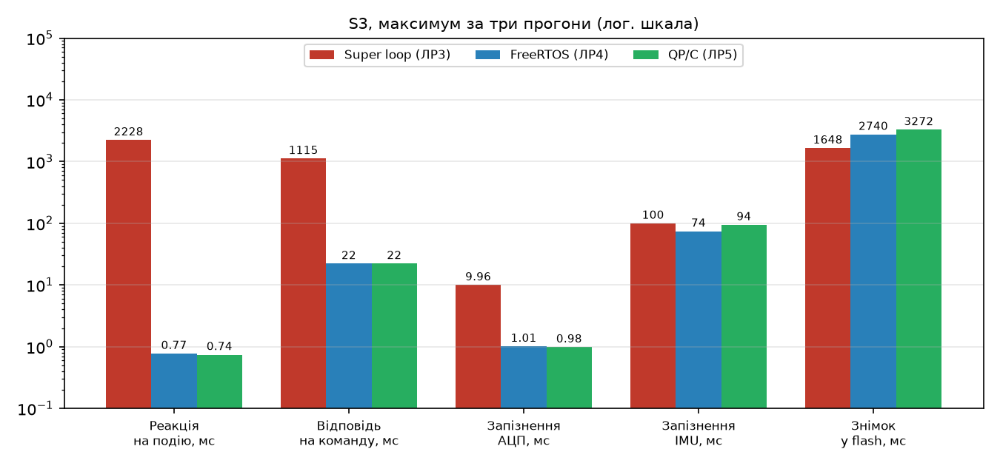
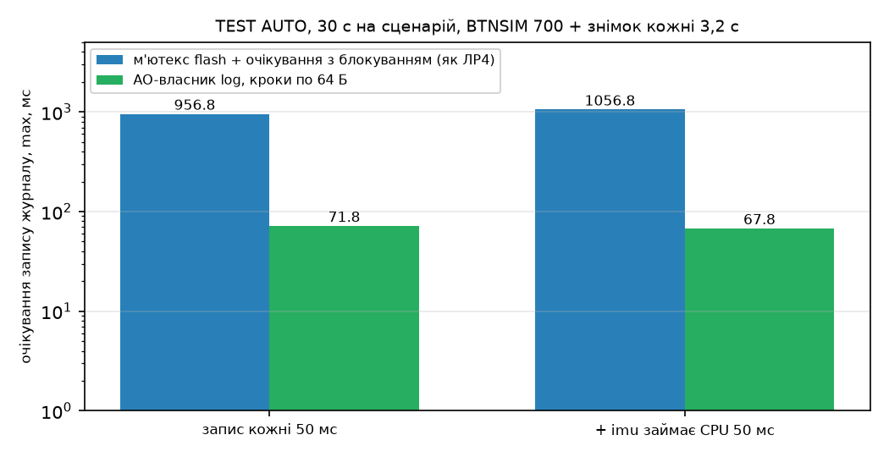
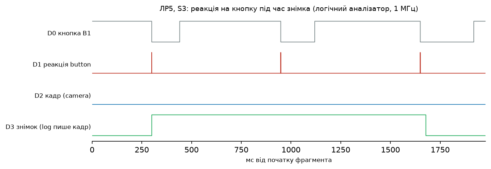

# Порівняння трьох підходів: super loop (ЛР3), FreeRTOS (ЛР4), QP/C на FreeRTOS (ЛР5)

Усі числа — з логів `docs/metrics/`, які пише `tools/measure_all.py` (прошивка друкує `STAT`, `LOAD`, `TASK`, `STACK`, `QUEUE`, `POOL`, `OSCOST`, скрипти лише збирають рядки). Таблицю збирає `python3 tools/compare_all.py`, рисунки — `python3 tools/make_figures_lr5.py` (`docs/lab_5/img/`). Порівняння ЛР3 і ЛР4 з минулої роботи лежить у `docs/comparison-lr3-lr4.md`.

## 1. Умови вимірювань

Три прошивки міряли в один день (24.11) на тому самому стенді, з тією самою лампою, підряд: ЛР5 16:48–17:04, ЛР4 17:05–17:20 (S1 і S1 без камери переміряли в 17:38–17:41, бо на 3 хвилини вимикали світло), ЛР3 17:21–17:37. Перед цим ми бачили, що різне освітлення змінює час кадру і завантаження, тому старі матриці з іншим світлом у порівнянні не використовуємо (`lr5_v2/`, `lr4_dark_s1/`).

| Параметр | ЛР3 | ЛР4 | ЛР5 |
|---|---|---|---|
| Збірка | гілка `lab3-measure`, `git=62b4b88` | тег `lab4`, `git=83f936c` | гілка `lab5-dev`, `git=415eb87` |
| Ядро, тік | — | FreeRTOS V11.1.0, 1000 Гц | той самий FreeRTOS, 1000 Гц + QP/C 8.1.6 (порт `ports/freertos`) |
| Частота ядра, периферія | 100 МГц; UART 115200 з блокуючим виводом і прийомом по RXNE; SPI 390 кГц, I²C, камера, АЦП — ті самі драйвери | те саме | те саме |
| Вимірювальний код | DWT, `STAT`, `LOAD` | те саме + `TASKS`, `STACK`, `HEAP`, `OSCOST` | те саме + `QSTAT` (черги, пули, втрати подій) |
| Сценарії | S1 без камери, S1, S2 ×3, S3 ×3, `break_adc`, `break_cam`, старт ×3 — по 60 с | ті самі | ті самі |
| S3 | знімок у flash кожні 3,2 с + потік `MODE` ≈ 20 Гц + подія кнопки кожні 700 мс (`BTNSIM`), серво вимкнені | те саме | те саме |

Як рахуємо: максимум — за три повтори, у дужках — по повторах; для вимог PRD вердикт за максимумом у S3. «Час виконання» в ЛР4 і ЛР5 — від пробудження задачі (початку обробки події) до кінця, **разом з витісненнями**. Лічильники `uart_rx_overflow` і `cam_err` у прошивках не скидаються між прогонами, тому в дужках вони наростають.

## 2. Фінальна таблиця (п. 9.4)

| Метрика (сценарій) | Super loop (ЛР3) | FreeRTOS (ЛР4) | QP/C на FreeRTOS (ЛР5) | Вимога PRD | Кращий | Інструмент, лог |
|---|---|---|---|---|---|---|
| Реакція на подію кнопки, max (S3) | 2228,4 мс | 0,772 мс | 0,741 мс | ≤ 50 мс | FreeRTOS ≈ QP/C | DWT від апаратного моменту події (TIM2) до початку реакції; `*_s3[abc]_*.log` |
| Реакція на подію кнопки, середня (S3) | 802,9 мс | 0,028 мс | 0,043 мс | — | FreeRTOS ≈ QP/C | те саме |
| Подій кнопки втрачено (S3) | 90 | 0 | 0 | 0 | FreeRTOS, QP/C | лічильник `btn_lost` |
| Запізнення АЦП (джитер), max (S3) | 9,96 мс | 1,01 мс | 0,985 мс | ≤ 2 мс | FreeRTOS ≈ QP/C | DWT |
| Пропущені періоди АЦП за 60 с (S3) | 6078 | 0 | 0 | 0 | FreeRTOS, QP/C | DWT |
| Запізнення IMU, max (S3) | 99,6 мс | 74,0 мс | 94,1 мс | ≤ 2 мс | жоден не виконує | DWT |
| Пропущені періоди IMU за 60 с (S3) | 560 | 5 | 5 | 0 | жоден не виконує | DWT |
| Найдовше очікування запису журналу у flash (S3) | — (запис у циклі) | не вимірювали | 62,0 мс | — | — | DWT: `LOG_REQ` → кінець запису (`flash_wait`) |
| Те саме при записі кожні 50 мс, м'ютекс проти AO-власника | — | 956,8 мс (варіант ЛР5 з м'ютексом, як у ЛР4) | 71,8 мс | — | QP/C | `lr5mx_auto_lograte_*`, `lr5_auto_lograte_*` |
| Відповідь на команду, max (S3) | 1114,7 мс | 22,1 мс | 22,1 мс | ≤ 100 мс (FR-09) | FreeRTOS ≈ QP/C | DWT: Enter у ISR → початок команди |
| Втрачені байти UART (S3, потік команд) | 136 | 271 | 182 | 0 | жоден не виконує | лічильник overrun USART |
| Захоплення кадру, max (S3) | 747 мс | 1746 мс | 1784 мс | — | super loop | DWT |
| Знімок у flash (кадр + запис), max (S3) | 1648 мс | 2740 мс | 3272 мс | — | super loop | DWT |
| Завантаження CPU, середнє (S2) | 25 % | 26 % | 26 % | — | ≈ | DWT, `LOAD` |
| Завантаження CPU, середнє (S3) | 82 % | 73 % | 63 % | — | QP/C | DWT, `LOAD` |
| Накладні витрати тіку (S2) | 0 | 184 такти/мс ≈ 0,18 % | 598 тактів/мс ≈ 0,6 % | — | super loop | `OSCOST tick_isr_avg_cyc` |
| Flash, усього (text + data) | 49 184 Б | 68 684 Б | 76 720 Б | ≤ 512 КБ | super loop | `arm-none-eabi-size` |
| RAM статично (data + bss) | 25 612 Б | 63 036 Б | 63 904 Б | ≤ 128 КБ | super loop | `arm-none-eabi-size` |
| Стеки: зарезервовано / використано (S3) | 2048 / 672 Б (один стек) | 9 536 / 3 936 Б (13 задач з IDLE) | 11 776 / 4 820 Б (12 AO + IDLE) | — | super loop | `MEM`, `STACK` |
| Черги: місць / найбільше заповнення (S3) | — | 32 події + 256 Б (`q_btn`, `q_log`, `sb_rx`) / не вимірювали | 228 подій у 12 чергах / 5 (у будь-якій черзі) | — | — | `QSTAT` |
| Пули подій: блоків / найменше вільних (S3) | — | — | 64 / 60, 24 / 19, 32 / 31 | — | — | `QSTAT` |
| Час від увімкнення до `ready` (3 старти) | 711–715 мс | 715–717 мс | 710–716 мс | — | ≈ | `boot_ms` у лозі старту |
| Рядків оркестрації продукту | 516 | 848 | 1 697 | — | super loop | `tools/loc_report.py` і той самий підрахунок для ЛР5 |
| Рядків власного коду прошивки загалом | 2 878 | 4 231 | 5 675 | — | super loop | те саме |
| Станів / переходів | неявні (прапорці і кроки в `product.c`) | неявні (місце в коді задачі) | 26 станів / 25 переходів (+12 початкових) | — | див. примітку | `tools/check_statecharts.py`, `docs/statecharts/` |
| М'ютексів і семафорів у прикладному шарі | 0 | 3 м'ютекси (`flash_mx`, `frame_mx`, `print_mx`) | 0 | — | QP/C | `scripts/check_deps.py` |
| Змінних, спільних для задач або з ISR | 5 (ISR → цикл) | 3 ISR → задачі + `trk`, `q`, `sky`, `servos_on` між задачами | 0 (крім вимірювальних лічильників) | — | QP/C | вручну за кодом |
| Місць правки для нової періодичної задачі | 2 (функція, рядок `TASK_DEF`) | 5 (функція, `SPEC`, три масиви на 12 задач) | 5 (файл AO; `ao.h`: id, вказівник, конструктор; `bsp.c`: `AO_DEF`, `START`, виклик конструктора) | — | super loop | вручну |

**Різниця словами.** Реакція на подію: ЛР3 → ЛР5 −2227,7 мс, у ≈ 3000 разів; ЛР4 → ЛР5 −0,03 мс, у межах розкиду між прогонами (0,375–0,772 мс у ЛР4, 0,569–0,741 мс у ЛР5). Відповідь на команду: ЛР3 → ЛР5 −1092,6 мс, у 50 разів; ЛР4 і ЛР5 однакові (22,1 мс). Очікування flash при частому записі: м'ютекс → AO-власник −885 мс, у 13 разів. Знімок: ЛР4 → ЛР5 +532 мс (+19 %), ЛР3 → ЛР5 у 2 рази довше. CPU у S3: ЛР4 → ЛР5 −10 п. п.

**Примітка про стани.** Станів у ЛР5 більше не тому, що логіка складніша. У ЛР3 ті самі стани були в прапорцях (`snap_step`, `cam_busy`, `flash_busy`), у ЛР4 — у тому, на якому рядку задача чекає. У ЛР5 вони явні, намальовані і перевіряються скриптом проти коду. Сама кількість — не перевага.

**Примітка про пам'ять.** RAM майже така сама, як у ЛР4, але розкладається інакше: heap ОС 24 КБ → 1 КБ, натомість статичні стеки 11,3 КБ, черги 912 Б, три пули подій 7,8 КБ (1 792 + 1 440 + 4 608 Б). Flash +8 КБ — код QP/C (≈ 7,6 КБ: `qf_port.o` 1,9 КБ, `qep_hsm.o` 1,2 КБ, `qf_dyn.o` 0,9 КБ, `qf_time.o` 0,8 КБ, решта по 0,1–0,7 КБ). Розклад по секціях — `docs/metrics/memory_lr5.txt`, `docs/qp-design.md`, розділ 7.

### Що видно з таблиці

* **Події і періоди.** ЛР4 і ЛР5 однакові: реакція < 1 мс, АЦП без пропусків, відповідь 22 мс. У ЛР5 ми свідомо лишили пріоритети задач такими, як у ЛР4 (розділ 1 `qp-design.md`), тому ця частина і не мала змінитись. Переваги моделі AO треба шукати не тут.
* **Спільні ресурси.** Головна різниця — у доступі до flash. У ЛР4 задача, що пише кадр, тримає м'ютекс flash усю операцію, і запис журналу чекає кадр цілком. У ЛР5 власник flash робить запис кроками по 64 Б, і запис журналу вклинюється між кроками. При записі журналу кожні 50 мс найдовше очікування 957 мс з м'ютексом проти 72 мс з AO-власником, і з м'ютексом 41 запис губиться через переповнену чергу (розділ 4).
* **Довгі операції.** Знімок у ЛР5 найдовший (3,27 с): той самий запис кадру тепер іде кроками по 64 Б з паузою на перевірку готовності flash (подія `POLL` кожну 1 мс), а не одним циклом. Ціна відповіді власника flash, але в межах PRD (окремої вимоги на час знімка немає, FR-11 — не частіше раз на 3 с).
* **CPU у S3 найменше в ЛР5 (63 %).** Різниця — у записі кадру: у ЛР4 задача `snapshot` займала 26,9 % CPU (`TASKS`), у ЛР5 власник flash `log` — 12,4–13,1 %. Обидві перевіряють готовність flash раз на 1 мс (`vTaskDelay(1)` у ЛР4, подія `POLL` у ЛР5), тому точну причину різниці ми не з'ясували.
* **IMU і UART.** Як і в ЛР4, жоден підхід не виконує джитер IMU 2 мс і прийом UART без втрат. Причина та сама: блокуючий драйвер UART з ЛР3 (поки `cli` друкує `STATS` 0,3 с, AO нижче за неї не працюють; поки камера вимикає переривання на рядок, губиться байт). AO-модель не прибирає блокування всередині драйвера.
* **Пам'ять і код** — дорожче за ЛР4: flash +8 КБ, рядків оркестрації вдвічі більше (явні стани, асинхронний запис flash кроками, команди CLI як події власникам).

### Якісне порівняння

| Властивість | Super loop (ЛР3) | FreeRTOS (ЛР4) | QP/C на FreeRTOS (ЛР5) |
|---|---|---|---|
| Модель виконання | один цикл, кожна частина чекає решту | задачі, що блокуються і витісняють одна одну | AO обробляють події кроками до завершення (RTC) і не блокуються; витісняють один одного як задачі FreeRTOS |
| Взаємодія | глобальні змінні і прапорці | черги, stream buffer, сповіщення, м'ютекси | лише події (пряме надсилання, публікація, часові події) |
| Спільні ресурси | по черзі в циклі | м'ютекси; інверсія пріоритетів, очікування цілої операції | AO-власник ресурсу; клієнти не чекають ресурс, а надсилають запит і отримують відповідь |
| Пам'ять для виконання | один стек 2 КБ | стек на задачу (9,5 КБ) + heap ОС | стек на AO (11,8 КБ) + черги + пули подій; heap ОС не потрібен |
| Що визначає час реакції | найдовша ділянка циклу (до 2,2 с) | пріоритет і час утримання м'ютексів | пріоритет і найдовший RTC-крок AO вищого пріоритету |
| Типові помилки в нашій роботі | пропущені події і періоди | тайм-аут HAL при витісненні, голодування, неатомарний друк | переповнення черги і `Q_onError` (проблема 34), власник ресурсу з довгими кроками забирає CPU (35), неврахована подія в стані (сценарій SNAPTO) |
| Опис поведінки | коментарі | схема задач | діаграми станів, перевірені скриптом проти коду |
| Налагодження | одна задача в `STATS` пояснює затримку | `TASKS`, хронологія, стан м'ютексів | те саме + `QSTAT` (черги, пули, втрати); аварії QP дають модуль і номер рядка (`Q_onError qf_port 630`) |
| Поріг входу | найнижчий | середній | найвищий: події, машини станів, пули, нюанси порту |

## 3. Задачі й AO: запізнення і пропуски

S3, максимум запізнення і сума пропусків за три прогони:

| Задача / AO | Запізнення max, мкс (ЛР3 / ЛР4 / ЛР5) | Пропущено (ЛР3 / ЛР4 / ЛР5) | Час кроку max, мкс (ЛР3 / ЛР4 / ЛР5) |
|---|---|---|---|
| button | 999 / 0 / 0 | 179 089 / 0 / 0 | 2 / 5 / 11 |
| adc | 9 963 / 1 010 / 985 | 17 065 / 0 / 0 | 154 / 191 / 178 |
| control | 9 991 / 1 178 / 1 211 | 17 054 / 0 / 0 | 4 / 14 / 93 |
| servo | 19 993 / 1 123 / 1 182 | 8 300 / 0 / 0 | 0 / 35 / 16 |
| log | 4 999 / 0 / 0 | 35 025 / 0 / 0 | 2 971 / 656 857 / 42 716 |
| cli | 999 / 0 / 0 | 179 090 / 0 / 0 | 322 376 / 313 198 / 329 408 |
| imu | 99 607 / 73 999 / 94 142 | 1 532 / 13 / 13 | 843 / 33 396 / 19 829 |
| tick | 987 841 / 273 999 / 327 998 | 47 / 0 / 0 | 19 061 / 37 899 / 36 681 |
| loss | 99 604 / 73 999 / 95 024 | 1 534 / 13 / 13 | 1 / 18 608 / 9 |
| led | 99 744 / 91 999 / 95 116 | 1 530 / 13 / 13 | 0 / 5 / 48 |
| camera | 260 690 / 14 893 / 1 140 998 | 0 / 0 / 36 | 750 318 / 3 009 999 / 1 787 520 |
| snapshot | 99 750 / 0 / 0 | 1 517 / 0 / 0 | 1 647 701 / 2 739 547 / 3 271 681 |

* `log` у ЛР5: крок до 42,7 мс — це не робота, а витіснення посеред кроку (у кроці не більше 64 Б по SPI, ≈ 1,3 мс). У ЛР4 задача `log` чекала м'ютекс flash, поки `snapshot` писала кадр (до 657 мс).
* `camera` у ЛР5: 36 пропущених періодів за три прогони і запізнення до 1,14 с. Так і задумано: поки буфер кадру позичений знімку (стан `lent`), camera не знімає кадр неба, а рахує період пропущеним. У ЛР4 задача в цей час чекала `frame_mx`, і період не пропускався, а зсувався.
* `control` у ЛР5: крок до 93 мкс проти 14 у ЛР4 — у кроці тепер створюються й надсилаються події (`TARGET`, раз на 10 періодів `TRACK`), а частина кроків витіснена `button` і `adc`.

## 4. Сценарії ЛР4 у термінах QP/C (п. 9.2) і специфічні для QP/C (п. 9.3)

Сценарії вмикаються командою `TEST ...` (`firmware/Core/Src/qp_tests.c`). Через зависання зв'язку «комп'ютер → плата» (проблема 36) ми проганяли їх командою `TEST AUTO`: прошивка сама вмикає сценарії по черзі, тримає навантаження (`BTNSIM 700` і знімок кожні 3,2 с) і після кожного друкує `STATS` і `QSTAT`, а хост лише читає (`tools/lr5_auto.py`). Логи `docs/metrics/lr5_auto_*.log`, варіант з м'ютексом — `lr5mx_auto_*.log`. Кожен сценарій — 30 с, якщо не сказано інше.

### 4.1 М'ютекс проти AO-власника (інверсія пріоритетів, п. 9.2 і 9.3.1)

Збірка `-DLR5_FLASH_MUTEX`: snapshot сам пише кадр у flash під м'ютексом і чекає готовності flash `vTaskDelay(1)`, як задача `snapshot` у ЛР4; записи журналу теж ідуть під м'ютексом. Порівнюємо з основною прошивкою (AO-власник `log`).

| Сценарій (30 с) | Очікування запису журналу, max | Записів втрачено | Черга log, max | imu пропущено | Реакція на кнопку, max |
|---|---|---|---|---|---|
| Запис журналу кожні 50 мс, м'ютекс | 956,8 мс | 41 | 14 / 16 | 0 | 0,62 мс |
| те саме, AO-власник | **71,8 мс** | 0 | 2 / 16 | 0 | 0,40 мс |
| + imu займає CPU 50 мс кожні 100 мс (інверсія), м'ютекс | 1056,8 мс | 7 | 14 / 16 | 0 | 0,02 мс |
| те саме, AO-власник | **67,8 мс** | 0 | 2 / 16 | 0 | 0,03 мс |

Чому так. З м'ютексом запис журналу чекає, поки snapshot допише кадр цілком (19 КБ при SPI 390 кГц, ≈ 0,4 с передачі плюс стирання секторів). Записи журналу у цьому варіанті пише `log` (пріоритет задачі 2), і поки вона чекає м'ютекс, її черга наповнюється (14 з 16), а нові записи губляться (41 за 30 с). Snapshot (пріоритет 1) на час очікування успадковує пріоритет 2 — такий самий, як у `imu`, тому в сценарії інверсії `imu` ділить з нею процесор, і очікування росте з 957 до 1057 мс. Головне ж — чекати доводиться весь кадр, а його запис перебивають усі AO вищі за 2. З AO-власником запис журналу чекає не кадр, а одну поточну операцію flash: крок запису 64 Б або стирання сектора, яке вже почалось (найдовша частина, до кількох десятків мс), плюс час, коли `log` витісняють AO вищого пріоритету. Інверсії немає, бо ніхто не чекає ресурс, захоплений нижчим AO: запит лягає в чергу `log`, а `log` має пріоритет вищий за тих, хто чекає його відповіді (snapshot, camera).

У звичайному S3 різниця менша: варіант з м'ютексом дав відповідь на команду 18,1 мс, imu 4 пропуски, реакцію 0,46 мс (`lr5mx_s3a_*.log`) — записів журналу в S3 мало, і вони рідко потрапляють на запис кадру.

**Пріоритет власника.** Методичка радить ставити власника вище за всіх клієнтів (п. 5.8). Ми виміряли обидва варіанти в S3 (проблема 35): власник `log` з пріоритетом задачі 4 (`-DLOG_OWNER_HIGH`, `lr5hi_s3a_*.log`) — відповідь на команду 74,7 мс, imu пропустив 58 періодів, очікування запису журналу 36,8 мс; з пріоритетом 2 (основна прошивка) — 22,1 мс, 5 пропусків, 62 мс. Драйвер SPI опитувальний, тому кожен крок власника — це робота процесора, і власник вище за `cli` та `imu` забирає в них час. Ми лишили 2: вище за тих, хто чекає відповіді, але не вище за `cli` і `imu`.

### 4.2 Блокувальний виклик в обробнику (п. 9.3.2)

`TEST BLOCK 1`: `log` чекає готовності flash циклом `while (busy) vTaskDelay(1)` прямо в обробнику, замість події `POLL`. `TEST OWNER 5`: `log` ще й тримає процесор 5 мс у кожному кроці («шина чекає 5 мс»). Обидва на фоні запису журналу кожні 50 мс.

| Метрика | `POLL` (норма) | `BLOCK` | `OWNER 5` |
|---|---|---|---|
| Крок `log`, max | 20,5 мс | 67,8 мс | 26,7 мс |
| Очікування запису журналу, max / середнє | 71,8 / 6,0 мс | 125,8 / 8,4 мс | 88,8 / 15,6 мс |
| Знімок, max | 2,14 с | 2,91 с | 5,48 с |
| Черга log, max | 2 / 16 | 2 / 16 | 2 / 16 |
| adc, imu пропущено | 0, 0 | 0, 0 | 0, 0 |
| Реакція на кнопку, max | 0,40 мс | 0,75 мс | 0,02 мс |

FreeRTOS такий код дозволяє: задача `log` у `vTaskDelay` просто блокується, і процесор отримують інші. Але модель AO він ламає: поки обробник чекає, `log` не бере нові події з черги, тобто весь час стирання сектора (десятки мс) запис журналу і будь-який інший запит стоять. Тому очікування запису виросло вдвічі. AO вищого пріоритету (adc, imu, кнопка) від цього не страждають: блокування — це не зайнятий процесор. `OWNER 5` гірший для тих, хто нижче за `log` (snapshot, camera): знімок до 5,5 с, а camera пропустила 7 кадрів.

### 4.3 Довгий RTC-крок (п. 9.3.3)

`TEST ONESTEP 1`: `log` пише весь кадр одним кроком. `TEST CTRL 30`: `control` робить 30 мс роботи на кожному 10-му `SAMPLE` (на кожному `SAMPLE` процесора не вистачає: 30 мс роботи кожні 10 мс, і `cli` переставала відповідати).

| Метрика | Норма | `ONESTEP` | `CTRL 30` |
|---|---|---|---|
| Найдовший крок | `log` 20,5 мс | `log` 1258 мс | `control` 30 мс (кожен 10-й) |
| Очікування запису журналу, max | 71,8 мс | 1253,8 мс | 1,8 мс |
| Записів втрачено / черга log | 0 / 2 з 16 | 112 / 14 з 16 | 0 / 1 з 16 |
| control пропущено | 0 | 0 | 600 з 3003 |
| Реакція на кнопку, max | 0,40 мс | 0,18 мс | 0,018 мс |
| CPU | 79 % | 78 % | 97 % |

Висновок: довгий крок шкодить тим, хто чекає саме цей AO, а не всім. При `ONESTEP` записи журналу 1,25 с стоять у черзі `log`, і 112 записів губляться, хоча `log` нічого не блокує. При `CTRL 30` `control` не блокується, але сам пропускає свої періоди, а все, що нижче за нього, отримує процесор рідше. Реакція на кнопку не змінилась: `button` вища за `control` і `log` і витісняє їх посеред кроку. В AO на одному потоці (без витіснення, як у QV) реакція на кнопку чекала б кінця кроку — тут нас рятує те, що кожен AO має свою задачу FreeRTOS. Час від `OP_TIMEOUT` до фактичної зупинки знімка в `ONESTEP` окремо не міряли.

### 4.4 Переповнення черги (п. 9.2 і 9.3.4)

`tools/run_scenario.py qflood`: 50 рядків команд без пауз (`lr5_qflood_*.log`). Відповідей 31 з 50, найбільше заповнення черги `cli` 29 / 32, `Q_onError` не було. 18 рядків відкинуто з лічильником (`LOST lines=18`): ISR бере подію рядка з пулу 2 через `Q_NEW_X_FROM_ISR` із запасом 2, і в пулі лишалось лише 2 вільні блоки з 24 (`POOL 2 min_free=2/24`); ще 18 байтів загубились в UART (`uart_rx_overflow`, як у ЛР3–ЛР4). Окрема збірка, де ISR надсилає рядок без запасу в черзі (`-DLR5_RX_NO_MARGIN`, `lr5rxnm_qflood_*.log`), дала той самий результат: черга `cli` (32) не встигає заповнитись, бо раніше закінчуються блоки пулу (24). Тобто в нашій прошивці межа — пул, а не черга. Аварію `Q_onError qf_port 630` від переповненої черги ми отримали раніше в реальній роботі (проблема 34).

Що вибрали для сигналів: `BUTTON` і `LINE` з ISR — із запасом (втрата рахується, система живе); `PERIOD` — одноразова часова подія, яку AO сам перезапускає, тому в черзі ніколи не буває двох; `LOG_REQ`, `TEXT` — із запасом 2 (запис чи рядок можна загубити з лічильником); запити до власників (`SAVE_FRAME`, `CAPTURE_REQ`) — із запасом 1 і відповіддю з помилкою.

### 4.5 Вичерпання пулу (п. 9.2 і 9.3.5)

`TEST POOL`: брати події з пулу 1 без повернення. Результат: `FATAL Q_onError qf_dyn 630` і перезапуск плати (`lr5_pool_*.log`). `Q_NEW` без запасу вважає нестачу пам'яті помилкою програми; `Q_NEW_X` із запасом повертає NULL, і це видно як `LOST events` у `QSTAT`. Найбільше динамічних подій одночасно в S3: у пулі 1 зайнято 4 з 64, у пулі 2 — 5 з 24 (`POOL 2 min_free=19/24`), у пулі 3 — 1 з 32; у сценаріях з голодуванням пул 2 доходив до 14 зайнятих з 24 (`flashfail`, `onestep`) — події `TRACK` накопичуються в чергах AO, які не отримують процесор.

### 4.6 Переповнення стека (п. 9.2)

Збірка `-DSTK_TICK_W=96` (стек AO `tick` 96 слів при виміряному використанні ≈ 150 слів): `FATAL stack overflow in tick` і перезапуск ще на старті (`lr5_stk96_boot_*.log`). Хук ядра `vApplicationStackOverflowHook` той самий, що в ЛР4: AO для ядра — звичайна задача.

### 4.7 Голодування (п. 9.2)

`TEST STARVE 1500`: `button` (найвищий пріоритет) 1,5 с шле подію сама собі і на кожній робить 1 мс роботи. Результат (`lr5_starve_20261124_195434.log`): `adc` і `control` пропустили по 149 періодів, `servo` — 74, `imu` — 19; `cli`, яка запустила сценарій, була витіснена на 1,5 с (крок 1,50 с). Те саме, що в ЛР4 (149 пропусків): AO на FreeRTOS голодують так само, як задачі.

У прогоні `TEST AUTO` цей сценарій спершу показав `adc` без пропусків. Причина — у нашому тесті: `TEST AUTO` скидав статистику *після* запуску сценарію, а `button` витісняла `cli` одразу після надсилання події, тож скидання відбувалось уже після голодування. Видно це було лише по AO, які рахують пропуски при наступному запуску: imu 19 пропусків, очікування запису журналу 3,2 с. Порядок виправлено (`qp_tests.c`), сценарій переміряли окремою командою.

### 4.8 Частота тіку 1000 і 200 Гц (п. 9.2)

Збірка `RTOS_TICK_HZ=200`, `BSP_TICKS_PER_SEC=200` (`lr5_tick200_s2a_*`, `lr5_tick200_s3a_*`). При 200 Гц `MS(1)` дає 5 мс.

| Метрика | 1000 Гц (S3, max за 3) | 200 Гц (S3, 1 прогін) |
|---|---|---|
| Реакція на кнопку, max | 0,74 мс | 0,14 мс |
| Запізнення АЦП, max (S2 / S3) | 0,92 / 0,99 мс | 1,0 / 1,04 мс |
| imu пропущено | 4–5 | 5 |
| Відповідь на команду, max | 22,1 мс | 18,0 мс |
| Хук тіку, avg | 598–692 такти (≈ 0,6–0,7 % CPU) | 1194 такти (≈ 0,24 % CPU) |
| Очікування запису журналу, avg / max | 2–3 / 62 мс | 8,2 / 21,5 мс |
| Знімків за 60 с / тривалість | 19–20 / до 3,27 с | 5 / 2,6–2,9 с |

Джитер АЦП не змінився: періоди AO кратні 5 мс. Реакція на кнопку від тіку не залежить (подія з ISR будить задачу одразу). Хук тіку при 1000 Гц у ЛР5 утричі дорожчий, ніж у ЛР4 (≈ 600 проти ≈ 190 тактів): у ньому QP перебирає свої часові події (`QTIMEEVT_TICK_FROM_ISR`). Помітно змінилась робота власника flash: подія `POLL` тепер приходить раз на 5 мс, тому кожен крок запису чекає довше, і середнє очікування запису журналу зросло з 2–3 до 8 мс. Знімків при 200 Гц удвічі менше за ті самі 60 с — запис кадру повільніший, а новий знімок можна почати лише після кінця попереднього. Тому лишили 1000 Гц.

### 4.9 Неочікувана подія (п. 9.3.6)

`TEST SNAPTO 1000`: таймаут знімка 1000 мс при самій операції 1,5–2,5 с (`lr5_auto_snapto_*.log`, 15 с). 4 знімки закінчились таймаутом (`OP_TIMEOUT` у `busy` → перехід в `idle`, `flash_err` +4 з кодом −10), і 4 запізнілі відповіді (`CAPTURE_DONE` або `SAVE_DONE`) прийшли вже в `idle` (`late_events=4`). Стан `idle` обробляє їх явно: повертає буфер камері (`BUF_RELEASE`) і нічого не вважає завершенням знімка (діаграма `docs/statecharts/snapshot.png`). Наступний знімок починається лише з нового `SNAP_REQ`, тож запізніла відповідь не може його «завершити». У super loop з прапорцем `snap_busy` запізнілий кінець запису скинув би прапорець наступного знімка. Перший варіант (таймаут 300 мс) ми не змогли зняти: тричі підряд зависав зв'язок ST-Link (проблема 36).

### 4.10 Відмова сенсора (п. 9.3.7)

MPU-6050 від'єднали під час S2 (`lr5_fail_imu_*.log`). `imu` перейшов у `fault` після 3 помилок поспіль (300 мс — 3 періоди), далі раз на період пробує розбудити датчик і прочитати; після підключення — `recovered after 14 111 ms` (стільки `imu` пробув у `fault`). Невдале читання займає 0,33 мс, `adc` і `control` без пропусків, `imu_err` 141. У ЛР3 така відмова шини зупиняла весь цикл (SDA на землі: АЦП 1493 пропуски за 20 с), у ЛР4 — лише задачу `imu`, але без явного стану відмови (кожен період знову чекала тайм-аут I²C). У ЛР5 стан відмови видно на діаграмі і в лозі.

### 4.11 Збій шини (п. 9.3.8)

`TEST FLASHFAIL 1` на 3 с, потім `0` (`lr5_auto_flashfail_*.log`): кожна операція flash повертає помилку шини. `log` після трьох помилок переходить у `fault` («requests answered with errors»), усі запити одразу отримують відповідь з помилкою: 31 запис журналу відхилено (`LOST logs=31`), `flash_err` 8, ніхто не чекав і не завис (знімок 1,7 с, adc і imu без пропусків). Після вимкнення збою `log` раз на секунду читає JEDEC ID і повертається в роботу («flash recovered»).

## 5. Пошук точки зламу

**АЦП, період 10 → 1 мс** (10 с на точку; пропущено / запізнення max):

| Період | ЛР3 | ЛР4 | ЛР5 |
|---|---|---|---|
| 10 мс | 283 / 8,8 мс | 0 / 0,89 мс | 0 / 0,91 мс |
| 5 мс | 575 / 4,6 мс | 0 / 0,98 мс | 0 / 0,89 мс |
| 3 мс | 965 / 2,8 мс | 0 / 0,89 мс | 0 / 0,87 мс |
| 2 мс | 1430 / 1,9 мс | 0 / 1,00 мс | 0 / 1,01 мс |
| 1 мс | 2857 / 0,9 мс | 0 / 0,90 мс | **3** / 1,00 мс |

**Камера, період кадру 3000 → 1000 мс** (20 с на точку): ЛР3 — АЦП пропустив 622 / 1707 / 1239 / 2986 періодів; ЛР4 і ЛР5 — 0 на всіх точках, кадрів без пропусків.

На періоді АЦП 1 мс ЛР5 пропустила 3 періоди з 12 202, ЛР4 — 0. Період 1 мс дорівнює тіку: часова подія QP спрацьовує в хуку тіку, і якщо попередній крок `adc` разом із витісненням закінчився пізніше за наступний тік, перезапуск на «наступний ідеальний тік» пропускає один період. У ЛР4 `vTaskDelayUntil` в такому разі повертається одразу і не пропускає. Ціна нашої реалізації періоду — лише на межі тіку; на робочому періоді 10 мс пропусків немає.

## 6. Логічний аналізатор: затримка від фізичного натискання і хронологія S3

Підключення як у ЛР3 і ЛР4: D0 — кнопка B1, D1 — PB3 (початок реакції `button`), D2 — PB5 (захоплення кадру), D3 — PB6 (знімок: від входу в `busy` до виходу); 1 МГц. Студент натискав B1 приблизно раз на секунду під час S3 (`docs/captures/lab5_button_latency.sr`, 75 с, лог `lr5_s3_btn_capture_*.log`).

| Метрика (аналізатор) | ЛР3 | ЛР4 | ЛР5 |
|---|---|---|---|
| Натискань / реакцій | 48 / 17 | 195 / 186 | 164 / 149 |
| Затримка, медіана | 342,9 мс | 0,014 мс | 0,019 мс |
| Затримка, max | 2346,2 мс | 0,881 мс | 0,873 мс (p99 0,607 мс) |
| Реакцій усередині знімка (D3) / кадру (D2) | 0 / 0 | 84 / 37 | 73 / 7 |

DWT під час запису: `btn_latency` max 38 мкс. Реакція з'являється посеред знімка (D3) і кадру (D2): `button` витісняє `log`, який пише кадр, і `camera`. Це й підтверджує діаграму послідовності S3 (`docs/statecharts/seq_s3.png`): подія кнопки витісняє довгу операцію, а та продовжується з того самого місця. Затримки понад 0,1 мс, як і в ЛР4, припадають на кадр і знімок — найімовірніше, ISR чекає кінця вікна рядка камери з вимкненими перериваннями (окремо не перевіряли). 15 натискань без реакції — злиті натискання ближче 3 с, на які `snapshot` не реагує (FR-11), або брязкіт; окремо не розбирали, `btn_lost` = 0.

## 7. Тривала робота (година)

Сценарій `long`, 3600 с: камера кожні 3 с, серво вимкнені, без знімків і без потоку команд, `STATS` кожні ≈ 5 хв (`docs/metrics/lr5_long1h_20261124_185030.log`). Освітлення за годину стабільне (TL 2973–3384).

| Метрика за годину | ЛР3 | ЛР4 | ЛР5 |
|---|---|---|---|
| Перезапусків | 0 | 0 | 0 (uptime 258 → 3927 с без розривів) |
| АЦП: запусків / пропущено / запізнення max | 289 859 / 74 783 / 9,98 мс | 364 417 / 0 / 1,01 мс | 364 431 / 0 / 1,02 мс |
| IMU: запізнення max / пропущено | 100,0 мс / 5864 | 98,0 мс / 43 | 98,7 мс / 50 |
| Кадрів / помилок кадру | 1216 / 0 | 1215 / 0 | 1215 / 0 |
| Відповідь на команду, max | 1,59 мс | 0,13 мс | 13,95 мс |
| `flash_err`, `imu_err` | 0, 0 | 0, 0 | 0, 0 |
| Пам'ять | стек без змін | heap ОС без змін; найменший запас стека `cli` 26 % | пули: найменше вільних 60/64, 19/24, 31/32; черги max 5; `LOST` 0; найменший запас стека `led` і `servo` 71 слово з 128 (55 %) |

За годину нічого не накопичилось: пули не вичерпуються (події повертаються), черги не ростуть, втрат подій 0. IMU пропускає періоди і тут — під час друку `STATS` (те саме, що в ЛР4, проблема 27). Найдовше очікування запису журналу за годину — 202,8 мс (один раз, між 620-ю і 938-ю секундою; середнє 2,3 мс). Найімовірніше, запис потрапив на стирання сектора під час друку `STATS`, коли `cli` (вища за `log`) займала процесор; окремо ми цього не доводили.

## 8. Обрив живлення під час запису

| | ЛР3 | ЛР4 | ЛР5 |
|---|---|---|---|
| Методика | `SNAP` кожні 3,2 с, USB висмикували кілька разів | те саме | те саме (`lr5_powerloss.txt`) |
| Журнал | без розривів | без розривів | відкрився без помилок, останні 16 записей #54414…#54429 підряд |
| Кадри | CRC 20 з 20 | CRC 20 з 20 | CRC 20 з 20, наступний кадр 1659 → 1687 |
| Калібровка | ціла | ціла | ціла (`ex=28 ey=42` до і після) |

Формат журналу і кадрів той самий, змінився лише спосіб запису (кроками). Знайшли стару помилку, яка є і в ЛР3–ЛР4: лічильник записів у журналі після закільцювання показує більше за ємність (проблема 38).

## 9. Перевірка висновків ЛР4 (п. 9.5)

### Висновок 1 з ЛР4: інверсія пріоритетів на спільному ресурсі
* **ЛР4:** м'ютекс `flash_mx` з успадкуванням; `TEST INV` — висока задача чекала 180 мс (з семафором 311–329 мс); у продукті запис журналу чекав увесь кадр.
* **Механізм QP/C:** AO-власник `log`, запис кроками по 64 Б, запит — подія в чергу власника.
* **Результат:** запис журналу кожні 50 мс + інверсія: м'ютекс 1056,8 мс, AO-власник 67,8 мс (`lr5mx_auto_inv_*`, `lr5_auto_inv_*`).
* **Вердикт:** проблема зникла (очікування обмежене однією операцією flash, а не всім кадром).
* **Ціна:** знімок довший (3,27 проти 2,74 с), +1,5 КБ коду власника, черга відкладених подій.

### Висновок 2 з ЛР4: голодування низьких пріоритетів, поки `cli` друкує (проблема 27)
* **ЛР4:** imu 13 пропусків у S3, запізнення до 74–100 мс.
* **Механізм QP/C:** немає (`cli` — AO-власник UART, але друкує тим самим блокуючим драйвером).
* **Результат:** ЛР5 — 13 пропусків, 94 мс (S3); за годину 50 пропусків.
* **Вердикт:** не змінилась. AO-модель не прибирає блокування всередині драйвера.
* **Ціна:** —.

### Висновок 3 з ЛР4: тайм-аут HAL, що спрацьовує при витісненні (проблеми 29, 33)
* **ЛР4:** `flash_err` 1 до збільшення тайм-ауту SPI, `cam_err` 1 у S3.
* **Механізм QP/C:** короткі кроки flash (кожен крок — одна коротка передача, а очікування готовності — подією `POLL`, а не циклом з тайм-аутом).
* **Результат:** `flash_err` 0 у всіх прогонах S1–S3 і за годину; `cam_err` 1 у S3 (той самий захоплювач кадру, тайм-аут 1,5 с за годинником).
* **Вердикт:** для flash зникла, для камери не змінилась. У сценаріях, які забирають процесор у камери (`inv`, `ctrl30`, `onestep`), захоплення регулярно закінчується тайм-аутом 1,5 с.
* **Ціна:** знімок довший.

### Висновок 4 з ЛР4: спільні змінні і неатомарний друк (проблема 26)
* **ЛР4:** м'ютекс навколо `printf`, спільні `trk`, `q`, `sky`, `servos_on`.
* **Механізм QP/C:** AO `cli` — єдиний власник UART (`TEXT`), дані — поля AO, копії — подіями.
* **Результат:** 0 спільних змінних і 0 м'ютексів у прикладному шарі (`scripts/check_deps.py`); друк з іншої задачі рахує `g_print_foreign` — 0.
* **Вердикт:** проблема зникла.
* **Ціна:** кожен рядок — подія з пулу 3 (32 × 144 Б = 4,6 КБ RAM); при потоці друку рядки губляться з лічильником `LOST texts`.

### Висновок 5 з ЛР4: зміна періоду і нова задача потребують правок у кількох місцях
* **ЛР4:** 5 місць для нової задачі.
* **Механізм QP/C:** —.
* **Результат:** 5 місць (файл AO, `ao.h`, три рядки в `bsp.c`).
* **Вердикт:** не змінилась.

### Висновок 6 з ЛР4: нові класи помилок ОС
* **ЛР4:** переповнення стека, вичерпання черги і heap, assert до запуску планувальника.
* **Результат ЛР5:** стек — так само (хук FreeRTOS, `FATAL stack overflow in tick`); heap — не використовується (1 КБ), замість нього пули (`Q_onError qf_dyn 630`); черга — `Q_onError qf_port 630` (проблема 34); старт — нова пастка: після першого виклику FreeRTOS і до запуску планувальника переривання вимкнені, і `HAL_Delay` зависає (проблема 37).
* **Вердикт:** класи помилок ті самі плюс нові (пули, переповнення черги часовими подіями).

### Реєстр обмежень ЛР3: хто що розв'язав

| Обмеження super loop (ЛР3) | FreeRTOS (ЛР4) | QP/C (ЛР5) додатково |
|---|---|---|
| 1. Реакція на подію під час довгої операції (2,2 с) | розв'язала (0,77 мс) | — (0,74 мс, те саме) |
| 2. Пропуски АЦП (6078 за 60 с у S3) | розв'язала (0) | — (0; на періоді 1 мс — 3 пропуски) |
| 3. Втрата подій і байтів UART | події — так (0), байти — ні (271) | події — так (0), байти — ні (182) |
| 4. Блокування HAL на відмові шини | лише задача `imu` чекає тайм-аут | явний стан `fault` з відновленням; `log` у `fault` відповідає одразу |
| 5. Довгі операції і спільні ресурси | лінійний код, але м'ютекси, інверсія, очікування цілого кадру | AO-власник, запис журналу чекає одну операцію flash (957 → 72 мс) |
| Не розв'язав жоден | джитер IMU ≤ 2 мс, прийом UART без втрат — обидва через драйвер UART з ЛР3 | |
