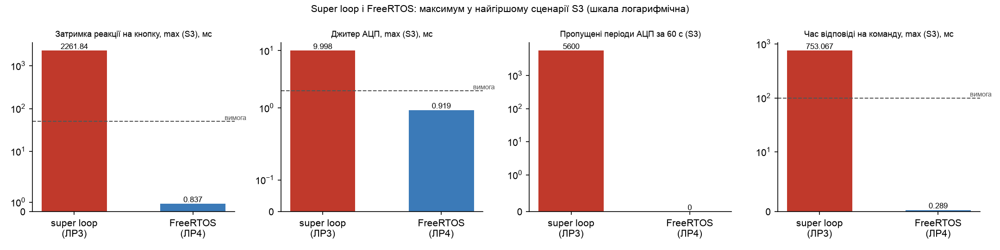

# Порівняння super loop (ЛР3) і FreeRTOS (ЛР4)

Усі числа — з логів `docs/metrics/lr3_*.log`, `lr3f_*.log` і `lr4_*.log`, які пише `tools/measure_all.py` (прошивка друкує `STAT`, `LOAD`, `TASK`, `OSCOST`, скрипти лише збирають). Таблиці нижче збирає `python3 tools/compare_lr3_lr4.py`, рисунки — `tools/make_figures_lr4.py`.

## 1. Умови вимірювань

| Параметр | Super loop (ЛР3) | Super loop + UART DMA | FreeRTOS (ЛР4) |
|---|---|---|---|
| Збірка | гілка `lab3-measure` (код з тега `lab3` плюс імітатор кнопки `BTNSIM` і інжекція `FAULT SDA`), `git=62b4b88` | гілка `lab3-fix`: те саме плюс прийом і вивід UART через DMA (виправлення проблеми 20), `git=de136d1` | гілка `lab4-dev`, `git=4939628` (з UART через DMA і виправленим тайм-аутом SPI) |
| Стенд, частота ядра, UART | NUCLEO-F411RE, SYSCLK 100 МГц, USART2 115200, ті самі з'єднання і лампа | те саме | те саме |
| Вимірювальний код | DWT, `STAT`, `LOAD` (ЛР3) | той самий | той самий формат; додано `TASKS`, `STACK`, `HEAP`, `OSCOST` |
| Сценарії | S1 без камери, S1, S2 ×3, S3 ×3, `break_adc`, `break_cam`, SDA, старт ×3 | ті самі | ті самі, ті самі команди і тривалість (60 с на прогін) |
| S3 | кадр у flash кожні 3,2 с (`SNAP`) + потік `MODE` ≈ 20 Гц + програмна подія кнопки кожні 700 мс (`BTNSIM`), серво вимкнені | те саме | те саме |

**Третій стовпчик.** Після першого порівняння ми побачили, що частина проблем обох прошивок — не від способу планування, а від того, як друкується лог: `HAL_UART_Transmit` чекає кожен байт, а байти прийому губляться, поки переривання вимкнені на рядок камери. Ми перевели UART на DMA в обох прошивках (проблеми 20 і 32) і переміряли. Щоб порівняння було чесним, super loop з DMA ми міряли окремим стовпчиком, а вихідний ЛР3 лишили як є: це той код, який ми здавали.

**Перша версія ЛР4.** Логи ЛР4 до виправлень (друк через HAL, SPI з тайм-аутом 100 мс) лежать у `docs/metrics/lr4_v1/`. Що змінилось — у розділі 2.

**Подія кнопки без людини.** У ЛР3 кнопку натискав студент, повторити це з тим самим ритмом неможливо. Тому `BTNSIM` запускає TIM2, який кожні 700 мс ставить програмну EXTI-подію на лінії B1 (`EXTI->SWIER`): це той самий ланцюжок `EXTI15_10_IRQHandler` → callback, що й від справжнього натискання, лише без брязкоту контактів. В усіх прошивках доданий однаковий код.

**Дві метрики реакції.** `btn_latency` — як у ЛР3: від входу в ISR до початку реакції в задачі. Але ISR сама може чекати, поки вимкнені переривання (у ЛР3 під час кадру — до 0,8 с). Тому додано `evt_latency` — від *апаратної* події (переповнення TIM2, момент береться з `TIM2->CNT` при вході в його ISR) до початку реакції. Вимога PRD (50 мс) перевіряється за `evt_latency`.

**Що саме означають числа.**
* Запізнення (джитер) і пропущені періоди — однакова семантика в обох прошивках (як у `sched.c`): запізнення = час від запланованого моменту до початку роботи; період, пропущений повністю, не наздоганяється, а додається до `missed`; у запізненні лишається залишок у межах періоду.
* У FreeRTOS «час виконання» задачі міряється від пробудження до наступного очікування і **включає час, коли її витісняли** (п. 6.1 методички). Для чистого часу виконання — `TASKS`/`cpu_us`.
* Максимум береться за всі три повтори сценарію, у дужках — по повторах.

## 2. Зведена таблиця

| Метрика | Сценарій | Super loop (ЛР3) | Super loop + UART DMA | FreeRTOS (ЛР4) | Різниця ЛР4 − ЛР3 | Вимога PRD | Інструмент | Хто кращий (ЛР3 / ЛР4) |
|---|---|---|---|---|---|---|---|---|
| Затримка реакції: від події до початку реакції, max | S3 | 2261.84 мс (1556.41, 2261.84, 1490.89) | 2274.59 мс (2207.06, 1544.83, 2274.59) | 0.837 мс (0.814, 0.709, 0.837) | -2261.01 мс, ÷2702 | ≤ 50 мс | DWT + апаратний момент події (TIM2) | FreeRTOS |
| Затримка реакції: від події до початку реакції, середня | S3 | 509.556 мс (462.009, 509.556, 428.501) | 801.67 мс (801.67, 428.51, 656.791) | 0.041 мс (0.028, 0.035, 0.041) | -466.65 мс, ÷13462 | — | DWT + апаратний момент події | FreeRTOS |
| Затримка реакції: від входу в ISR до початку реакції, max | S3 | 1620.8 мс (877.048, 1620.8, 875.802) | 1602.21 мс (1602.21, 861.789, 1602.2) | 0.016 мс (0.016, 0.016, 0.016) | -1620.78 мс, ÷101300 | — | DWT (як у ЛР3) | FreeRTOS |
| Подій кнопки втрачено | S3 | 74 (25, 51, 74) | 107 (44, 68, 107) | 0 (0, 0, 0) | -74.00 | 0 | лічильник | FreeRTOS |
| Джитер АЦП (запізнення старту), max | S3 | 9.998 мс (9.996, 9.998, 9.833) | 9.911 мс (9.911, 9.864, 9.843) | 0.919 мс (0.916, 0.901, 0.919) | -9.08 мс, ÷11 | ≤ 2 мс | DWT | FreeRTOS |
| Джитер АЦП, max | S2 | 9.956 мс (9.956, 9.811, 9.9) | 9.908 мс (9.711, 9.531, 9.908) | 0.999 мс (0.968, 0.999, 0.938) | -8.96 мс, ÷10 | ≤ 2 мс | DWT | FreeRTOS |
| Пропущені періоди АЦП за 60 с | S3 | 5600 (5600, 5392, 5359) | 4857 (4808, 4357, 4857) | 0 (0, 0, 0) | -5600.00 | 0 | DWT | FreeRTOS |
| Пропущені періоди АЦП за 60 с | S2 | 1614 (1535, 1614, 1490) | 1443 (1443, 1371, 1346) | 0 (0, 0, 0) | -1614.00 | 0 | DWT | FreeRTOS |
| Джитер IMU, max | S3 | 99.581 мс (98.957, 89.663, 99.581) | 99.443 мс (58.891, 99.443, 92.532) | 1.124 мс (1.122, 1.124, 1.111) | -98.46 мс, ÷89 | ≤ 2 мс | DWT | FreeRTOS |
| Час відповіді на команду, max | S3 | 753.067 мс (753.067, 51.565, 636.811) | 1602.19 мс (1390.92, 846.369, 1602.19) | 0.289 мс (0.272, 0.269, 0.289) | -752.78 мс, ÷2606 | ≤ 100 мс (FR-09) | DWT: Enter у ISR → початок команди | FreeRTOS |
| Втрачені байти UART | S3 | 130 (46, 89, 130) | 8 (0, 0, 8) | 0 (0, 0, 0) | -130.00 | 0 | лічильник | FreeRTOS |
| Захоплення кадру (довга операція), max | S3 | 755.7 мс (697.687, 755.7, 624.95) | 782.649 мс (755.97, 615.414, 782.649) | 787.49 мс (637.953, 787.49, 758.916) | +31.79 мс | — | DWT | super loop |
| Знімок у flash (кадр + запис), max | S3 | 1639.7 мс (1627.11, 1639.7, 1626.71) | 1626.7 мс (1510.7, 1568.7, 1626.7) | 1973.28 мс (1915.11, 1973.28, 1666.56) | +333.58 мс | — | DWT | super loop |
| Завантаження CPU (середнє за прогін) | S1 | 20 % | 24 % | 22 % | +2.00 % | — | DWT | super loop |
| Завантаження CPU (середнє за прогін) | S2 | 26 % (24, 26, 24) | 23 % (23, 22, 21) | 23 % (23, 22, 21) | -2.67 % | — | DWT | FreeRTOS |
| Завантаження CPU (середнє за прогін) | S3 | 76 % (76, 76, 76) | 70 % (69, 63, 70) | 49 % (47, 48, 49) | -28.00 % | — | DWT | FreeRTOS |
| Помилки захоплення кадру (cam_err) | S3 | 0 (0, 0, 0) | 0 (0, 0, 0) | 0 (0, 0, 0) | +0.00 | 0 | лічильник | обидва виконують |
| Втрачені записи журналу (pend_lost) | S3 | 0 (0, 0, 0) | 0 (0, 0, 0) | 0 (0, 0, 0) | +0.00 | 0 | лічильник | обидва виконують |

Що тут видно. У super loop кнопка, АЦП і команди чекають, поки закінчиться найдовша операція в циклі (кадр камери, запис у flash). У FreeRTOS ці задачі мають вищий пріоритет і витісняють довгі операції, тому реакція впала з секунд до часток мілісекунди, АЦП і IMU перестали пропускати періоди, а відповідь на команду — менше 0,3 мс. Довгі операції у FreeRTOS трохи довші, ніж у super loop (знімок 1,64 → 1,97 с, кадр 0,76 → 0,79 с): їх перебивають усі інші задачі.

**Super loop з UART через DMA.** Байтів UART у S3 втрачено 8 за три прогони (0, 0, 8) замість 130. Апаратні втрати зникли; 8 байтів у третьому прогоні — це програмне кільце 256 Б між ISR і циклом: поки цикл 1,6 с робить знімок, команди ніхто не читає, і кільце заповнюється. Решта метрик super loop майже не змінилась: реакція на кнопку 2274,6 мс, пропуски АЦП 4857 за 60 с, джитер IMU 99,4 мс — їх визначає довга операція в циклі, а не друк. CPU в S3 76 → 70 %. Відповідь на команду навіть гірша (753 → 1602 мс): раніше команди, що приходили під час кадру, губились і в статистику не потрапляли, тепер вони доходять, але чекають кінця знімка. Помітно DMA допоміг super loop там, де довгих операцій немає: у S1 без камери АЦП пропускав 53 періоди за 60 с через друк рядка `tick` (18 мс), з DMA — 0, а рядок `tick` займає 0,13 мс.

**Що дало виправлення ЛР4** (перша версія → поточна, S3, max за три повтори):

| Метрика | ЛР4 перша версія (`lr4_v1`) | ЛР4 зараз | Чому змінилось |
|---|---|---|---|
| Втрачені байти UART | 286 | 0 | прийом через DMA: байт іде в пам'ять без процесора, навіть коли переривання вимкнені на рядок камери (проблема 32) |
| Джитер IMU, max / пропущено | 81,0 мс / 12 | 1,12 мс / 0 | `cli` більше не чекає UART 300 мс під час друку `STATS`, тож задачі з пріоритетом 2 не голодують (проблема 27) |
| Відповідь на команду, max | 15,7 мс | 0,29 мс | те саме: `cli` не зайнята друком |
| Знімок у flash, max | 3,66 с | 1,97 с | задачі, що друкують, не займають процесор очікуванням UART |
| Захоплення кадру, max | 1,83 с | 0,79 с | те саме |
| CPU, середнє S3 | 74 % | 49 % | те саме: очікування UART раніше рахувалось як робота |
| `flash_err` за три прогони | 1 | 0 | тайм-аут SPI 100 → 1000 мс: тайм-аут рахувався за годинником, і витіснена задача його «проспала» (проблема 29) |

Тобто більшість недоліків першої версії були не від ОС, а від блокуючого друку.

Метрики пам'яті, часу старту і складності — розділи 6–8.

## 3. Задачі: запізнення і пропуски

### S3 (найгірший сценарій)

| Задача | LR3 запізнення max, мкс | LR4 запізнення max, мкс | LR3 пропущено | LR4 пропущено | LR3 час виконання max, мкс | LR4 час виконання max, мкс |
|---|---|---|---|---|---|---|
| button | 999 | 0 | 171516 | 0 | 2 | 26 |
| cli | 999 | 0 | 171437 | 0 | 340361 | 2136 |
| adc | 9998 | 919 | 16351 | 0 | 154 | 191 |
| control | 9987 | 1103 | 16349 | 0 | 4 | 28 |
| servo | 19575 | 1088 | 7954 | 0 | 0 | 3 |
| loss | 99578 | 1872 | 1463 | 0 | 1 | 4 |
| imu | 99581 | 1124 | 1462 | 0 | 843 | 1031 |
| led | 99802 | 1077 | 1463 | 0 | 0 | 3 |
| log | 4996 | 0 | 33595 | 0 | 65548 | 0 |
| snapshot | 99547 | 0 | 1455 | 0 | 1639698 | 1973279 |
| camera | 1506698 | 738 | 0 | 0 | 758423 | 1805982 |
| tick | 789105 | 910 | 66 | 0 | 18888 | 152 |

У S3 усі періодичні задачі ЛР4 без пропусків; найбільше запізнення — 1,9 мс у `loss` (пріоритет 2), бо перед нею за той самий тік прокидаються `adc`, `control`, `servo`, `imu`. У першій версії `loss`, `imu`, `led` пропускали періоди, поки `cli` друкувала `STATS`.

### S2 (номінальний)

| Задача | LR3 запізнення max, мкс | LR4 запізнення max, мкс | LR3 пропущено | LR4 пропущено | LR3 час виконання max, мкс | LR4 час виконання max, мкс |
|---|---|---|---|---|---|---|
| button | 985 | 0 | 49239 | 0 | 0 | 0 |
| cli | 988 | 0 | 49084 | 0 | 39446 | 1825 |
| adc | 9956 | 999 | 4639 | 0 | 153 | 162 |
| control | 9965 | 1170 | 4632 | 0 | 4 | 11 |
| servo | 19902 | 1076 | 2250 | 0 | 0 | 33 |
| loss | 98459 | 2010 | 392 | 0 | 1 | 4 |
| imu | 98462 | 1127 | 392 | 0 | 842 | 1014 |
| led | 99307 | 1105 | 392 | 0 | 1 | 3 |
| log | 4984 | 0 | 9533 | 0 | 2954 | 0 |
| snapshot | 99312 | 0 | 392 | 0 | 0 | 0 |
| camera | 9665 | 12 | 0 | 0 | 787778 | 768421 |
| tick | 740810 | 938 | 0 | 0 | 18887 | 176 |

## 4. Пошук точки зламу

Серія `break_adc` (період `adc` 10 → 1 мс, по 10 с на точку) і `break_cam` (період кадру 3000 → 1000 мс, по 20 с):

**АЦП, період 10 → 1 мс** (пропущені періоди і найбільше запізнення за 10 с на точку):

| Період АЦП | ЛР3 пропущено | ЛР3 запізнення max, мкс | ЛР4 пропущено | ЛР4 запізнення max, мкс | ЛР4 CPU, % |
|---|---|---|---|---|---|
| 10 мс | 208 | 9796 | 0 | 1011 | 22 |
| 5 мс | 707 | 4914 | 0 | 886 | 23 |
| 3 мс | 963 | 2855 | 0 | 889 | 25 |
| 2 мс | 1452 | 1794 | 0 | 984 | 27 |
| 1 мс | 2893 | 864 | 0 | 998 | 33 |

**Камера, період кадру 3000 → 1000 мс** (пропуски АЦП, 20 с на точку):

| Період кадру | ЛР3 пропущено АЦП | ЛР3 запізнення АЦП max, мкс | ЛР4 пропущено АЦП | ЛР4 запізнення АЦП max, мкс | ЛР4 CPU, % |
|---|---|---|---|---|---|
| 3000 мс | 503 | 9801 | 0 | 895 | 21 |
| 2000 мс | 1230 | 9801 | 0 | 894 | 23 |
| 1500 мс | 1153 | 9587 | 0 | 902 | 40 |
| 1000 мс | 3035 | 9893 | 0 | 899 | 63 |

Super loop з UART через DMA (`lr3f_break_*`): при періоді АЦП 10 / 5 / 3 / 2 / 1 мс пропущено 256 / 512 / 844 / 1255 / 2486 за 10 с; при періоді кадру 3000 / 2000 / 1500 / 1000 мс пропущено АЦП 352 / 822 / 896 / 1242 за 20 с. Точка зламу та сама, що в ЛР3: її визначає кадр, а не друк.

У super loop точка зламу АЦП є вже на 10 мс (пропуски на кожному кадрі). У FreeRTOS за 1 мс і кадрі раз на секунду АЦП не пропустив жодного періоду, запізнення лишається меншим за 1 мс (це крок тіка). Межу для FreeRTOS у цих серіях ми не знайшли: CPU до 63 %, запас є. Обмеження зверху — частота тіка 1 кГц: період, менший за 1 мс, задачею з `vTaskDelayUntil` не зробити.

## 5. Відмова шини: SDA замкнено на землю (FAULT SDA)

SDA I²C1 (PB9) програмно замкнено на землю на 20 с (`FAULT SDA 1`), потім відпущено. Те саме, що дріт на GND у ЛР3, але повторюється командою.

| Метрика за 20 с з SDA на землі | ЛР3 | Super loop + UART DMA | ЛР4 |
|---|---|---|---|
| АЦП: пропущені періоди | 1493 | 387 | 0 |
| АЦП: запізнення max | 9,69 мс | 9,90 мс | 0,89 мс |
| IMU: час виконання max (очікування тайм-ауту I²C) | 43,3 мс | 32,6 мс | 32,9 мс |
| IMU: запізнення max / пропущено | 46,2 мс / 134 | 76,4 мс / 32 | 0,95 мс / 0 |
| Відповідь на команду, max | 0,86 мс | 0,79 мс | 0,10 мс |
| `imu_err` | 0 | 0 | 0 |

На замкненій SDA драйвер I²C чекає тайм-аут десятки мілісекунд в усіх прошивках. Різниця в тому, кого це зачіпає. У super loop цей час стоїть увесь цикл, і АЦП та IMU пропускають періоди. У FreeRTOS чекає лише задача `imu` (пріоритет 2), а поки вона чекає, `adc` і `control` працюють без пропусків. DMA для UART тут нічого не змінює: блокує I²C, а не друк.

## 6. Пам'ять

| | ЛР3 (super loop) | Super loop + UART DMA | ЛР4 (FreeRTOS) | Різниця ЛР4 − ЛР3 |
|---|---|---|---|---|
| Flash (text + data) | 49 184 Б (9,4 % з 512 КБ) | +1,1 КБ | 69 660 Б (13,3 %) | +20,0 КБ |
| RAM статично (data + bss, без стека) | 25 612 Б | +5,0 КБ (буфери DMA: прийом 1 КБ, вивід 4 КБ) | 67 412 Б (51 % з 128 КБ) | +40,8 КБ |

Звідки різниця для ЛР4 (з `.map`, `docs/metrics/memory_lr4.txt`):
* код ядра FreeRTOS ≈ 16,9 КБ flash: `tasks.c` 9,2 КБ, `queue.c` 3,1 КБ, `stream_buffer.c` 2,3 КБ, `port.c` 1,0 КБ, `heap_4.c` 1,1 КБ;
* heap ОС 24 КБ (`ucHeap`). З нього стеки і TCB 12 задач, черги, м'ютекси займають 12 136 Б (найбільше використання), тобто вільно ≈ 12 КБ;
* буфери DMA для UART: 4 КБ кільце виводу і 256 Б прийому (у ЛР3 прийомний буфер 1 КБ, бо там переривання вимкнені на весь кадр, до 0,8 с);
* діагностика ЛР4: буфер хронології (`g_rts`, 8,6 КБ) і масиви для `OSCOST`/камери (≈ 4,8 КБ). У робочій прошивці без вимірювань їх можна прибрати.

Стеки задач після S3 (`STACK`, найбільше використання, байти): `cli` 756 з 1280 (вільно 41 %), `tick` 524/1280, `snapshot` 404/1152, `log` 364/1024, `imu` 340/896, `camera` 316/896, `control` 176/448, `servo` 172/384 (вільно 55 %), `adc` 152/448, `loss` 140/384, `led` 140/384, `button` 140/448, `IDLE` 52/512. За годину роботи найменший запас — `cli`, 120 слів з 320 (37 %). Рисунок: `lab_4/img/fig_stacks.png`.

Мінімальний heap перевірили окремими збірками: з 12 КБ прошивка стартує і працює (усі задачі створено), з 8 КБ не створюється одна із задач, і `configASSERT` зупиняє старт (`docs/metrics/lr4_heap8k_boot_*.log`).

## 7. Старт

Від скидання до рядка `ready` у UART (три старти, `lr3_boot`, `lr3f_boot`, `lr4_boot`): ЛР3 — 713, 714, 713 мс; super loop + DMA — 626, 630, 630 мс; ЛР4 — 631, 629, 629 мс (у першій версії ЛР4 — 715, 717, 715 мс).

Super loop з DMA стартує так само швидко, як ЛР4. Отже різниця ≈ 85 мс між ЛР3 і ЛР4 — це друк самоперевірки при старті, на який з `HAL_UART_Transmit` програма чекала, а з DMA ні. Сама ОС до часу старту додає кілька мілісекунд (створення 12 задач і запуск планувальника). Майже весь час старту — ініціалізація пристроїв (камера, flash, IMU, відкриття журналу ≈ 364 мс), однакова в усіх прошивках.

## 8. Складність і супроводжуваність

Рядки свого коду (`tools/loc_report.py`, повна таблиця в `docs/metrics/loc.txt`, без HAL і ядра):

| | ЛР3 | ЛР4 |
|---|---|---|
| Оркестрація продукту (планувальник і `product` / задачі і `rtos_port`), рядків усього (коду) | 516 (485) | 850 (801) |
| Додатково в ЛР4: облік CPU і хронологія, сценарії п. 7.2, `FreeRTOSConfig.h` | — | 365 (330) |
| Весь власний код прошивки, рядків | 2878 | 4367 |
| Глобальні змінні, які пише ISR і читає код задач / циклу | 5 | 3 (решта через чергу `q_btn` і stream buffer `sb_rx`) |
| Місць, які треба змінити, щоб додати нову періодичну дію | 2 | 5 (функція, рядок `SPEC`, три масиви на 12 задач) |

Тобто за рядками коду і за кількістю правок при додаванні задачі super loop простіший. Частина зростання — вимірювальний код (облік CPU, хронологія, тести), у робочій прошивці його можна не збирати. Проте задачі ЛР4 читаються простіше: довгі операції (знімок, запис у flash) написані прямо, по порядку, без розрізання на кроки кінцевого автомата, як у ЛР3, а обмін з ISR іде через об'єкти ядра, а не через спільні прапорці.

Що стало складніше: треба думати про спільні ресурси (м'ютекси для flash, кадру і `printf`), розмір стека кожної задачі, пріоритети і про те, що з ISR можна викликати тільки `...FromISR`. Помилки тут не видно одразу. Приклади з нашої роботи: тайм-аут HAL, який рахується за годинником, спрацьовує, коли задачу витіснили (проблема 29); переповнення стека, яке перевірка ядра пропускає, якщо не зачеплені саме останні 16 байт стека (проблема 30).

## 9. Перевірка гіпотез з реєстру ЛР3

Гіпотези записані в `docs/baseline-lab4.md` (розділ 3) за п'ятьма обмеженнями з `docs/limitations.md`. Числа «зараз» у базовій лінії — з ЛР3; для порівняння ми ще раз переміряли ЛР3 тими самими скриптами, тому в таблиці стоять ці нові числа.

| № | Гіпотеза (ЛР3) | Метрика | Очікували | ЛР3 | ЛР4 | Вердикт |
|---|---|---|---|---|---|---|
| 1 | Задача кнопки з високим пріоритетом витісняє знімок | реакція на кнопку, S3, max | одиниці мс, *якщо захоплення кадру не вимикає переривання* | 2261,8 мс | 0,84 мс | **підтверджено**; умова важлива: з кадром, як у ЛР3 (`CAMIRQ 0`), — 699,6 мс |
| 2 | Задача АЦП за розкладом, незалежно від камери | пропущені періоди `adc`, S2 | близько 0 | 1614 за 60 с; 74 783 за годину (ЛР3) | 0 за 60 с; 0 за годину (364 507 запусків) | **підтверджено** |
| 3 | Черга подій і задача UART | втрачені натискання і байти, S3 | 0 | 74 натискання, 130 байтів | 0 натискань, 0 байтів | **підтверджено**, але байти — завдяки DMA, а не ОС: у першій версії ЛР4 без DMA байтів втрачено 286 |
| 4 | Блокування лише в задачі IMU | `adc` запізнення max при замкнутій SDA; відповідь CLI | `adc` без змін, CLI ≤ 100 мс | 9,69 мс, 1493 пропуски; CLI 0,86 мс | 0,89 мс, 0 пропусків; CLI 0,10 мс | **підтверджено**, і `adc` став кращим, а не «без змін» |
| 5 | Лінійний код знімка в окремій задачі | час знімка; зростання CPU | знімок без змін; CPU ≤ +5 п. п. | 1,64 с; CPU S2 26 %, S3 76 % | 1,97 с; CPU S2 23 %, S3 49 % | **частково**: CPU не зросло, а знімок на 20 % довший |

Механізм і ціна по кожній гіпотезі:

* **1.** Механізм: черга `q_btn` з ISR, задача `button` з пріоритетом 6, знімок і камера з пріоритетом 1; захоплення кадру з вимкненими перериваннями лише на один рядок. Ціна: кадр трохи довший (756 → 787 мс max), бо його перебивають. Нова проблема: тики ОС губилися під час кадру (проблема 23).
* **2.** Механізм: `vTaskDelayUntil` з пріоритетом 5. Ціна: стек 448 Б; тік ОС ≈ 1,9 мкс щомілісекунди (≈ 0,2 % CPU) і два перемикання контексту на кожен запуск. Нова проблема: при неправильному вимірі «джитер» показував 128 мс (проблема 24).
* **3.** Механізм: черга `q_btn` на 16 подій, stream buffer `sb_rx` на 256 Б. Ціна: ≈ 400 Б heap. Нова проблема: байти UART губилися в апаратному регістрі, поки переривання вимкнені на рядок камери (≤ 0,9 мс). Розв'язали прийомом через DMA (проблема 32), і той самий прийом через DMA виправив і super loop (стовпчик «Super loop + UART DMA»).
* **4.** Механізм: окрема задача `imu` з пріоритетом 2. Ціна: стек 896 Б. Нових проблем не помітили.
* **5.** Механізм: задача `snapshot` з пріоритетом 1, лінійний код без кінцевого автомата. Ціна: знімок довший, бо поступається всім; м'ютекси `frame_mx` і `flash_mx`. Нові проблеми: інверсія пріоритетів на flash (перевірено `TEST INV`, розділ сценаріїв ОС у звіті) і тайм-аут SPI, який спрацьовував, коли знімок витісняли (проблема 29).

Окремо з базової лінії: «перевіряється, чи не втрачено переваги super loop» — розкид часу виконання `adc` був 151–154 мкс, став 155–191 мкс (у S3, через переривання і тік, що вклинюються); RAM 25,6 → 67,4 КБ; стеки 2 КБ (один стек) → 9 КБ (13 стеків).

## 10. Що super loop робить краще (перевірка списку з ЛР3)

Список з `docs/limitations.md` («Що super loop у нашому продукті робить краще за ОС»):

| Пункт з ЛР3 | Що виміряли в ЛР4 | Підтвердилось? |
|---|---|---|
| Детермінізм: `adc` 151–154 мкс, `control` 2–5 мкс | ЛР4, S3: `adc` 155–191 мкс, `control` 7–28 мкс (переривання і тік, що вклинюються, рахуються в час виконання) | **так**, але різниця — десятки мкс і на вимоги не впливає |
| Простота налагодження: будь-яку затримку пояснює одна задача з `STATS` | у ЛР4 для пояснення затримки потрібні `TASKS`, хронологія `TRACE` і стан м'ютексів; збої ядра (assert, стек, HardFault) треба було спеціально виводити в UART (проблеми 21, 23, 24, 30) | **так** |
| Пам'ять: flash ≈ 49 КБ, RAM ≈ 25,6 КБ, стек 2 КБ | flash 69,7 КБ (+20 КБ), RAM 67,4 КБ (+41 КБ, з них heap ОС 24 КБ), стеки задач 9 КБ | **так** |
| Час старту | 713 → 630 мс; ЛР4 стартує швидше, але через DMA для друку, а не через ОС (розділ 7) | **ні**, різниця не на користь super loop і не від ОС |
| Передбачуваність відмов: немає переповнення стека в чужій задачі і блокувань | у ЛР4 з'явились класи помилок: переповнення стека задачі, інверсія пріоритетів (`TEST INV`: 180 мс з м'ютексом проти 311 мс із семафором), голодування (`TEST STARVE`: `adc` пропустив 149 періодів), вичерпання черги і heap, тайм-аут HAL при витісненні | **так** |

Накладні витрати ОС, які в ЛР3 були нульовими: обробка тіка ≈ 184–199 тактів (≈ 1,9 мкс) щомілісекунди, тобто ≈ 0,2 % CPU; ≈ 400 перемикань/с у S2 і ≈ 600/с у S3; від сповіщення до початку роботи задачі 11,3 мкс (`TEST CTX`). Загальне завантаження CPU від цього не зросло (S2 26 → 23 %, S3 76 → 49 %): драйвери в ЛР4 чекають через `vTaskDelay`, а не активним циклом `HAL_Delay`, а друк іде через DMA.
