# Звіт: Лабораторна робота №2 — інтеграція сенсорної підсистеми

## 1. Мета лабораторної роботи

Мета: довести, що всі пристрої нашого продукту сумісні фізично й логічно та працюють в одній прошивці одночасно.

Що ми зробили:

* склали таблицю пінів і схему підключення (`docs/pinout.md`) і зібрали стенд;
* додали до прошивки самоперевірку: MPU-6050, камера OV7670, флеш W25Q64, чотири канали АЦП, серво;
* записали логічним аналізатором усі використані інтерфейси (I²C, SCCB, SPI, UART, PWM, маркер АЦП) і розібрали записи;
* перебудували прошивку в шари Core / Platform / Devices / App з автоматичною перевіркою залежностей;
* написали хостові тести з fake/mock шин, покриття 100 % для драйверів, налаштували CI.

Результат: самоперевірка 8 з 8, 7 записів аналізатора, 136 перевірок у тестах без помилок.

## 2. Розподіл обов'язків

| Учасник | Роль | Внесок | Артефакти |
|---------|------|--------|-----------|
| Андрій Плешу | усі напрями порівну (50 %) | схема підключення, монтаж стенда, прошивка (шари, самоперевірка, SCCB, серво), запис і розбір сигналів, тести, звіт | `firmware/`, `tests/`, `docs/`, `docs/captures/` |
| Тимур Варшавський | усі напрями порівну (50 %) | схема підключення, монтаж стенда, прошивка (шари, самоперевірка, SCCB, серво), запис і розбір сигналів, тести, звіт | `firmware/`, `tests/`, `docs/`, `docs/captures/` |

Усю роботу виконували разом: кожен напрям методички (звіт, pinout, робота з апаратурою, декодування, структура проєкту, тестування) робили обидва, один одного перевіряли.

## 3. Процес виконання

### 3.1 Журнал (хронологія)

* **Етап 1.** перебудували прошивку в шари Core / Platform / Devices / App; камеру перевели на програмний SCCB (bit-bang на PB10/PB4), після чого вона відповіла `PID=0x76 VER=0x73`; написали хостові тести з fake/mock шин, перевірку залежностей і CI; склали `pinout.md`, `architecture.md`, перший журнал проблем.
* **Етап 2.** стабілізували MPU-6050 (читання двома обмінами замість repeated-START, проблема 6); підключили обидва серво, додали плавний старт і конденсатор 100 мкФ на їхньому живленні (проблема 11); налаштували логічний аналізатор і PulseView; зняли перші записи: I²C (MPU-6050), UART, PWM, маркер АЦП.
* **Етап 3.** зняли записи SCCB, навмисного NACK та SPI; знайшли розбіжність на шині (сміття на MOSI при читанні, проблема 12), виправили і підтвердили новим записом; додали дзеркало логу на PA9 (проблема 13); закінчили розбір записів і звіт.

### 3.2 Аргументація схеми підключення

Повна таблиця «пін → функція → пристрій» з джерелами — `docs/pinout.md` §1; бюджет живлення §3; параметри шин §4; відхилені варіанти §6.

* **Чому MPU-6050 на I²C1 (PB8/PB9).** Це єдина пара апаратного I²C на Arduino-роз'ємах без конфліктів. Модуль GY-521 має свої pull-up резистори.
* **Чому камера на окремому програмному SCCB (PB10/PB4), а не на I²C1.** SCCB не дорівнює I²C: 9-й біт «don't care», немає repeated-START. HAL трактує NACK як помилку й залишає блок у BUSY. До того ж PB10 (I2C2_SCL) і PB4 (I2C3_SDA) належать різним блокам, на одну апаратну шину їх не звести. Bit-bang ізолює збої камери від MPU.
* **Чому XCLK = MCO1 з HSI 16 МГц.** Діапазон камери 10–48 МГц, HSI дає чистий сигнал. У довідковому проєкті джерело PLL давало «сміття».
* **Чому SPI2 і програмний CS (PB12).** SPI1 конфліктує зі світлодіодом (PA5) і PWM (PA6/PA7). Програмний CS тримає CS# опущеним на всю транзакцію «команда + дані».
* **Чому SPI mode 0 і ≈ 390 кГц, I²C 100 кГц.** Це standard mode. Колись ставили 50 кГц через довгі дроти (проблема 2 ЛР1), після виправлення читання (проблема 6) стабільно працює 100 кГц. Розрахунок із дерева тактування — `docs/pinout.md` §4.
* **Чому серво від окремого 5 В, а не з 3V3.** Піки ≈ 650 мА на серво набагато перевищують можливості стабілізатора 3.3 В і ліміт USB. Спільний GND потрібен як опорний рівень для PWM.
* **Конфлікт камери з іншими інтерфейсами.** Паралельну шину камери (11 ліній) ми зарезервували на PC0–PC7 і три піни керування; жоден не перетинається з I2C1, SPI2, TIM3 та ADC (`docs/pinout.md` §1.1). У ЛР2 її не монтували.

### 3.3 Інструкція з підключення

Усі GND з'єднані спільною шиною макетки та пінами GND плати. Плату підключаємо до USB лише після монтажу.

| Пристрій | З'єднання |
|----------|-----------|
| MPU-6050 (GY-521) | VCC → 3V3, GND → GND, SCL → D15 (PB8), SDA → D14 (PB9), AD0 → GND |
| OV7670 | VCC → 3V3, GND → GND, SIOC → D6 (PB10), SIOD → D5 (PB4), XCLK → D7 (PA8), PWDN → GND, RESET → 3V3, по 10 кОм від SIOC і SIOD до 3V3 |
| W25Q64 | VCC → 3V3, GND → GND, CS → PB12, CLK → PB13, DO → PB14, DI → PB15 (роз'єм CN10) |
| Фоторезистори GM5528 ×4 | 3V3 → фоторезистор → вузол → 10 кОм → GND; вузли на A0, A1, A2, A3 |
| Серво SG92R / SG90 | сигнал на D12 (PA6, азимут) і D11 (PA7, елевація); живлення 5 В з плати, конденсатор 100 мкФ на живленні серво; GND спільний |

Після прошивки в терміналі (115200 8N1) має з'явитися лог самоперевірки з підсумком `RESULT pass=8 total=8`.

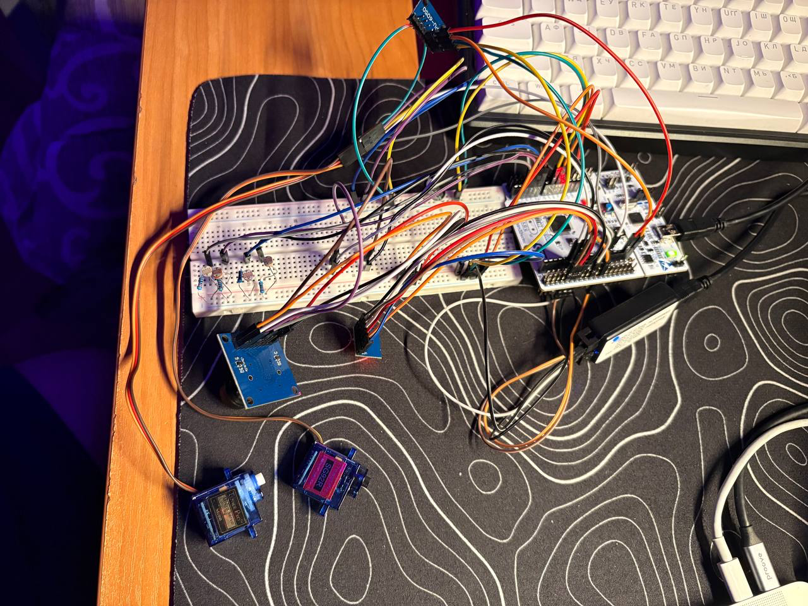

### 3.4 Самоперевірка

Формат придатний для автоматичного розбору: `[st] <NAME> <PASS|FAIL> key=value …`, підсумок `[st] RESULT pass=N total=M`.

| Пристрій | Ідентифікація | Мінімальна ініціалізація | Перевірка правдоподібності |
|----------|---------------|--------------------------|-----------------------------|
| MPU-6050 | WHO_AM_I = 0x68 | PWR_MGMT_1 = 0 (вихід зі sleep) | модуль прискорення 1 g ± 15 % у спокої, температура кристала 15…40 °C |
| OV7670 | PID = 0x76, VER = 0x73 | XCLK 16 МГц (MCO1) | повторне читання при збої, відновлення шини |
| W25Q64 | JEDEC = EF 40 17 | вихід із power-down | стирання сектора 0x7FF000, запис 16 байтів, порівняння |
| GM5528 ×4 | — | ADC1, 84 цикли семплування | значення не прилипли до 0/4095; мВ = raw·3300/4095 |
| Серво ×2 | — | TIM3 50 Гц | ширина імпульсу відповідає заданій; фізично виміряна аналізатором (розд. 3.5.6) |

Лог із плати (серво вимкнені):

```
[st] BEGIN
[st] I2C_SCAN  n=1 addrs= 0x68
[st] MPU6050  PASS who=0x68 ax=-1828 ay=-12592 az=-8928 mag_mg=947 temp_cC=2350 tries=1
[st] OV7670   PASS rc=0 pid=0x76 ver=0x73
[st] W25Q_ID  PASS rc=0 jedec=EF4017
[st] W25Q_RW  PASS rc=0 addr=0x7FF000 bytes=16 first=0xA0
[st] ADC_TL   PASS raw=2567 mv=2068
[st] ADC_TR   PASS raw=2843 mv=2291
[st] ADC_BL   PASS raw=2197 mv=1770
[st] ADC_BR   PASS raw=2366 mv=1906
[st] RESULT pass=8 total=8
```

MPU-6050 відповідає не завжди: після перестановок проводів на макетці бувало 3 з 8, при надійному контакті 8 з 8 (проблема 6).

### 3.5 Записи логічного аналізатора

Записи лежать у `docs/captures/`: `.sr` (запис), `.pvs` (налаштування PulseView), `.txt` (декодований текст), `.png` (скріншоти).
Декодування: `make decode`, автоперевірка: `make check-captures`.

Аналізатор: 8-канальний клон на FX2 (24 МГц), PulseView 0.4.2, драйвер `fx2lafw`. GND аналізатора з'єднаний із GND стенда. Тригер не використовували: запис запускаємо вручну, а потрібну транзакцію викликаємо командою з комп'ютера (`scripts/sendcmd.py`), тож кожен запис можна відтворити.

| Запис | Команда | Канали | Частота |
|-------|---------|--------|---------|
| `i2c_mpu6050_whoami_burst` | `r` (потік MPU) | D0 = SCL (D15), D1 = SDA (D14) | 1 МГц |
| `i2c_nack_addr0x69` | `e` | D0 = SCL (D15), D1 = SDA (D14) | 1 МГц |
| `sccb_ov7670_pid` | `c` | D0 = SIOC (D6), D1 = SIOD (D5) | 1 МГц |
| `spi_w25q64_jedec_write`, `spi_w25q64_after_fix` | `f`, `w` | D0 = MISO, D1 = SCK, D2 = MOSI, D3 = CS | 4 МГц |
| `uart_stlink_log_tick` | сам лог (`tick` раз на секунду) | D0 = TX (PA9, D8) | 1 МГц |
| `pwm_servo_az_1000_2000` | `1` | D2 = PWM азимут (PA6) | 1 МГц |
| `adc_marker_pa5` | `a` | D0 = TX (PA9), D1 = маркер (PA5) | 1 МГц |

Два зауваження щодо підключення:

* **UART.** Пін D1 на роз'ємі Arduino не з'єднаний із PA2 (перемички SB62/SB63 за замовчуванням розімкнені), тому лог ми дублюємо ще й на PA9 (USART1 TX, пін D8). У `_write()` байти спочатку йдуть у USART2 (ST-Link), потім у USART1.
* **Пін PA5** спільний зі світлодіодом LD2. Тому на D1 у записі АЦП видно і повільне блимання світлодіода (≈ 100 мс), і короткий імпульс маркера.

#### 3.5.1 I²C: MPU-6050

Декодовано (`i2c_mpu6050_whoami_burst.txt`):

```
S  AW 0x68  A  0x75  A  P          запис адреси регістра WHO_AM_I
S  AR 0x68  A  0x68  N  P          читання: 0x68
S  AW 0x68  A  0x3B  A  P          ACCEL_XOUT_H
S  AR 0x68  A  1E 1C D0 C0 E2 A8  N  P
```

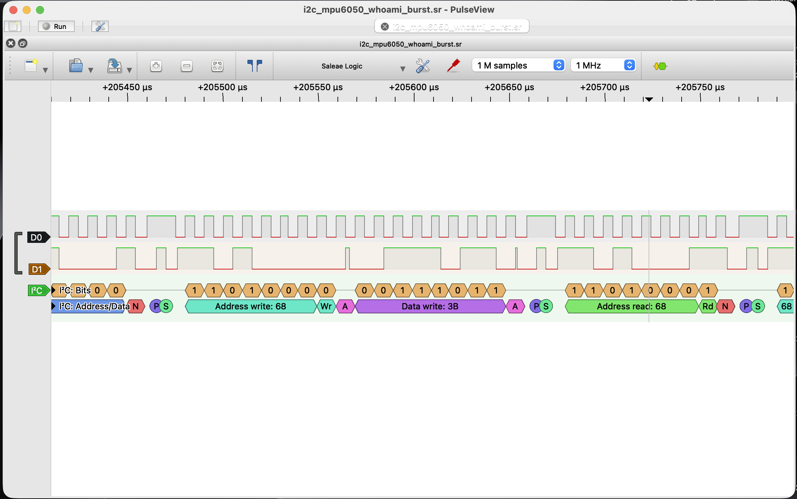

* **Зіставлення з datasheet.** WHO_AM_I (0x75) = 0x68, ACCEL_XOUT_H = 0x3B, старший байт іде першим. Збігається.
* **Дані.** Сирі значення: ax = 7708, ay = -12096, az = -7512. При шкалі ±2 g (16384 LSB/g) це 470, -738, -458 мг, модуль ≈ 988 мг, тобто 1 g. Ці байти використані як вектор у `tests/vectors/vectors.h`.
* **STOP між записом і читанням.** Це зроблено навмисно: читання через repeated-START на цьому HAL було ненадійне (проблема 6).
* **Тайминги.** Період SCL = 10 мкс (100 кГц), як налаштовано. Читання 6 байтів разом з адресою: 7 байтів × 9 тактів = 63 такти, на записі 639 мкс, за розрахунком ≈ 630 мкс.

#### 3.5.2 SCCB: OV7670

`sccb_ov7670_pid.txt`:

```
S  AW 0x21 (0x42)  A  0x0A  A  P
S  AR 0x21 (0x43)  A  0x76  N  P        PID
S  AW 0x21         A  0x0B  A  P
S  AR 0x21         A  0x73  N  P        VER
```

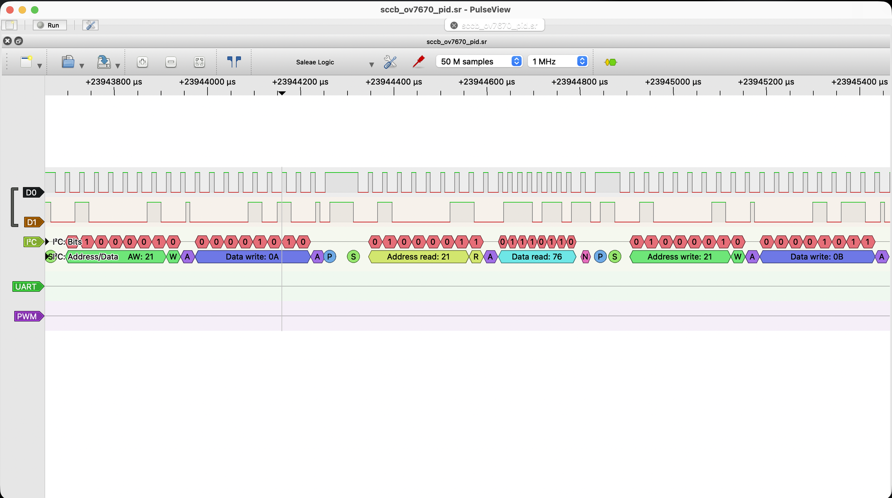

* PID = 0x76, VER = 0x73, як у datasheet.
* Між записом регістра і читанням стоїть STOP, repeated-START немає. Це головна відмінність SCCB від I²C.
* 9-й біт у фазі запису декодер показує як ACK (камера тягне SDA вниз). У SCCB цей біт «don't care», прошивка його не перевіряє.
* Період SCL = 31 мкс (≈ 32 кГц), а розраховували ≈ 50 кГц. Причина: у bit-bang кожна зміна лінії має затримку 10 мкс, а на один такт потрібно три зміни. Камері це не заважає; значення виправлено в `docs/pinout.md`.
* Одна фаза (запис регістра) триває ≈ 600 мкс разом із START/STOP.

#### 3.5.3 SPI: W25Q64

`spi_w25q64_jedec_write.txt`. JEDEC: CS опущений на 87,8 мкс, MOSI `9F 00 00 00`, MISO `FF EF 40 17`. Збігається з datasheet (Winbond EF, 0x40 0x17 = 64 Мбіт). Перед цим іде `AB` (вихід із power-down, 22 мкс).

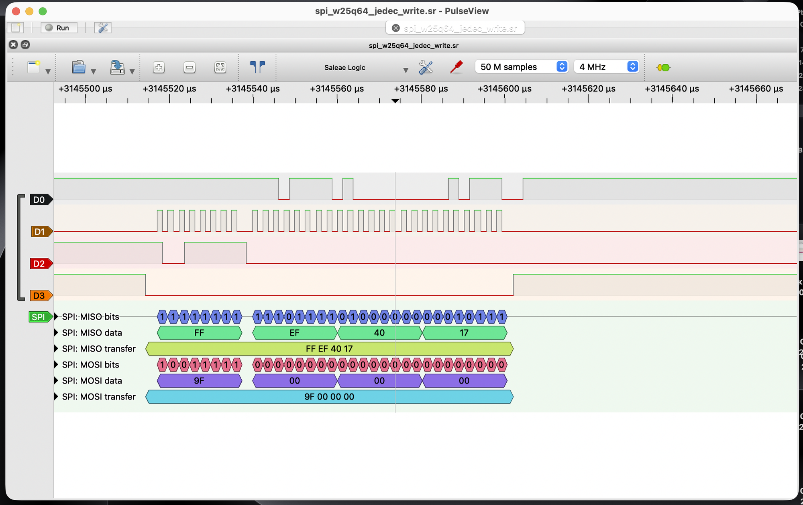

Запис із попередньою командою дозволу:

| Команда | MOSI | MISO | Що це |
|---------|------|------|-------|
| Write Enable | `06` | | дозвіл запису |
| Read Status | `05 00` | `FF 02` | WEL = 1, дозвіл прийнятий |
| Sector Erase | `20 7F F0 00` | | сектор 0x7FF000 |
| Read Status | `05 xx` | `FF 03` | BUSY = 1, WEL = 1: стирання триває |
| Page Program | `02 7F F0 00` + 16 байтів | | запис, 409 мкс |
| Read Data | `03 7F F0 00` + 16 байтів | | читання, 413 мкс |

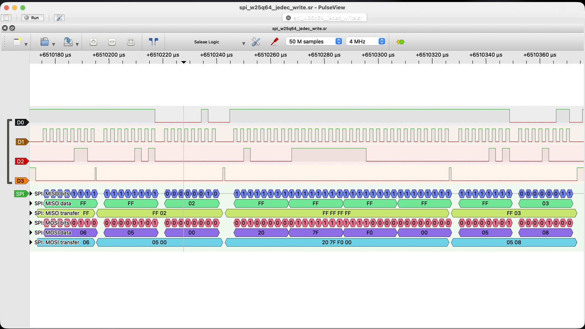

* CS не відпускається між командою і даними.
* **SCK:** період 2,5 мкс (400 кГц) проти розрахункових 390 кГц (50 МГц / 128). Роздільність запису 0,25 мкс, тож розбіжність у межах похибки.
* **Page Program:** 20 байтів × 8 = 160 тактів × 2,5 мкс = 400 мкс, на записі 409 мкс.
* Від команди 0x20 до наступного запису минає ≈ 65 мс (за datasheet стирання типово 45 мс, максимум 400 мс), у цей час прошивка опитує статус.

#### 3.5.4 UART

`uart_stlink_log_tick.txt`: байти збираються в рядки виду `tick 158525 (uptime 155 s, TL=2652 TR=2788 BL=2486 BR=2718, ex=34 ey=22)`.

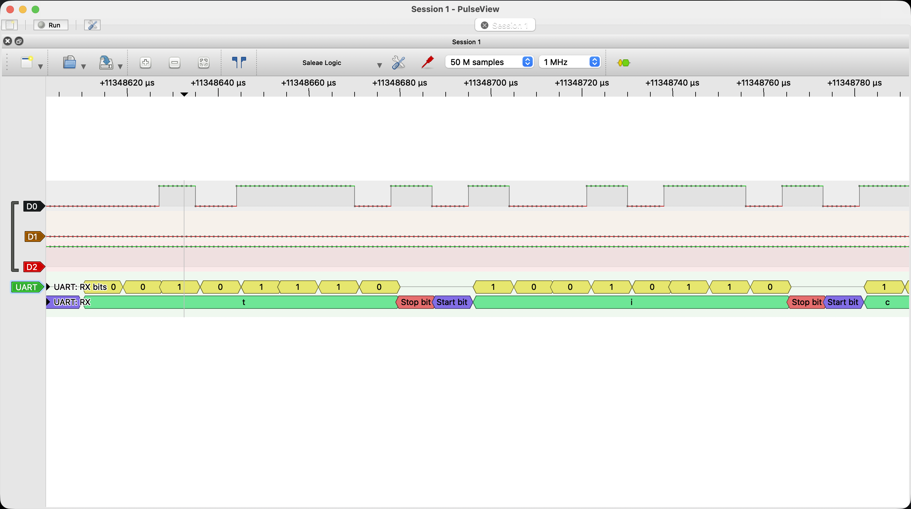

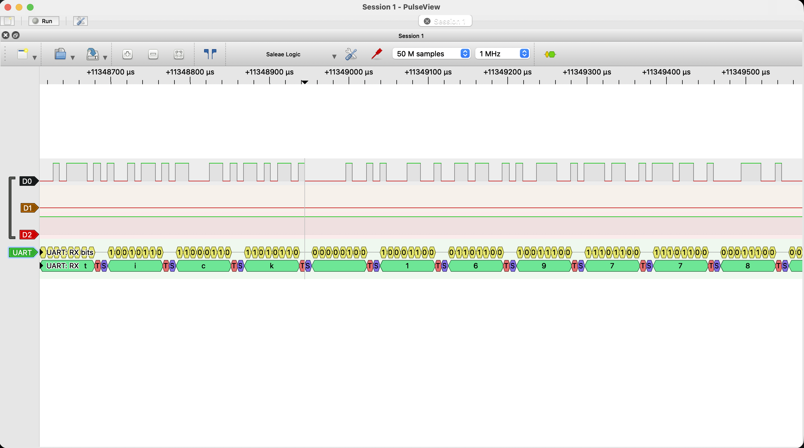

* Біт ≈ 8,7 мкс, тобто 115200 бод. Кадр 8N1 = 10 бітів ≈ 87 мкс на символ.
* Рядок `tick` приходить раз на ≈ 1,01 с.

#### 3.5.5 Маркер АЦП

`adc_marker_pa5.sr`: імпульс на PA5 перед вимірюванням і його ширина.

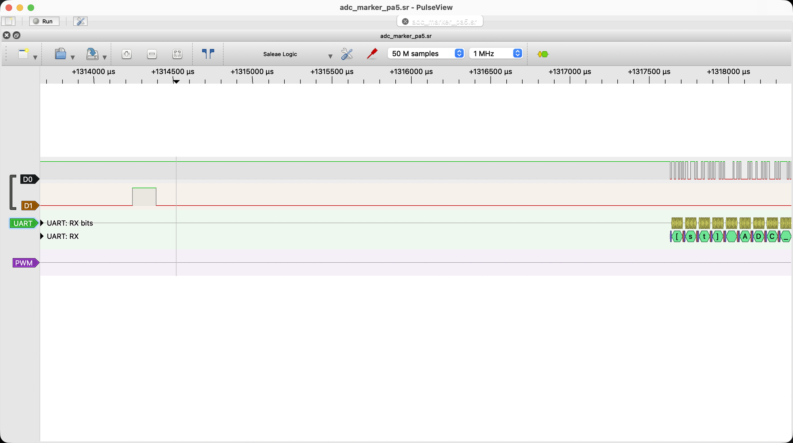

* Імпульс на PA5 дорівнює часу вимірювання чотирьох каналів: 149–150 мкс у всіх 8 знайдених випадках.
* Вивід в UART починається через ≈ 3,4 мс після фронту маркера. Це не час реакції прошивки: байти спершу повністю йдуть у USART2 (перший рядок ≈ 3 мс), і лише потім у дзеркало на PA9.

#### 3.5.6 PWM серво (азимут)

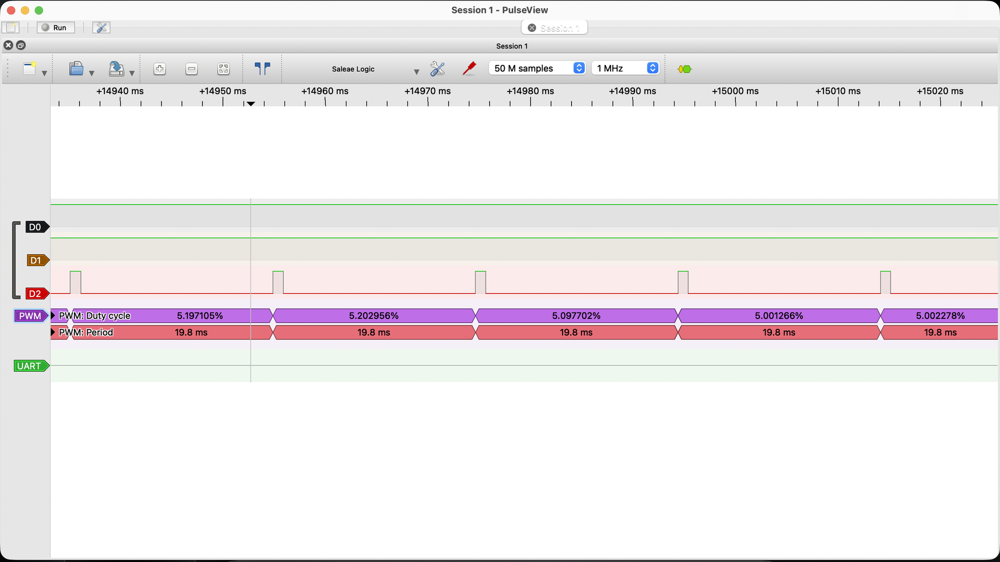

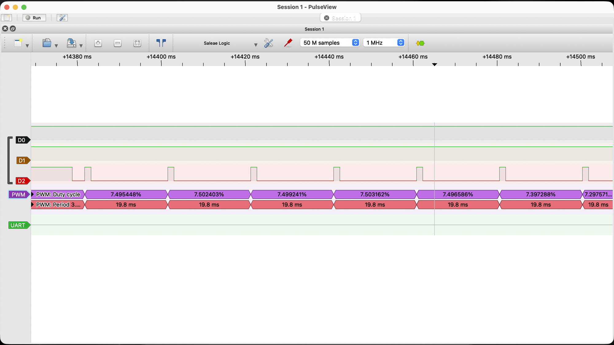

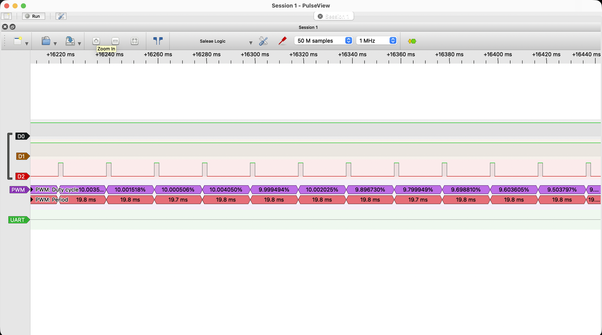

| Задано | Скважність | Імпульс на проводі |
|--------|-----------|--------------------|
| 1000 мкс | 5,00 % | ≈ 0,99 мс |
| 1500 мкс | 7,50 % | ≈ 1,49 мс |
| 2000 мкс | 10,00 % | ≈ 1,98 мс |

* Період 19,8 мс проти 20 мс за розрахунком (−1 %). Усі три імпульси теж на 1 % коротші. Це схоже на похибку часової бази: HSI (±1 %) або кварц самого аналізатора. Окремо причину не з'ясовували, для серво 1 % значення не має.
* Рух плавний: ширина змінюється на 20 мкс за період (`step_us=20/20ms`), це видно на записі.

#### 3.5.7 Ручне декодування

Запис `i2c_nack_addr0x69`, одна транзакція (скріншот нижче):

1. START: SDA падає, поки SCL високий.
2. На 7 тактах SCL (по зростаючому фронту) SDA = 1 1 0 1 0 0 1, старшим бітом вперед: `1101001` = 0x69.
3. 8-й такт: SDA = 0, це R/W = 0, запис.
4. 9-й такт: SDA лишається високим, ніхто не тягне вниз, тобто NACK.
5. STOP: SDA зростає, поки SCL високий.

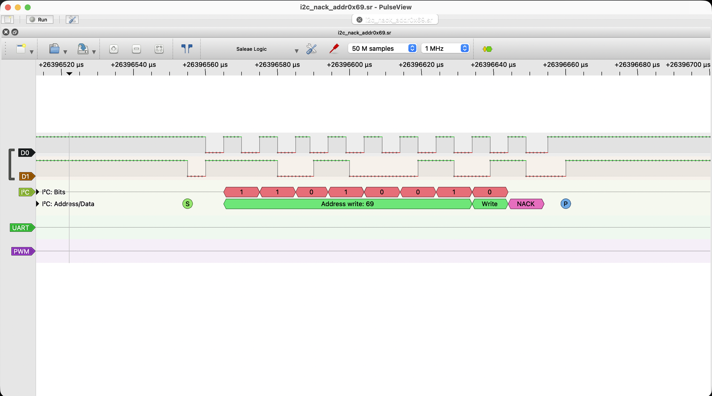

#### 3.5.8 Аномалії

**1. NACK по адресу 0x69 (навмисна).** Команда `e` звертається до адреси, де пристрою немає. На записі: START, адреса, R/W = 0, NACK, STOP, дані після NACK не йдуть. Прошивка друкує `rc=-1`, шина після STOP вільна. Запис `i2c_nack_addr0x69`.

**2. Сміття на MOSI при читанні SPI (знайшли і виправили).** Статус читався так: команда `05`, потім `xfer(NULL, &sr, 1)`, тобто лише приймання. На шині другий байт MOSI був не `00`, а `08`, потім `03` і так далі: це попередній вміст `sr`. Причина: `HAL_SPI_Receive()` в режимі master на двох лініях сам викликає `TransmitReceive(rx, rx)` і висилає на MOSI буфер приймання. Флеш цей байт ігнорує, функціональної помилки не було, але це розбіжність між тим, що написано в коді («лише читаємо»), і тим, що на шині. Виправлення: у `spi_xfer` при прийманні явно висилаємо `0xFF`. Повторний запис `spi_w25q64_after_fix` це підтверджує: було `9F 00 00 00` і `05 08`, стало `9F FF FF FF` і `05 FF`, у всіх читаннях на MOSI `FF`.

**3. Пін D1 не з'єднаний із PA2.** З'ясували, коли на D1 не було сигналу UART. Рішення описане на початку розділу 3.5.

### 3.6 Структура проєкту

Прошивка поділена на шари (`docs/architecture.md`):

* `Core/`: main, тактування, MSP, syscalls. Знає про все.
* `Platform/`: адаптація до плати (піни, шини поверх HAL, bit-bang SCCB, ADC, серво). API для верхніх шарів — `platform.h` без HAL.
* `Devices/`: драйвери MPU-6050, W25Q64, OV7670. Залежать лише від `bus.h`.
* `App/`: логіка продукту (квадрант, самоперевірка, CLI, головний цикл). Без HAL.
* `Drivers/`: HAL і CMSIS від ST, не редагуються (версії в `docs/versions.md`).

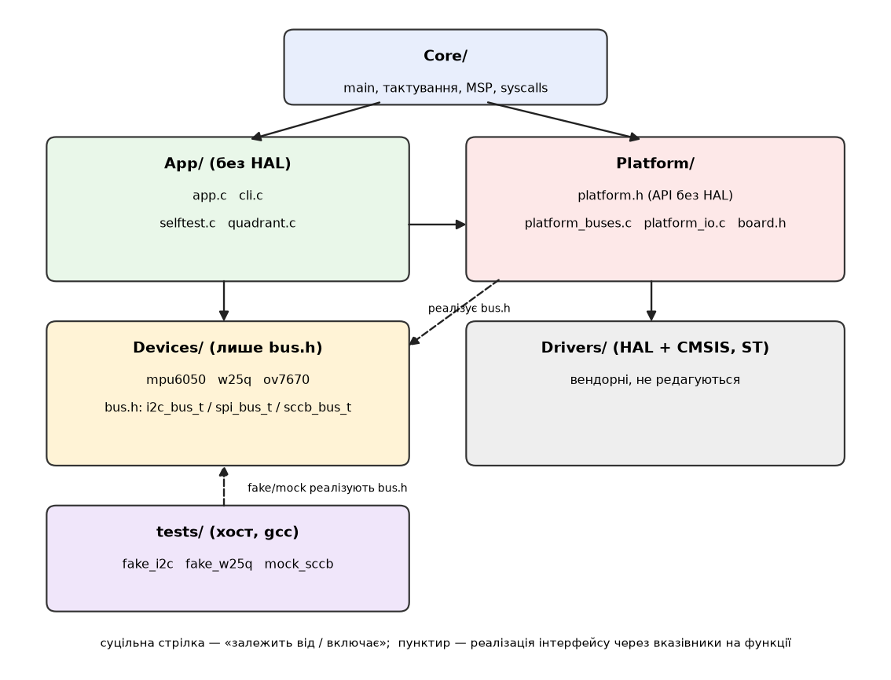

**Правила залежностей:** Devices включає лише `Devices/Inc`; App включає `Devices/Inc`, `App/Inc`, `platform.h`, але не HAL, `main.h` чи `board.h`; Platform використовує HAL і `board.h`, але не App; Core може все. У Devices і App заборонені також апаратні ідентифікатори (`HAL_*`, `hi2c1`, `GPIOA`, `TIM3`).

**Як це перевіряється:** `python3 scripts/check_deps.py` (`make check-deps`) аналізує `#include` і заборонені символи та падає з кодом 1 при порушенні. Скрипт запускається в CI на кожен PR перед збіркою і тестами.

**Як драйвер отримує шину:** через структуру з вказівниками на функції (`i2c_bus_t`, `spi_bus_t`, `sccb_bus_t` у `Devices/Inc/bus.h`). На платі її створює Platform, у хостовому тесті fake. Той самий код драйвера виконується на хості без заліза.

**Збірка:** `make build` у Docker, власний код з `-Wall -Wextra -Werror` (нуль попереджень), HAL підключений через `-isystem`. Підключені лише потрібні модулі HAL, у `stm32f4xx_hal_conf.h` біля кожного коментар «навіщо».

### 3.7 Тестування

Команда `make test` (Docker, gcc, без плати), `make coverage` з порогом **90 %** рядків для `Devices/` і `App/quadrant`. Поріг вибрали так, щоб ловити «забуті» гілки обробки помилок, але не вимагати штучного покриття glue-коду.

* **Каркас:** власний, на assert-логіці (`tests/test.h`). Unity/CMock не брали, бо для трьох драйверів немає потреби генерувати моки. Чого це позбавляє: автоматичних моків, багатих ASSERT-макросів, ізоляції тестів.
* **Test doubles.** *Fake*: `fake_i2c` (пам'ять регістрів, інʼєкція NACK, журнал транзакцій) і `fake_w25q` (модель команд 0x06/0x05/0x9F/0x20/0x02/0x03: WEL, BUSY, AND-семантика програмування, загортання в межах сторінки). *Mock*: `mock_sccb` (перевіряє взаємодію: скільки разів читали, скільки пауз, що записано в COM7). Mock потрібен там, де цікавить саме поведінка виклику (повтори, паузи), а не стан пристрою.
* **Що покрито:** перетворення сирих даних (прискорення в мг, температура за формулою datasheet, модуль, raw в мВ, кут в мкс); помилки шини (NACK, timeout, неочікуваний ID: 0xFF/0x00/інший); послідовність команд до SPI-флешу (WE перед кожною сторінкою, перевірка WEL, не перетинати межу сторінки, wait-ready з таймаутом).
* **Вектори:** JEDEC `EF 40 17`, PID/VER `76 73`, WHO_AM_I `0x68` взяті з UART-логу реального заліза; burst-байти MPU (`1E 1C D0 C0 E2 A8`) взяті із запису аналізатора (`tests/vectors/vectors.h`).
* **Приклад з datasheet:** температура MPU `T = raw/340 + 36.53`.
* **Результат останнього прогону:** 136 перевірок, 0 помилок; покриття рядків: mpu6050 100 %, w25q 100 %, ov7670 100 %, quadrant 100 %.
* **Свідомо не покриваємо:** `Platform/` і `Core/` (код поверх HAL, перевіряється лише на залізі), `App/selftest.c`, `cli.c`, `app.c` (I/O-склейка, її перевіряє самоперевірка на платі).
* **Дефекти:** тести на момент написання не виявили дефектів у драйверах; єдиний збій прогону був помилкою в очікуванні самого тесту (998 проти 999 мг), ми його виправили. Дефект, знайдений на залізі й закритий тестом: проблема 5 (повторне читання при неправильному ID камери, тест `identify_unexpected_id_is_retried`).
* **CI:** `.github/workflows/ci.yml` на кожен PR запускає `make coverage`, `check_deps.py` і збірку для F411 та F446.

### 3.8 Проблеми та їх вирішення

Повний текст — `docs/problems.md` (проблеми 5–13 для ЛР2).

#### Проблема 5: після рефакторингу камера повернула `pid=0x73` (значення VER замість PID)

* **Симптом:** `OV7670 FAIL rc=-2 pid=0x73 ver=0x73` після перепрошивки, хоча раніше було `PID=0x76`; нестабільно від запуску до запуску.
* **Причина:** камера не скидається разом з МК і може стояти посеред попереднього обміну; наш START сприймався як продовження старого кадру.
* **Рішення:** при ініціалізації SCCB-пінів: 9 тактів SIOC при SIOD = 1 і STOP; `ov7670_identify` повторює читання (до 3 разів) і при неправильному ID. Тест `identify_unexpected_id_is_retried`. На залізі 3 з 3 перезапусків дали `PID=0x76 VER=0x73`. Коміти: `35ac9a2`, `2370112`.

#### Проблема 6: MPU-6050 відповідає нестабільно

* **Симптом:** `MPU6050 FAIL` на різних кроках, `hal_err=0x4` (немає ACK), спотворені дані, іноді SDA залипає в 0.
* **Що перевірили і відкинули:** контакт і дроти (скан 0x68 стабільний), наводку від XCLK (вимкнення нічого не змінило), `HAL_I2C_IsDeviceReady` (артефакт HAL після серії NACK, замінили пробою через `Master_Transmit`), шум від серво, хибно поставлений резистор між SCL і SDA.
* **Причина:** `HAL_I2C_Mem_Read` (repeated-START) на F411 ненадійний; читання двома обмінами дало 94–100 % проти 66–94 % на тих самих швидкостях і дротах.
* **Рішення:** у `platform_buses.c` читання регістра розділене на два обміни, I²C знову 100 кГц, відновлення шини (9 тактів SCL, STOP, повторна ініціалізація) і до 3 спроб. Залишок близько 3 % спотворених кадрів виявляє перевірка правдоподібності. Коміт: `35ac9a2`.

#### Проблема 7: `make test` не збирався в Docker

* **Симптом:** `cc: No such file or directory` (Error 127).
* **Причина:** у образі лише кросс-компілятор, хостового gcc немає.
* **Рішення:** додали `gcc libc6-dev` у `docker/Dockerfile`, `CC = gcc` у `tests/Makefile`. Коміт: `2370112`.

#### Проблема 8: перевірка залежностей давала хибне спрацьовування на `board.h`

* **Симптом:** `check_deps.py`: «шар Platform не має права включати stm32f4xx_hal.h».
* **Причина:** правило для Platform дозволяло лише заголовки наших шарів, а `board.h` законно включає HAL.
* **Рішення:** для Platform дозволили заголовки HAL і CMSIS; навмисне порушення (включення `main.h` в App) і далі ловиться. Коміт: `2370112`.

#### Проблема 9: покриття gcov не рахувалось

* **Симптом:** `make coverage` друкував «OK» без жодного відсотка, `libgcov profiling error`.
* **Причина:** не збігались імена `.gcda` і старі профілі змішувались із новою збіркою.
* **Рішення:** очищення `.gcda` перед запуском, правильні імена, явний відсоток по кожному файлу і падіння при покритті нижче порогу. Коміт: `2370112`.

#### Проблема 10: I²C може зависнути після скидання МК посеред транзакції (профілактика)

* **Симптом:** іноді «no ACK» після перезапусків без зміни проводів.
* **Причина:** слейв, який не скидається разом з МК, може тримати SDA в 0 (UM10204).
* **Рішення:** `I2C1_BusRecover()` перед ініціалізацією: до 9 тактів SCL, поки SDA не звільниться, потім STOP; стан ліній виводиться в лог. Коміт: `35ac9a2`.

#### Проблема 11: просадка живлення від серво скидає плату і USB

* **Симптом:** при русі серво від 5 В Nucleo зникає USB-порт, плата не знаходиться; один SG90 працював, два ні.
* **Причина:** пускові струми серво від USB-живлення Nucleo.
* **Рішення:** виходи PWM вимкнені, поки App їх не ввімкне; серво рухаються по одному і плавно (крок 20 мкс за 20 мс), після руху виходи вимикаються; PWM прибрано з автоматичної самоперевірки; на живлення серво поставили конденсатор 100 мкФ. Після цього обидва серво працюють. Коміт: `35ac9a2`.

#### Проблема 12: при читанні по SPI на MOSI йшло сміття

* **Симптом:** на записі аналізатора у командах читання статусу (`05`) другий байт на MOSI був `08`, потім `03`, а не `00`.
* **Причина:** `HAL_SPI_Receive()` у режимі master на двох лініях висилає на MOSI вміст буфера приймання.
* **Рішення:** у `spi_xfer` для приймання явно висилаємо `0xFF`; новий запис `spi_w25q64_after_fix` показав `FF` у всіх читаннях. Коміт: `ae9f23b`.

#### Проблема 13: на D1 немає сигналу UART

* **Симптом:** аналізатор на D1 не бачив логу, хоча в терміналі він є.
* **Причина:** пін D1 на Arduino-роз'ємі за замовчуванням не з'єднаний із PA2 (SB62/SB63).
* **Рішення:** лог дублюється на USART1 TX = PA9 (D8). Коміт: `17c23c1`.

## 4. Висновок

Ми підключили всі пристрої продукту до однієї плати й довели, що вони працюють разом: самоперевірка проходить 8 з 8, а кожен інтерфейс підтверджений незалежним записом логічного аналізатора. Аналізатор виявив розбіжність, яку лог у UART не показав: HAL при читанні по SPI висилав сміття на MOSI. Ми це виправили і підтвердили новим записом. Прошивка поділена на шари з автоматичною перевіркою залежностей, драйвери покриті хостовими тестами на 100 %, а CI перевіряє збірку, тести і структуру на кожен PR.

Залишкова проблема: MPU-6050 на макетці іноді відповідає нестабільно через контакт (проблема 6). Для наступних робіт варто припаяти штирі модуля.

## 5. Відповіді на контрольні питання

**1. Чим відрізняються відомості в datasheet МК, reference manual і user manual плати? Приклад із нашої схеми.**
Datasheet (DS10314) описує мікроконтролер як деталь: електричні параметри, розпіновку, таблицю альтернативних функцій (які піни можуть бути USART2, SPI2 тощо). Reference manual (RM0383) описує, як влаштована периферія: регістри, дерево тактування, на якій шині APB сидить блок. User manual плати (UM1724) описує саме плату: які піни виведені на роз'єми, що з'єднано перемичками, як підключений ST-Link. Для UART-логу знадобились усі три. З datasheet: PA2/PA3 мають функцію USART2 (AF7). З RM0383: USART2 на APB1 (50 МГц), звідси дільник бодрейту `50 МГц / (16·115200) = 27,13`. З UM1724: лінії PA2/PA3 ідуть на ST-Link, а пін D1 на Arduino-роз'ємі за замовчуванням з ними не з'єднаний (перемички SB62/SB63), чого ми спершу не врахували (проблема 13).

**2. Чому лінії I²C налаштовуються як open-drain? Що буде, якщо push-pull? Як це виглядатиме на записі?**
Шина I²C працює за принципом «монтажне І»: лінію підтягує до 1 резистор, а пристрої тільки тягнуть її до 0. Тому кілька пристроїв не конфліктують, а слейв може відповідати ACK (тягне SDA до 0). У push-pull один вихід міг би тягнути лінію до 1, поки інший тягне до 0, і через вихідні ключі пішов би струм короткого замикання. До того ж ACK був би неможливий: слейв не змусить лінію піти в 0, якщо master активно тримає 1. На записі це виглядало б як відсутність ACK (на 9-му такті завжди 1) або спотворені рівні під час конфлікту. У нас `GPIO_MODE_AF_OD` для PB8/PB9.

**3. Від чого залежить номінал pull-up на I²C? Що, коли на шині кілька модулів зі своїми pull-up?**
Номінал обмежений з двох боків. Знизу струмом, який може втягнути пристрій (3 мА при VOL 0,4 В): `R_min = (3,3 − 0,4) / 3 мА ≈ 1 кОм`. Зверху ємністю лінії та потрібним часом наростання (для standard mode ≤ 1000 нс за UM10204): `R_max = t_r / (0,8473·C_b)`. Для 100 пФ це ≈ 11,8 кОм, для 400 пФ ≈ 2,9 кОм. Швидший режим і довші дроти потребують менших резисторів. Коли модулі мають свої pull-up, резистори з'єднуються паралельно, загальний опір падає, а струм при низькому рівні зростає; за межу `R_min` виходити не можна. У нас на модулі GY-521 є свої pull-up, тому додаткові на шину MPU ми не ставили.

**4. Чим SCCB відрізняється від I²C і як це проявляється з драйвером HAL?**
У SCCB 9-й біт кожного байта «don't care»: пристрій може його не підтверджувати, а master його ігнорує. Немає repeated-START: адресу регістра записують в одній транзакції, закінчують STOP, а читають окремою (на записі `sccb_ov7670_pid` між `AW 0x21 / 0x0A` і `AR 0x21 / 0x76` стоїть STOP). Стандартний драйвер HAL розглядає NACK як помилку (`HAL_I2C_ERROR_AF`) і може залишити блок у BUSY, а `HAL_I2C_Mem_Read` використовує repeated-START, який камера не обробляє. Тому ми зробили програмний SCCB (bit-bang на PB10/PB4).

**5. Що таке CPOL і CPHA? Який режим SPI у нашого флешу і як підтвердили?**
CPOL задає рівень SCK у стані спокою (0 = низький), CPHA задає, по якому фронту (першому чи другому) відбувається вибірка даних. Разом вони дають режими 0–3. W25Q64 підтримує режими 0 і 3, ми використовуємо режим 0 (CPOL = 0, CPHA = 0). На записі SCK у спокої низький, а біти на MOSI стабільні в момент зростаючого фронту. Підтвердження: декодер SPI з CPOL = 0, CPHA = 0 коректно видав байти `9F` і `EF 40 17`; з неправильним режимом байти були б зсунуті.

**6. Чому для SPI-флешу зазвичай програмний CS#, а не апаратний NSS?**
Операції флешу складаються з кількох обмінів («команда, потім адреса, потім дані»), і CS# має залишатися опущеним весь цей час. Апаратний NSS керується периферією і не гарантує, що лінія не піднімається між окремими викликами HAL. З програмним CS ми самі викликаємо `begin`, потрібну кількість `xfer` і `end`. На записі CS тримається опущеним 87,8 мкс на всі 4 байти JEDEC і 409 мкс на Page Program.

**7. Яка мінімальна частота дискретизації потрібна для наших інтерфейсів? Що обмежує її зверху?**
Для надійного декодування беремо не менше 4–10 відліків на такт сигналу. I²C 100 кГц: мінімум близько 1 МГц (ми знімали на 1 МГц, 10 відліків на такт). SCCB 32 кГц: 1 МГц із запасом. SPI 400 кГц: 4 МГц (10 відліків на такт, так і знімали). UART 115200: не менше 1 МГц (≈ 8,7 відліку на біт). PWM 50 Гц з імпульсом 1–2 мс: 1 МГц дає роздільність 1 мкс. Зверху обмежує сам аналізатор: у цього клону на FX2 максимум 24 МГц при 8 каналах, а також пропускна здатність USB і обсяг пам'яті комп'ютера (50 млн відліків це 50 МБ у пам'яті).

**8. Як частота APB впливає на досяжні частоти I²C, SPI, UART і таймерів? Розрахунок.**
Усі ці блоки беруть частоту з тактової шини і ділять її. У нас SYSCLK = 100 МГц, APB1 = 50 МГц, APB2 = 100 МГц. I²C1 (APB1): `CCR = 50 МГц / (2·100 кГц) = 250`, дає 100 кГц. SPI2 (APB1): `50 МГц / 128 = 390,6 кГц` (на записі 400 кГц у межах роздільності). USART2 (APB1): `USARTDIV = 50 МГц / (16·115200) = 27,13`, помилка бодрейту близько 0,006 %. TIM3 (APB1): частота таймера дорівнює `2 × 50 МГц = 100 МГц` (бо дільник APB1 не 1), з `PSC = 99` отримуємо 1 МГц (1 тік = 1 мкс), з `ARR = 19999` період 20 мс, тобто 50 Гц. Зміна APB1 одразу зсунула б усі ці частоти.

**9. Чому серво не бажано живити від лінії 3V3 Nucleo? Чому земля зовнішнього джерела має бути спільною?**
Серво споживає сотні міліамперів (до ≈ 650 мА при блокуванні), а стабілізатор 3,3 В на платі і ліміт USB розраховані на значно менше. Просадка живлення скидає мікроконтролер: ми самі бачили, як при русі серво зникав USB (проблема 11), і вирішили це програмно (по одному серво, плавний рух) та конденсатором 100 мкФ. Земля має бути спільною, бо будь-який логічний рівень (наприклад PWM-сигнал 3,3 В) це напруга відносно землі; без спільної землі немає опорного рівня і зворотного шляху для струму, сигнал сприймається невизначено.

**10. Які шари має проєкт і в якому напрямку дозволені залежності? Що гарантує правило?**
Core, Platform, Devices, App (плюс вендорні Drivers). Залежності йдуть зверху вниз: Core знає про всі, App залежить від Devices і `platform.h`, Devices залежить лише від `bus.h`, Platform використовує HAL. Правило гарантує скрипт `scripts/check_deps.py` (`make check-deps`): він розбирає `#include` і заборонені символи (`HAL_*`, `hi2c1`, `GPIOA`) і падає з кодом 1; запускається в CI на кожен PR.

**11. Як драйвер сенсора отримує шину? Як виконується в хостовому тесті?**
Драйвер тримає вказівник на структуру з функціями (`i2c_bus_t`: `ctx`, `read`, `write`, `probe`; для SPI `begin/xfer/end`) і ніколи не викликає HAL напряму. На платі цю структуру створює Platform поверх HAL, у тесті її реалізує fake (`fake_i2c`, `fake_w25q`) або mock (`mock_sccb`). Код драйвера в обох випадках той самий.

**12. Чим fake відрізняється від mock? Приклад, де потрібен mock.**
Fake це спрощена робоча реалізація зі станом: `fake_w25q` моделює флеш (регістр статусу, WEL, BUSY, програмування «І» і загортання в межах сторінки), тому перевіряємо результат. Mock це заглушка, яка записує виклики і перевіряє поведінку. Mock потрібен для `ov7670_identify`: нас цікавить не стан камери, а поведінка виклику: `ov7670_identify` повторює читання при поганому ID і робить паузи між спробами, а `ov7670_soft_reset` має записати в регістр COM7 значення 0x80. Це перевіряє `mock_sccb` (рахує читання і паузи, запам'ятовує записи).

**13. Яку частину коду ми свідомо не покриваємо тестами і чому?**
`Platform/` і `Core/`: це код поверх HAL, який можна перевірити лише на залізі, самоперевіркою і записами аналізатора. Також `App/selftest.c`, `cli.c`, `app.c`: це склейка вводу-виводу без обчислювальної логіки. Вся логіка, яку можна перевірити на хості (драйвери, перетворення даних, математика квадранта й серво), тестами покрита.

## 6. Матеріали та посилання

* STM32F411xC/xE Datasheet (DS10314), Reference manual RM0383, UM1724 (Nucleo-64), UM1725 (HAL і LL драйвери) — st.com
* MPU-6000/MPU-6050 Product Specification і Register Map and Descriptions Rev 4.2 — InvenSense/TDK
* W25Q64JV Datasheet — Winbond
* OV7670/OV7171 CMOS VGA CameraChip Datasheet, OV7670 Implementation Guide, SCCB Specification — OmniVision
* UM10204: I²C-bus specification and user manual — NXP
* sigrok wiki (sigrok.org/wiki): PulseView, sigrok-cli, протокольні декодери
* Репозиторій проєкту: `docs/pinout.md`, `docs/architecture.md`, `docs/problems.md`, `docs/versions.md`

## 7. Відеозвіт (2–3 хв)

У відео: стенд зі всіма підключеними пристроями, вивід самоперевірки в UART, фрагмент роботи з PulseView на реальному записі.
Файл у репозиторії не зберігаємо, лише посилання.

Посилання на відео: https://drive.google.com/file/d/1bkmDj3VoO9egDjwT98JWo7B4difG5Dfp/view?usp=sharing
