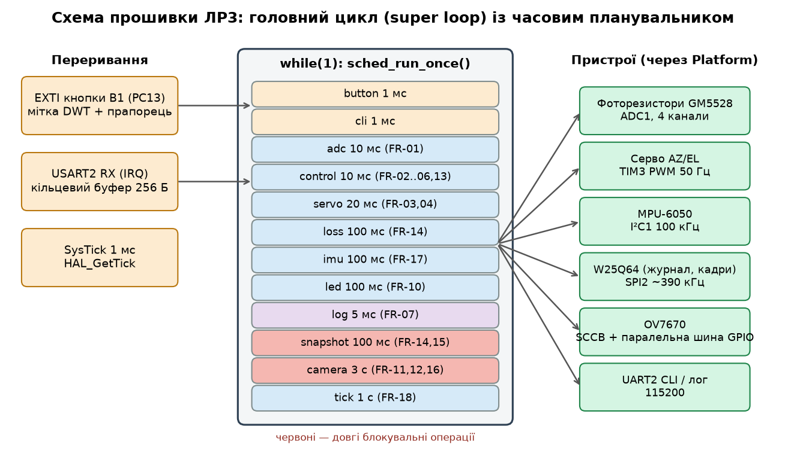
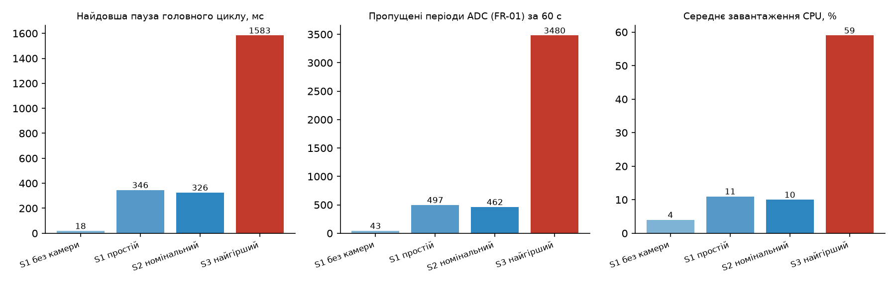
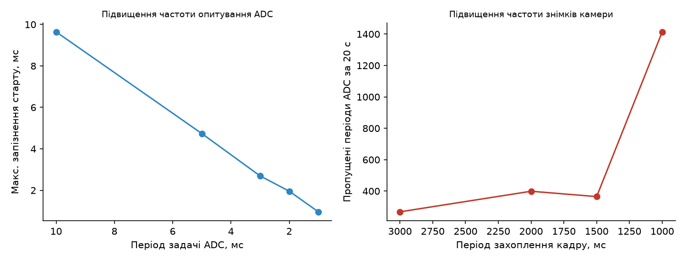
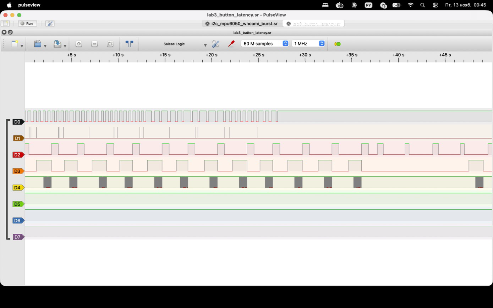
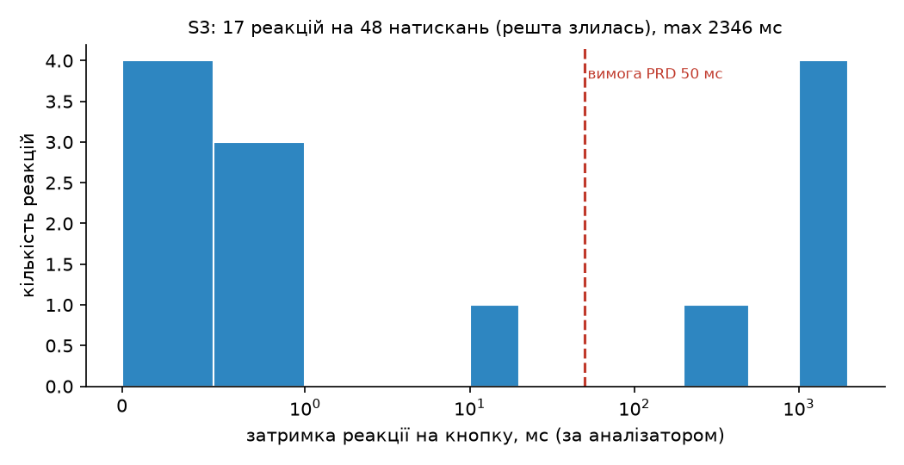
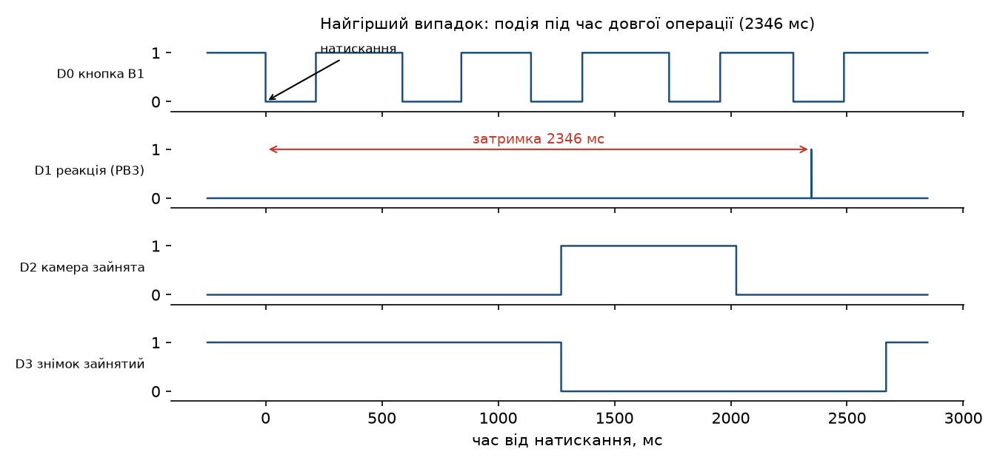
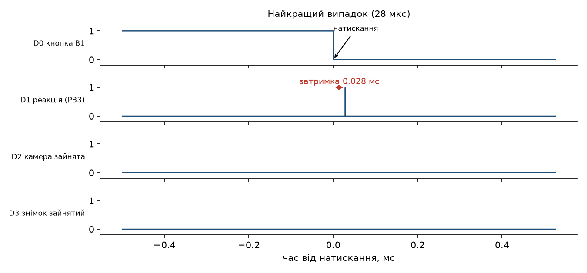
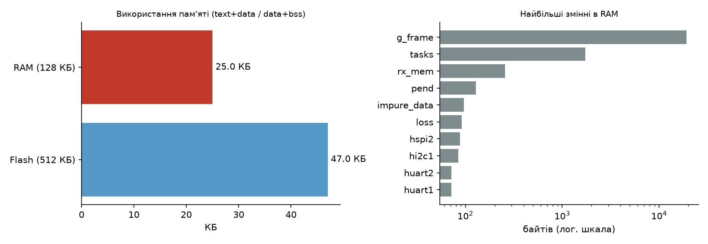

# Звіт: Лабораторна робота №3 — продукт на bare metal (super loop), вимірювання і межі підходу

## 1. Мета лабораторної роботи

Мета: реалізувати вимоги PRD в одній прошивці без ОС, виміряти швидкодію і пам'ять у кількох сценаріях навантаження і знайти межі підходу.

Що ми зробили:

* зібрали одну прошивку з дванадцятьма задачами в time-triggered super loop: опитування квадранта, наведення серво з режимами TRACK / OVERCAST / PARK, камера з класифікацією неба, журнал подій і кільце кадрів у W25Q64, калібрування в flash, командний інтерфейс;
* додали вимірювальний код: лічильник DWT, статистику кожної задачі (min / avg / max, запізнення, пропуски), гістограму, завантаження CPU, затримку реакції на кнопку, службові GPIO для логічного аналізатора, перевірку стека методом stack painting;
* виконали сценарії S1–S3, дві серії пошуку точки зламу, годинний прогін, відмови (відключений MPU-6050, замкнена SDA, обрив живлення);
* зняли запис логічного аналізатора затримки реакції на кнопку і порівняли його з DWT;
* склали реєстр із п'яти обмежень super loop (`docs/limitations.md`) і базову лінію для ЛР4 (`docs/baseline-lab4.md`).

Результат: усі 18 вимог PRD реалізовані в прошивці; 15 виконані, 3 виконані з обмеженням (FR-01 і FR-09 під навантаженням, FR-17 за змістом), недосяжних немає (див. таблицю в розділі 4). Вимога реакції на подію 50 мс у найгіршому сценарії S3 не виконується: виміряний максимум 2,35 с.

## 2. Розподіл обов'язків

Ролі взято з розділу 9 методички. Нас двоє, тому ролі об'єднані: кожен напрям ми робили разом, один одного перевіряли.

| № | Роль | Андрій Плешу | Тимур Варшавський | Артефакти |
|---|------|--------------|-------------------|-----------|
| 1 | Розробка super loop | 50 % | 50 % | `firmware/App/`, `firmware/Platform/`, `docs/tasks.md` |
| 2 | Метрики | 50 % | 50 % | `firmware/App/Src/perf.c`, `sched.c`, `tools/analyze_*.py`, `docs/metrics/memory.txt` |
| 3 | Тестування | 50 % | 50 % | `tests/`, `tools/run_scenario.py`, таблиці розділу 5 |
| 4 | Тестування на обладнанні | 50 % | 50 % | `docs/captures/`, `docs/metrics/*.log`, фізичні відмови, фото стенда |
| 5 | Звіт | 50 % | 50 % | `docs/limitations.md`, `docs/baseline-lab4.md`, `docs/problems.md`, цей звіт, відео |

Загальний внесок: Андрій 50 %, Тимур 50 %. Кожен із нас може пояснити структуру циклу, будь-яке обмеження з реєстру і спосіб його вимірювання.

## 3. Процес виконання

### 3.1 Журнал (хронологія)

* **Етап 1.** Розписали задачі продукту (`docs/tasks.md`): період, дедлайн, довгі операції. Додали шар `Common` із кільцевим буфером і логіку без HAL (планувальник, статистика, трекер, журнал, кадри, калібрування) з хостовими тестами.
* **Етап 2.** Зібрали прошивку з дванадцяти задач, перевели камеру на справжнє захоплення кадру через GPIO із синхронізацією по HREF, додали вимірювальний код і команди `STATS`, `MEM`, `PERIOD`, `SNAP`, `VER`.
* **Етап 3.** Зняли сценарії S1–S3 і серії пошуку точки зламу, склали звіт про пам'ять, побудували рисунки.
* **Етап 4.** Підключили логічний аналізатор до кнопки і службових пінів, записали затримку реакції в S3, порівняли з DWT.
* **Етап 5.** Перевірили на залізі відмови (відключений датчик, замкнена SDA, обрив живлення) і функціональні вимоги FR-03…FR-17; виправили режим-«смикання» і правило розсіяного світла.
* **Етап 6.** Година роботи в режимі S2, реєстр обмежень, базова лінія для ЛР4, журнал проблем, відео.

### 3.2 Опис прошивки

**Структура циклу.** Головний цикл викликає планувальник (`sched.c`) без блокувань: для кожної задачі він порівнює поточний час (DWT) із запланованим моментом і, якщо настав її час, викликає її один раз. Задача повертає керування сама. Довгі операції нічого не віддають назад: поки вони йдуть, інші задачі стоять.

**Таблиця задач** (повний варіант — `docs/tasks.md`):

| Задача | Період | FR | Виконання (виміряно) |
|--------|--------|----|---------------------|
| `button` | подія EXTI, перевірка 1 мс | FR-10 | 0 мкс |
| `cli` | байт UART, перевірка 1 мс | FR-09, 18 | 1–2 мкс, до 3,5 мс на команду |
| `adc` | 10 мс | FR-01 | 151–154 мкс |
| `control` | 10 мс | FR-02…06, 13 | 2–5 мкс |
| `servo` | 20 мс | FR-03, 04 | 0 мкс |
| `loss` | 100 мс | FR-14 | 1 мкс |
| `imu` | 100 мс | FR-17 | 842 мкс |
| `led` | 100 мс | FR-10 | 0 мкс |
| `log` | 5 мс | FR-07, 08 | 0–1 мкс, до 3 мс при записі |
| `snapshot` | 100 мс (перевірка запиту) | FR-11, 14, 15 | довга операція, 1,25–1,58 с |
| `camera` | 3 с | FR-11, 12, 16 | 0,39–0,79 с |
| `tick` | 1 с | FR-18 | 17,5–19,6 мс |

**Переривання і навіщо.**

* `EXTI15_10` (кнопка B1, PC13): записує мітку DWT і піднімає прапорець. Реакцію виконує `button_task` у циклі. ISR нічого не друкує і не викликає HAL із таймаутом.
* `USART2` RX: кладе байт у кільцевий буфер (`Common/Src/ringbuf.c`), розбирає його `cli_task`.
* `SysTick`: лише `HAL_IncTick`.

**Спільні дані.** Мітка і прапорець кнопки — `volatile`, ISR пише, цикл читає. Буфер RX — кільцевий, один записувач (ISR), один читач (цикл). Кадр `g_frame` 19 200 Б — один буфер, ISR його не чіпають. `volatile` не гарантує атомарності пари «мітка + прапорець»: при двох натисканнях підряд друге перезаписує мітку першого. Це й є джерело втрачених натискань (обмеження 3).

**Режими наведення.** TRACK: серво йдуть за світлом, крок 10 мкс, зона нечутливості 30 проміле. OVERCAST (розсіяне світло, або клас неба OVERCAST від камери): серво стоять. PARK (темрява довше 3 с, поріг 2500): серво в положення 1500/1500. Для переходів між TRACK і OVERCAST діє утримання режиму 1 с проти «смикання» (проблема 14).

### 3.3 Стенд

Стенд з ЛР2 без змін, плюс шина камери. Камера OV7670: XCLK 16 МГц (PA8), SCCB програмний (PB10/PB4), дані і керування на CN7. PCLK зменшено до ≈ 1 МГц (регістри CLKRC/COM14), щоб програма встигала читати пін, кадр QQVGA 160×120 YUV, береться лише яскравість (Y). Автоекспозицію вимкнено (AEC 600, підсилення 0x30). Піни — `docs/pinout.md`, розділ 1.1. Логічний аналізатор (FX2, 24 МГц, 8 каналів): D0 — кнопка B1, D1 — початок реакції, D2 — захоплення кадру, D3 — знімок у flash.

## 4. Статус вимог PRD

Вердикт «виконана» ставимо лише тоді, коли максимум у найгіршому сценарії не перевищує вимогу. Для вимог без числа — коли функція підтверджена перевіркою на залізі.

| FR | Вимога (скорочено) | Статус | Доказ | Обмеження |
|----|-------------------|--------|-------|-----------|
| FR-01 | 4 канали АЦП ≥ 100 Гц | виконана з обмеженням | час циклу 151 мкс; але камера блокує цикл і за S2 пропущено 462 періоди на 60 с, 74 783 за годину (≈ 21 на секунду) | № 2 |
| FR-02 | зсув по осях | виконана | `docs/metrics/fr03_tracking.txt`, тести `test_tracker` | — |
| FR-03 | TRACK: серво мінімізують зсув | виконана | `fr03_tracking.txt`: після зсуву лампи (t ≈ 19 с) елевація 1500→2400, азимут 1500→1940 | — |
| FR-04 | межі імпульсу серво | виконана | обмеження в `tracker.c` (`clamp_us`), тест `track_moves_towards_light_and_clamps`; у логах `fr03` / `fr06` ціль зупиняється на межі | — |
| FR-05 | PARK при темряві | виконана | `fr05_park.txt`: накриття t ≈ 22 с, PARK через 3 с, цілі 1500/1500 | — |
| FR-06 | OVERCAST при розсіяному світлі | виконана | `fr06_13_overcast.txt` | — |
| FR-07 | журнал у W25Q64 | виконана | записи по 16 Б із CRC16, кільце з 4 секторів, команда `LOG` | — |
| FR-08 | журнал переживає вимкнення | виконана | `powerloss.txt`: нумерація без розривів, CRC 20 кадрів кільця коректні; перезапис кільця не спостерігали (1018 з 1024 записів) | — |
| FR-09 | CLI калібрування, відповідь ≤ 100 мс | виконана з обмеженням | `fr09_calibration_persist.txt`: калібровка не губиться після вимкнення живлення; відповідь на команду S2: 876 мкс, S3: до 52,7 мс (`s3`) і 688 мс (`s3btn`), 1,1 с (`s3cap`) | № 1, 3 |
| FR-10 | LED за режимом | виконана | візуально: TRACK 5 Гц, OVERCAST 1 Гц, PARK короткий спалах | — |
| FR-11 | кадр не частіше 1 за 3 с | виконана | `camera` 1216 кадрів за годину, період 3 с; `snapshot_task` не запускається частіше ніж раз на 3 с | № 5 |
| FR-12 | клас неба не рідше ніж раз на 10 с | виконана | `fr12_camera_classes.txt`: CLEAR, DARK (долоня на об'єктиві), OVERCAST (папір) | — |
| FR-13 | у OVERCAST серво стоять | виконана | `fr06_13_overcast.txt`: цілі не змінюються в OVERCAST | — |
| FR-14 | втрата сигналу: кадр і подія | виконана | `fr14_signal_loss.txt`: події типу 3 з номером кадру | № 5 |
| FR-15 | кільце з 20 кадрів | виконана | 20 слотів, заголовок пишеться останнім (тест `frames_header_is_written_last`), 20 кадрів з коректним CRC після серії обривів | № 5 |
| FR-16 | розбіжність камера/фоторезистори | виконана | `fr12_camera_classes.txt`, `fr14_signal_loss.txt`: події типу 4 «підозра на датчик» | — |
| FR-17 | кут нахилу з MPU-6050 | виконана з обмеженням | `fr17_mpu_tilt.txt`: сирі прискорення читаються, кут за ними змінюється при нахилі; сам кут у прошивці не рахується, його рахує скрипт на хості | — |
| FR-18 | лог 115200 8N1 | виконана | рядок `tick` щосекунди, 3660 рядків за годину без пропусків | № 4 (час виводу 18 мс) |

Додаткова вимога з `docs/tasks.md`: реакція на подію ≤ 50 мс (кнопка). У S1 і S2 подію не подавали; у S3 вона не виконана (розділ 5.4, обмеження 1).

## 5. Вимірювання

### 5.1 Методика

* **DWT.** Лічильник циклів ядра (`DWT->CYCCNT`, 32 біти, 100 МГц, переповнення кожні ≈ 43 с). Кожна задача обгорнута в `perf_now()` до і після виклику; різниця беззнакових значень коректна навіть після одного переповнення. Для кожної задачі зберігаються `n`, `min`, `avg`, `max`, запізнення запуску (max, p99), пропущені періоди (інтервал > двох періодів). Завантаження CPU рахується лише за час задач, які виконали роботу. Команда `STATS` друкує блок `STAT` у форматі з методички, команда `STATS RESET` скидає лічильники.
* **Затримка реакції.** У ISR кнопки береться мітка DWT; в `button_task` різниця дає затримку «подія → початок реакції» (`btn_latency`). Натискання, що прийшли, поки попереднє не оброблене, рахуються як втрачені (`btn_lost`). Відповідь на команду вимірюється так само (`cmd_latency`).
* **Логічний аналізатор.** Службові GPIO: D0 — кнопка (фізична подія), D1 — піднімається на початку реакції, D2 — тривалість захоплення кадру, D3 — тривалість знімка. Запис 24 МГц, PulseView 0.4.2, файл `docs/captures/lab3_button_latency.sr`. Затримку рахує `tools/analyze_latency.py`.
* **Стек і heap.** Stack painting: на старті стек заповнюється шаблоном, `MEM` шукає найглибше місце, де шаблон порушено. Також `-fstack-usage` для статичної оцінки і `mallinfo` для heap.
* **Умови.** Одна збірка на сценарій (хеш у першому рядку логу), SYSCLK 100 МГц, USART 115200, стенд без змін, лампа по центру квадранта, серво вимкнені (`SERVO OFF`). Кожен прогін 60 с, годинний 3600 с. Хост-скрипти: `tools/run_scenario.py`, `tools/analyze_stats.py`.

### 5.2 Сценарії

| Сценарій | Що відбувається | Тривалість |
|----------|-----------------|------------|
| S1, без камери | лише періодичні задачі, кадри вимкнені | 60 с |
| S1 | періодичні задачі, кадр раз на 3 с | 60 с |
| S2 | як S1 плюс кожні 10 с одна команда | 60 с |
| S3 | знімок у flash кожні 3,2 с (кадр, стирання 5 секторів, запис 19 КБ), команди `MODE` ≈ 20 разів на секунду, натискання кнопки B1 | 60 с |
| Пошук точки зламу | `PERIOD adc` 10→1 мс; `PERIOD camera` 3000→1000 мс | 10 і 20 с на точку |
| Тривала робота | S2 без команд, зрізи `STATS` кожні 5 хв | 3600 с |
| Відмови | відключений MPU-6050, замкнена SDA, обрив живлення | за сценарієм |

Старту від подачі живлення до першого коректного виміру ми окремо не вимірювали (розділ 5.8).

### 5.3 Результати за сценаріями

| Метрика | S1 без камери | S1 | S2 | S3 | Вимога | Спосіб | Вердикт |
|---------|--------------|----|----|----|--------|--------|---------|
| Найдовша пауза циклу, мс | 18 | 346 | 326 | 1 583 | — | DWT | — |
| Запізнення `adc` (max), мс | 8,0 | 9,7 | 9,9 | 10,0 | ≤ 2 (`tasks.md`) | DWT | не виконана навіть у S1 без камери |
| Пропущені періоди `adc` за 60 с | 43 | 497 | 462 | 3 480 | 0 | DWT | не виконана |
| Запізнення `imu` (max), мс | 17,2 | 88,5 | 94,0 | 91,3 | ≤ 2 | DWT | не виконана |
| Кадр камери (max), мс | — | 343 | 323 | 442 | — | DWT | — |
| Знімок у flash (max), мс | — | — | — | 1 457 | — | DWT | — |
| Відповідь на команду (max), мс | 0,36 | 0,02 | 0,88 | 52,7 | ≤ 100 (FR-09) | DWT | виконана в `s3`; у S3 з кнопкою до 688 мс |
| Реакція на кнопку (max), мс | — | — | — | 991 (`s3btn`), 2 161 (`s3cap`) | ≤ 50 | DWT + аналізатор | не виконана в S3 |
| Втрачено байтів UART | 0 | 0 | 0 | 38 | 0 | лічильник | не виконана |
| Завантаження CPU (середнє), % | 4 | 11 | 10 | 59 | — | DWT | — |
| p99 періоду циклу, мкс | 100 | 100 | 100 | 100 | — | DWT | — |

Різниця S3 − S1 показує вартість довгих операцій: найдовша пауза циклу 346 мс → 1 583 мс, пропущені періоди АЦП 497 → 3 480, завантаження 11 % → 59 %. Те, що p99 періоду циклу залишається 100 мкс у всіх сценаріях, означає, що паузи рідкісні, але саме максимум визначає вимоги реального часу.

Запізнення `adc` max у S1 без камери (8 мс), ймовірно, дає блокувальний вивід рядка `tick` (≈ 18 мс), а не камера (обмеження 4).

**Пошук точки зламу** (`break_adc`, `break_cam`, `docs/metrics/break_*.log`).

| Період `adc`, мс | Пропущені періоди за 10 с | Найдовша пауза циклу, мс |
|------------------|--------------------------|--------------------------|
| 10 | 140 | 433 |
| 5 | 288 | 419 |
| 3 | 563 | 412 |
| 2 | 714 | 408 |
| 1 | 1 453 | 407 |

Задача АЦП виконується 151 мкс, тобто технічно вона витримала б 1 мс, але вимога порушується вже на 10 мс (вимога FR-01), бо кадр камери тримає цикл до 0,43 с. Збільшення частоти опитування лише збільшує кількість пропусків. Причина зламу — камера, а не навантаження самого АЦП.

Серія `break_cam` (період кадру 3000, 2000, 1500, 1000 мс): камера повторно запускається не частіше за вказаний період і без власних пропусків, але пропуски АЦП за 20 с становлять 268, 399, 365, 1 414, а завантаження CPU у вікнах вимірювання коливається від 4 до 33 %. Кадр частіше ніж раз на секунду не вміщається без повної зупинки решти системи (FR-11 вимагає ≥ 3 с, тож ми в межах вимоги).

### 5.4 Затримка реакції на кнопку: запис аналізатора

Запис `docs/captures/lab3_button_latency.sr` (50 с, S3 з кнопкою): 48 натискань, реакцій 17, злитих (втрачених) натискань 28. Затримка (аналізатор): min 28 мкс, медіана 343 мс, avg 1,00 с, max 2 346 мс, p99 2 346 мс.

Реакції розпадаються на дві групи (розбір — `docs/metrics/latency_analysis.txt`):

* швидкі, до 1 мс (наприклад, №2: 428 мкс, №5: 384 мкс, №14: 28 мкс): камера і знімок вільні;
* повільні, 1,9–2,35 с (№4: 1 917 450 мкс, №7: 2 271 810 мкс, №17: 2 346 207 мкс): у цей момент зайнятий знімок (канал D3), а за ним ще й камера.

Формула найгіршої затримки для нашого циклу: `T_max ≈ T_знімка + T_камери + Σ T_решти`. Підставляємо виміряне: знімок max 1,58 с, захоплення кадру до 0,76 с, решта задач менше 10 мс, разом ≈ 2,35 с.

### 5.5 Порівняння двох способів вимірювання

Для кількох величин ми маємо і аналізатор, і DWT. Порівнюємо мінімум і максимум; середнє для задач, що викликаються кожні 100 мс, не порівнюється (DWT усереднює і порожні виклики).

| Величина | Аналізатор | DWT | Різниця |
|----------|------------|-----|---------|
| Захоплення кадру, min | 426 721 мкс (n = 16) | 431 740 мкс (n = 16) | +1,2 % |
| Захоплення кадру, max | 762 423 мкс | 771 185 мкс | +1,1 % |
| Знімок у flash, max | 1 582 099 мкс (n = 13) | 1 587 719 мкс | +0,4 % |
| Реакція на кнопку, max | 2 346 207 мкс (n = 17) | 2 161 496 мкс (n = 7) | −8 % |

Кадр і знімок: у DWT значення трохи більше, різниця від 5 до 9 мс (до 1,5 %). Точну причину ми не з'ясовували: DWT міряє від входу до виходу з функції, а аналізатор від підняття до опускання піна, і виміри брались у різних межах вікон статистики.

Реакція на кнопку: аналізатор бачить 17 реакцій, DWT — лише 7 (інша кількість вибірок), і максимум відрізняється на 8 %. Тому ця пара чисел між собою не порівнянна в строгому сенсі. Аналізатор вимірює від фронту на дроті (включно з дребезгом контакту), DWT — від входу в ISR. Чому DWT побачив менше подій, ми не розкладали по причинах, тут ми спираємося на аналізатор як на еталон реального моменту на дроті.

### 5.6 Порівняння з розрахунком

* **Вивід рядка `tick`.** Рядок ≈ 109 байтів, 115200 8N1: 10 біт на байт, ≈ 9,5 мс. `_write()` передає його двічі, у USART2 і в дзеркало USART1, тому очікуємо ≈ 19 мс. Виміряно avg 18,2–18,6 мс (min 17,5, max 19,6). Розбіжність 2–4 %.
* **Знімок у flash.** За datasheet W25Q64JV: стирання сектора 4 КБ типово 45 мс (до 400 мс), 5 секторів ≈ 0,23 с; програмування сторінки типово 0,4 мс, 75 сторінок ≈ 0,03 с; передача 19 200 Б по SPI на ≈ 390 кГц ≈ 0,39 с. Разом зі знімком кадру (0,4–0,8 с) очікуємо ≈ 1,1–1,4 с. Виміряно 1,25–1,58 с (avg 1,46 с). Розбіжність до 15–20 %, ми не розкладали час по складових.
* **Кадр камери.** За документацією OV7670 у режимі YUV рядок займає 784 пікселі по 2 байти (1568 тактів PCLK), кадр 510 рядків, тобто ≈ 800 тис. тактів і ≈ 0,80 с при PCLK 1 МГц. Виміряний максимум 0,79 с збігається з розрахунком (1 %). Коротші захоплення (min 0,39 с, avg 0,59 с) трапляються, коли початок захоплення припадає не на початок кадру; цього ми окремо не перевіряли.

### 5.7 Пам'ять

Вивід `make memory` (`docs/metrics/memory.txt`):

| text | data | bss | усього |
|------|------|-----|--------|
| 46 276 | 1 868 | 23 728 | 71 872 |

* **Flash:** text + data = 48 144 Б ≈ 9 % від 512 КБ.
* **RAM:** data + bss = 25 596 Б ≈ 25 КБ із 128 КБ. Найбільше — буфер кадру `g_frame` 19 200 Б; далі таблиця задач 1 728 Б, буфер RX 256 Б.
* **Найбільші об'єктні файли за text:** `stm32f4xx_hal_i2c.o` 16,7 КБ, `stm32f4xx_hal_spi.o` 7,6 КБ, `product.o` 6,0 КБ.
* **Найбільші символи:** `HAL_RCC_OscConfig` 1016 Б, `run_line` 912 Б, `HAL_SPI_TransmitReceive` 854 Б.

**Стек.** Статична оцінка (`-fstack-usage`): найбільші кадри окремих функцій `evlog_open` 304 Б, `platform_cam_capture` 80 Б, `product_print_stats` 72 Б. Виміряна глибина (stack painting, `MEM`) — 656 Б із зарезервованих 2 048 Б (запас 1 392 Б), і вона не змінилась протягом години. Виміряне більше за будь-який окремий кадр, бо складається з ланцюжка викликів (задача → функція → HAL) і кадрів переривань, а `-fstack-usage` не бачить виклики бібліотеки (`printf`).

**Heap.** `arena` 1 468 Б (`mallinfo`), за годину не змінився.

**Розмір кадру і RAM.** Кадр 160×120×1 Б (лише яскравість) = 19 200 Б, тобто 15 % RAM. Один буфер замість двох заощадив 19 КБ (проблема 17). Кадр 320×240 (76 800 Б) ще вмістився б, але вже 60 % RAM; 640×480 (307 200 Б) не вміщається в 128 КБ.

### 5.8 Сценарії відмов, тривала робота, обрив живлення

**Відключений MPU-6050** (`fail_imu_disconnected.txt`, `fail_imu_reconnected.txt`). Лічильник `imu_err` росте (224 за прогін), час задачі `imu` падає до 319 мкс (швидка відмова NACK), інші задачі працюють: `adc` max 152 мкс. Після підключення датчика `imu` повертається до 842 мкс, нових помилок немає.

**Замкнена SDA** (`fail_sda_low.txt`, `fail_sda_released.txt`). У лозі `[i2c1] bus: idle SDA=0 SCL=1, recovery clocks=9, after SDA=0`: відновлення шини 9 тактами не допомогло, лінія лишається в нулі. Час задачі `imu`: min 842 мкс, avg 6 684 мкс, **max 234 815 мкс**; пропущено 545 запусків. Відповідь на команду в цьому прогоні 220 мс. Після відпускання лінії `imu` знову 842 мкс. Обмеження 4.

**Обрив живлення під час запису** (`powerloss.txt`). Під час `SNAP` кожні 3,2 с USB плати висмикували кілька разів. До: 897 записів, останній #8833, наступний кадр 159. Після: 930 записів, останній #8866, наступний кадр 161. Нумерація продовжилась без розривів, усі 20 кадрів кільця мають коректний CRC. Висновок: серія обривів живлення під час роботи зі знімками не пошкодила журнал і кадри. Обрив посеред запису окремо перевірено хостовими тестами з імітацією недописаних записів: `log_skips_torn_record_after_power_loss`, `frames_header_is_written_last`.

**Тривала робота: година в S2** (`docs/metrics/long1h_20261123_121107.log`, 12 зрізів `STATS`, 3660 рядків `tick`).

| Показник | Перший зріз (300 с) | Останній зріз (3600 с) |
|----------|--------------------|------------------------|
| Найдовша пауза циклу, мс | 792 | 1 075 |
| Пропущені періоди `adc` | 6 445 | 74 783 |
| Кадрів камери | 102 | 1 216 (min 390, avg 591, max 789 мс) |
| Переповнення UART RX | 2 | 13 |
| Помилки flash / IMU / камери | 0 / 0 / 0 | 0 / 0 / 0 |
| Втрачені натискання | 0 | 0 |
| Стек, heap | 656 Б, 1 468 Б | 656 Б, 1 468 Б |
| Записів у журналі | — | 1018 із 1024 |

Пропуски `adc` ростуть лінійно (≈ 21 на секунду), тренду на погіршення немає. Heap і стек не змінились. DWT переповнювався приблизно 84 рази, статистика лишилась коректною (інтервали менше 43 с). Найдовша пауза циклу зросла з 792 до 1 075 мс трьома окремими стрибками; причину кожного окремо ми не розбирали. Журнал до заповнення кільця на 1024 записи не дійшов (1018), тому перезапис найстаріших записів за час прогону не спостерігали. Переповнення UART RX (13 за годину) збігаються з моментами, коли скрипт слав `STATS` і `LOG` під час захоплення кадру.

**Не виміряно.** Час від подачі живлення до першого коректного виміру кожного сенсора. Для ЛР4 його треба зняти і на збірці ЛР3, і на FreeRTOS (`docs/baseline-lab4.md`, розділ 1).

## 6. Реєстр обмежень (зведення)

Повний текст у форматі методички — `docs/limitations.md`.

| № | Обмеження | Доказ | Що дасть ОС | Гіпотеза для ЛР4 |
|---|-----------|-------|-------------|------------------|
| 1 | Затримка реакції на подію під час довгої операції | кнопка до 2,35 с проти 50 мс | витіснення, задача кнопки з високим пріоритетом | реакція в S3 до одиниць мс |
| 2 | Пропуски періодичних задач і джитер | 74 783 пропущених періоди АЦП за годину | періодична задача АЦП за розкладом | пропуски близько 0 |
| 3 | Втрата подій і байтів UART | 28 з 48 натискань злито; 13–66 втрачених байтів | черга подій, сповіщення задач | 0 втрачених натискань |
| 4 | Блокувальні виклики HAL з таймаутом | SDA замкнена: `imu` до 235 мс | блокування лише в одній задачі | `adc` не залежить від `imu` |
| 5 | Довгі операції доводиться розбивати вручну | кадр 0,4–0,8 с, знімок 1,25–1,58 с | лінійний код у задачі з окремим стеком | менше станів у коді |

**Після ЛР4.** Обхід без ОС для обмеження 3 (прийом UART через DMA) і частина обходу для обмеження 4 (вивід через DMA) зроблені і переміряні в гілці `lab3-fix`: втрата байтів UART у S3 130 → 8, пропуски АЦП у S1 без камери 53 → 0. Обмеження 1, 2 і 5 від цього не змінились (проблема 20, розділ 8).

Окремо зафіксовано, що super loop робить краще: детермінізм (`adc` 151–154 мкс у всіх сценаріях), пам'ять (RAM 25 КБ із 128 КБ, стек 656 Б), простота налагодження, відсутність блокувань і взаємних блокувань.

## 7. Тести

* Хостові тести (`make test`): 457 перевірок, 0 помилок. Додані тести для планувальника, статистики, трекера (гістерезис, утримання режиму, PARK, детектор втрати сигналу), журналу, кільця кадрів, калібрування і класифікації неба.
* Покриття (`make coverage`): ≥ 90 % для всіх файлів із тестами, 100 % у драйверах MPU-6050, W25Q64 і OV7670.
* Перевірка шарів (`make check-deps`): `Layer dependencies OK`.

## 8. Проблеми та їх вирішення

Повний текст — `docs/problems.md`, проблеми 14–20.

#### Проблема 14: режим TRACK / OVERCAST «смикався»

Симптом: режим перемикався щосекунди, LED мигав. Причина: режим вибирався заново по кожному вимірюванню, без утримання. Виправлення: мінімальний час перебування в режимі 1 с і тести (коміт `e5474f7`).

#### Проблема 15: OVERCAST не вмикався при папері

Симптом: розсіяне світло не розпізнавалось, серво шукали зсув у шумі. Причина: порівняння сирого зсуву з порогом без урахування нуля квадранта (`CAL ZERO`); поріг темряви 1200 був надто низьким. Виправлення: розсіяність за зсувом після віднімання нуля або за класом неба від камери, поріг темряви 2500 (коміт `06ba832`).

#### Проблема 16: у логах був застарілий git-хеш

Симптом: `VER` показував хеш попереднього коміту. Причина: `make` не перекомпільовував `product.c`, де хеш підставляється прапором. Виправлення: видалення `product.o` перед збіркою (коміт `af447e2`).

#### Проблема 17: два буфери кадру по 19 КБ

Симптом: зайві 19 КБ RAM. Причина: камера і збереження в flash мали окремі буфери. Виправлення: один спільний `g_frame` (коміт `9a37eb6`).

#### Проблема 18: аналізатор показував не ті сигнали на CN10

Симптом: канали на CN10 бачили чужі сигнали. Причина: хибне припущення про порядок рядків роз'єму. Виправлення: команда `PROBE` і перестановка дротів, відповідність записана в `docs/pinout.md` (коміт `4bf9d0d`).

#### Проблема 19: кадр «пливе»

Симптом: рядки кадру зсувались. Причина: захоплення рахувало такти PCLK без прив'язки до початку рядка. Виправлення: синхронізація по HREF, автовизначення ліній PC8/PC9, тайм-аути (коміт `9d4c041`).

#### Проблема 20: команди губляться під час кадру, ST-Link іноді не приймає байти

Симптом: частина команд зникала, інколи плата переставала відповідати на команди, хоча лог із неї йшов. Причина (частково): переривання вимкнені на час кадру, а USART має один байт апаратного буфера; причину збоїв каналу хост→МК у ST-Link ми не встановили. Рішення: лічильник втрат, скрипти з повторами, вимкнення USB на 15 с для відновлення. Першопричину не усунуто (коміт `37a5c23`).

**Виправлено після ЛР4** (гілка `lab3-fix`, коміти `1f32538`, `de136d1`). Причину зависання ST-Link знайшли в ЛР4: прошивку копіювали командою `cp`, і macOS дописувала на диск ST-Link службовий файл атрибутів; тепер прошиваємо `tools/flash.py`. Втрату байтів прибрали прийомом через DMA: DMA1 Stream5 пише байти в кільцевий буфер 1 КБ сам, навіть коли переривання вимкнені на весь кадр; ISR по паузі на лінії (`IDLE`) і по половині / кінцю буфера переносить їх у кільце 256 Б, яке читає цикл. Вивід теж через DMA (кільце 4 КБ), тому цикл більше не чекає UART: рядок `tick` займає 0,13 мс замість 18 мс. `HardFault_Handler` тепер друкує `FATAL HardFault` і перезапускає плату.

Переміряли тією самою матрицею (логи `docs/metrics/lr3f_*.log` і порівняння `docs/comparison.md` — у гілці `lab4-dev`):

| Метрика | До виправлення | Після |
|---|---|---|
| Втрачені байти UART, S3 (три прогони) | 130 | 8 (0, 0, 8) |
| Пропущені періоди АЦП, S1 без камери, 60 с | 53 | 0 |
| Час старту до `ready` | 713 мс | 626–630 мс |
| RAM статично | 25,6 КБ | 30,6 КБ (+5 КБ буферів DMA) |
| Реакція на кнопку, S3, max | 2261,8 мс | 2274,6 мс |
| Пропущені періоди АЦП, S3, 60 с | 5600 | 4857 |

Залишок у 8 байтів — переповнення кільця 256 Б, поки цикл 1,6 с робить знімок і не читає команди. Реакція на кнопку і пропуски АЦП під час знімка майже не змінились: це обмеження 1 і 2, їх DMA не знімає.

## 9. Висновок

Чи потрібна нашому продукту ОС? За виміряними числами для всього продукту як цілого так, але не через загальні міркування, а через конкретні вимоги:

1. Вимога реакції на подію 50 мс не виконується в S3: максимум 2,35 с (аналізатор). Причина — знімок у flash (1,25–1,58 с) і захоплення кадру (до 0,8 с), які неможливо перервати.
2. Вимога FR-01 (≥ 100 Гц) порушується вже в S2: пропущено 462 періоди АЦП на 60 с і 74 783 за годину, хоча сам цикл АЦП займає лише 151 мкс.
3. Втрачається 28 із 48 натискань кнопки і до 66 байтів UART у S3.

Без ОС ці проблеми можна було б частково пом'якшити: розбити знімок на кроки, прийняти UART і АЦП через DMA, замінити слот кнопки чергою. Але захоплення кадру по GPIO з вимкненими перериваннями (до 0,8 с) залишається неподільним у будь-якому разі; його без зміни апаратної частини (DCMI) не усунути ні в super loop, ні у FreeRTOS. Тому гіпотеза для ЛР4 така: ОС розв'яже обмеження 1, 2 і 4 для всього, що не пов'язане з кадром, але реакція під час самого захоплення кадру залишиться порядку десятих часток секунди, поки захоплення не переробити.

Super loop у нашому продукті дає детермінованість у штатному режимі (час `adc` 151–154 мкс), мінімум пам'яті (RAM 25 КБ, стек 656 Б) і простоту налагодження. У ЛР4 ми перевіримо, скільки з цього збережеться.

Потрібні уточнення в наших вимірюваннях: час старту не виміряно; пояснення максимумів паузи в годинному прогоні (792 → 1 075 мс) ми не розкладали по причинах; розбіжність часу знімка в flash з розрахунком (до 20 %) не розкладена по складових.

## 10. Відповіді на контрольні питання

**1. Як влаштований головний цикл? Формула найгіршої затримки.**
Time-triggered super loop: планувальник у нескінченному циклі проходить таблицю з 12 задач і викликає кожну, коли настав її час (за DWT). Перериваннями лише фіксуємо події (кнопка, байт UART). Найгірша затримка реакції на подію: `T_max = T_найдовшої задачі, що виконується в момент події + Σ T усіх задач, які цикл має пройти до перевірки`. У нас: знімок до 1,58 с плюс захоплення кадру до 0,76 с плюс менше 10 мс решти ≈ 2,35 с (виміряно аналізатором).

**2. Що таке джитер? Як виміряли і чим спричинений?**
Відхилення фактичного моменту запуску періодичної задачі від запланованого. Вимірювали в `sched.c`: для кожної задачі `late = фактичний запуск − запланований`, зберігаємо max і p99 (гістограма), а також кількість пропущених періодів (інтервал > двох періодів). У нас джитер `adc` max ≈ 10 мс (S3) і 8 мс навіть без камери (блокувальний `tick` ≈ 18 мс); пропуски дає камера.

**3. Чому важливий найгірший, а не середній час? Як переконались, що максимум справжній?**
Вимоги реального часу (50 мс, 100 Гц) треба витримувати щоразу, а не в середньому: середнє `adc` 151 мкс, але пауза до 1,6 с. Справжність максимуму перевіряли тим, що максимум збігається у двох способах (DWT і аналізатор для знімка 0,4 %, кадру 1,1 %), і тим, що за годину (1216 кадрів) максимум кадру 789 мс майже збігається з розрахунком 0,80 с. Для реакції на кнопку ми маємо лише 17 реакцій у записі, тому її max (2,35 с) — нижня оцінка найгіршого випадку, не гарантія.

**4. Як працює DWT CYCCNT? Чому різниця беззнакових коректна і коли ні?**
Це 32-бітний лічильник тактів ядра, збільшується на кожному такті (100 МГц), вмикається через `DEMCR.TRCENA` і `DWT_CTRL.CYCCNTENA`. Різниця беззнакових 32-бітних значень береться за модулем 2³², тому коректна, навіть якщо лічильник один раз переповнився. Вона перестає бути коректною, коли справжній інтервал більший за один період переповнення (2³²/100 МГц ≈ 43 с): тоді втрачається ціле число обертів. Для довгих інтервалів ми використовуємо `platform_millis()`.

**5. Чому для затримок за логами не можна брати час прибуття рядка на хості?**
Між прошивкою і хостом є буфери UART/USB (ST-Link VCP), які додають до мілісекунд змінної затримки; вивід рядка сам займає час (наш `tick` 18 мс). Тому час беремо з МК (DWT, `platform_millis`), а на хості лише рахуємо різниці. Також перший рядок кожного логу фіксує версію прошивки.

**6. Що можна і чого не можна в ISR? Що буде, якщо викликати HAL з timeout?**
У ISR можна лише коротке: записати мітку, піднімати прапорець, покласти байт у буфер. Не можна блокуватись, чекати, друкувати, викликати функції з таймаутом. Функції HAL із таймаутом покладаються на `HAL_GetTick()` (SysTick); якщо ISR має вищий пріоритет за SysTick або виконується з вимкненими перериваннями, тік не росте і таймаут ніколи не спливе, а решта системи зависає. Тому в нашому ISR кнопки лише мітка DWT і прапорець.

**7. Що гарантує і чого не гарантує volatile? Приклад.**
`volatile` забороняє компілятору кешувати значення в регістрі й викидати читання/запис, тож цикл побачить зміну, зроблену ISR. Він не гарантує атомарності складених даних і не впорядковує доступ до кількох змінних. Приклад із нашого коду: мітка DWT кнопки і прапорець `pending` — дві `volatile`-змінні; якщо друге натискання прийшло між читанням прапорця і мітки, мітка перезаписана, і затримка перша виходить хибною, а саме натискання зливається з попереднім. Це дає втрачені натискання (28 з 48 у S3). Потрібна критична секція або черга подій.

**8. Що показують text, data, bss? Чому не видно стека?**
`text` — код і константи (flash), `data` — ініціалізовані змінні (flash для початкових значень і RAM), `bss` — неініціалізовані змінні (RAM, нулюються при старті). У нас 46 276 / 1 868 / 23 728. Стек і heap виділяються під час виконання, `size` бачить лише зарезервовану область (`._user_heap_stack` 3 072 Б), а не те, наскільки глибоко стек реально заходить.

**9. Статична оцінка стека та виміряна: різниця, яка більша?**
`-fstack-usage` дає розмір кадру кожної функції окремо (найбільший у нас `evlog_open` 304 Б), але не знає про ланцюжок викликів, бібліотечні функції (`printf`) та переривання. Stack painting показує реальну найглибшу точку: 656 Б. Виміряне більше за будь-який окремий статичний кадр, бо це сума ланцюжка і кадрів ISR; повна статична оцінка (по графу викликів) була б не меншою за виміряне.

**10. Як RAM обмежує роздільну здатність кадру?**
Кадр зберігається цілком: яскравість 1 байт на піксель. 160×120 = 19 200 Б (15 % від 128 КБ). 320×240 = 76 800 Б (60 %), вже без запасу на другий буфер. 640×480 = 307 200 Б у RAM не вміщається. Саме тому PRD обмежує кадр 160×120, і ми зробили один спільний буфер.

**11. Що відбувається, якщо пристрій на I²C перестає відповідати? Скільки блокується?**
Для відключеного датчика (NACK) задача `imu` швидко завершується з помилкою: 319 мкс, лічильник `imu_err` росте, продукт працює. Якщо SDA замкнена на землю, обмін чекає таймаут 50 мс і шина не відновлюється; задача `imu` займає до 235 мс (avg 6,7 мс), цикл стоїть увесь цей час. Відповідь на команду в цьому прогоні — 220 мс. Для інших задач це означає пропуски АЦП на час блокування.

**12. Яке обмеження найсерйозніше? Який механізм ОС розв'язує і які нові ризики?**
Обмеження 1 (затримка реакції під час довгої операції): реакція до 2,35 с проти вимоги 50 мс. Розв'язує витіснення за пріоритетами: задача з високим пріоритетом переривала б знімок. Нові ризики: інверсія пріоритетів на спільному SPI/буфері кадру, переповнення стека задачі, нові накладні витрати на перемикання контексту і пам'ять під стеки. Крім того, захоплення кадру з вимкненими перериваннями ОС не розв'яже без переробки.

**13. Що у продукті super loop робить краще за ОС?**
Детермінізм у штатному режимі (час `adc` 151–154 мкс майже без розкиду), мінімальна пам'ять (RAM 25 КБ із 128 КБ, стек 656 Б, heap 1,5 КБ без росту), простота налагодження (кожну затримку пояснює одна задача в таблиці `STATS`), відсутність взаємних блокувань і гонок між задачами. Час старту ми не вимірювали, тому як перевагу його не заявляємо.

## 11. Матеріали та посилання

* Репозиторій: `https://github.com/Ripper-del/heliostat-sky-cam`
* Реєстр обмежень: `docs/limitations.md`; базова лінія для ЛР4: `docs/baseline-lab4.md`; задачі: `docs/tasks.md`; журнал проблем: `docs/problems.md`
* Логи прогонів: `docs/metrics/` (S1–S3, `break_*`, `long1h_*`, `fail_*`, `fr*.txt`, `memory.txt`, `latency_analysis.txt`)
* Запис аналізатора: `docs/captures/lab3_button_latency.sr` (+ `.pvs`); рисунки: `docs/lab_3/img/`
* Відповідність хешів збірок у логах поточним комітам: `docs/commit-map.md`
* Скрипти: `tools/run_scenario.py`, `tools/analyze_stats.py`, `tools/analyze_latency.py`, `tools/make_figures.py`

## 12. Відеозвіт (2–3 хв)

Посилання на відео: https://drive.google.com/drive/folders/1hXphGatK6j-2GWOnMWaTJKAtgvG1KWl8?usp=sharing
