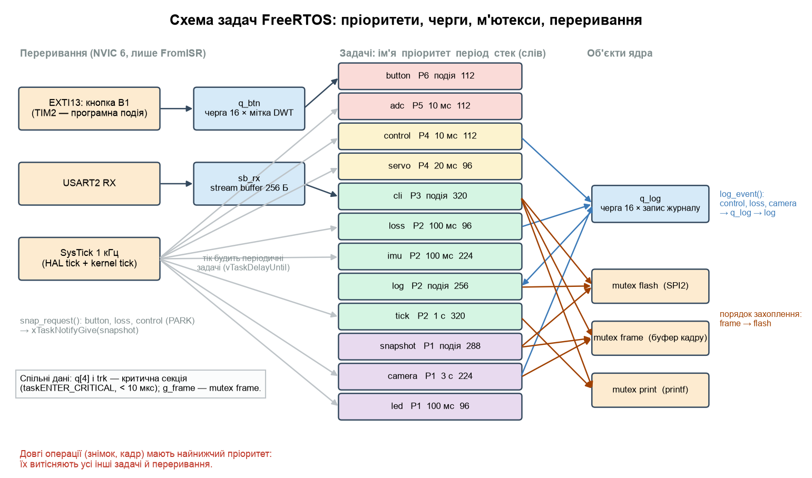
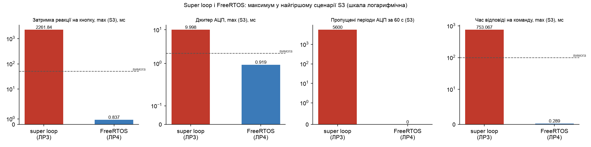
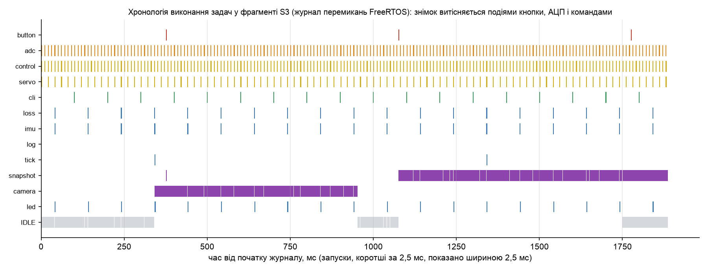
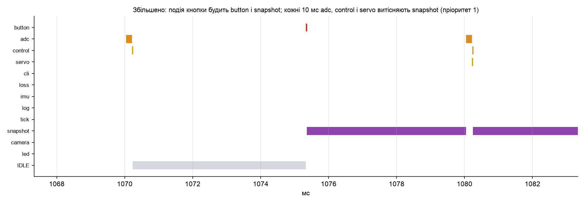
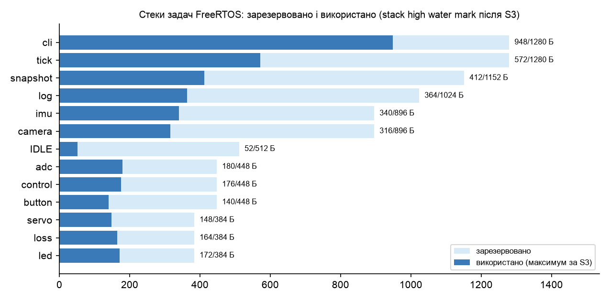
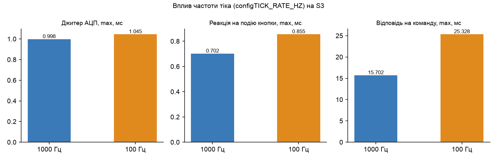

# Звіт: Лабораторна робота №4 — продукт на FreeRTOS і кількісне порівняння з super loop

## 1. Мета лабораторної роботи

Мета: реалізувати ті самі вимоги PRD, що в ЛР3, на FreeRTOS і з'ясувати в цифрах, що ОС дала і що забрала.

Що ми зробили:

* підключили FreeRTOS-Kernel V11.1.0 (порт GCC/ARM_CM4F, `heap_4`) і перенесли продукт з super loop на 12 задач з пріоритетами, черги, stream buffer, сповіщення і м'ютекси; логіка (трекер, клас неба, журнал, кадри, калібровка, CLI) лишилась тими самими модулями з ЛР3;
* зберегли командний інтерфейс і формат логів ЛР3 (`STAT`, `LOAD`, `MEM`, `PERIOD`, `SNAP`…) і додали команди ОС: `TASKS`, `STACK`, `HEAP`, `OSCOST`, `TRACE`, `TEST …`;
* переміряли обидві прошивки (тег `lab3` і ЛР4) в один вечір, тими самими скриптами і сценаріями: S1, S2 ×3, S3 ×3, точка зламу АЦП і камери, замкнена SDA, старт ×3, годинний прогін;
* виконали сценарії, специфічні для ОС (п. 7.2): інверсія пріоритетів, переповнення стека, голодування, вичерпання черги і heap, частота тіка 1000 і 100 Гц;
* склали порівняльну таблицю (`docs/comparison.md`) і перевірили п'ять гіпотез з базової лінії ЛР3;
* після першого порівняння знайшли причини проблем, що лишились (блокуючий друк через UART, втрата байтів прийому, тайм-аут SPI при витісненні), виправили їх, переміряли ЛР4 і окремо — super loop з тим самим виправленням UART.

Головний результат: у найгіршому сценарії S3 реакція на подію кнопки впала з 2261,8 мс до 0,84 мс, пропущені періоди АЦП — з 5600 до 0 за 60 с, відповідь на команду — з 753 мс до 0,29 мс, джитер IMU — з 99,6 мс до 1,1 мс. Платимо за це пам'яттю (flash +20 КБ, RAM +41 КБ), складнішим кодом і тим, що довгі операції трохи довші (знімок у flash 1,64 → 1,97 с). Байти UART тепер не губляться (130 → 0), але головне тут DMA, а не ОС: super loop з тим самим DMA губить лише 8 байтів за три прогони S3.

## 2. Розподіл обов'язків

Ролі з розділу 8 методички. Нас двоє, тому ролі об'єднані, і кожну роль ми вели вдвох, перевіряючи один одного.

| № | Роль | Андрій Плешу | Тимур Варшавський | Артефакти |
|---|------|--------------|-------------------|-----------|
| 1 | Розробка на FreeRTOS | 50 % | 50 % | `firmware/Core/Src/product_rtos.c`, `rtos_port.c`, `FreeRTOSConfig.h`, `docs/rtos-design.md` |
| 2 | Метрики | 50 % | 50 % | `firmware/App/Src/rtstats.c`, команди `TASKS`/`STACK`/`HEAP`/`OSCOST`/`TRACE`, `tools/compare_lr3_lr4.py` |
| 3 | Тестування | 50 % | 50 % | `firmware/Core/Src/rtos_tests.c`, `tools/os_tests.py`, `tools/fr_check_lr4.py`, `docs/comparison.md` |
| 4 | Тестування на обладнанні | 50 % | 50 % | `tools/measure_all.py`, `tools/lr4_post.sh`, логи `docs/metrics/lr3_*`, `lr4_*` |
| 5 | Звіт | 50 % | 50 % | цей звіт, `docs/problems.md` (20–32), рисунки `docs/lab_4/img/`, відео |

Загальний внесок: Андрій 50 %, Тимур 50 %; кількість комітів у гілці однакова. Кожен із нас може пояснити схему задач і пріоритетів і будь-який рядок порівняльної таблиці.

## 3. Процес виконання

### 3.1 Журнал (хронологія)

* **Етап 1.** Підключили ядро V11.1.0 (копія файлів із записом версії), написали `FreeRTOSConfig.h`, хуки (`configASSERT`, переповнення стека, malloc), загорнули `printf` у м'ютекс, лишили SysTick спільним для HAL і ядра.
* **Етап 2.** Розбили продукт на 12 задач з тими самими іменами, що в ЛР3 (щоб `STAT`-рядки збігались), замінили прапорці ISR чергою і stream buffer, драйвери перевели на `vTaskDelay`.
* **Етап 3.** Переробили захоплення кадру: переривання вимикаються лише на рядок, а не на весь кадр, бо інакше ядро губило тіки (проблема 23).
* **Етап 4.** Додали вимірювання ОС (облік CPU за задачами в `traceTASK_SWITCHED_IN`, журнал перемикань, вартість тіка) і програмний імітатор кнопки `BTNSIM`, щоб подію в S3 подавати однаково для обох прошивок. Той самий імітатор і інжекцію `FAULT SDA` додали в прошивку ЛР3 (гілка `lab3-measure`).
* **Етап 5.** Переміряли ЛР3 і ЛР4 за однією матрицею (`tools/measure_all.py`), знайшли і виправили помилку виміру джитера (проблема 24), переміряли ЛР4.
* **Етап 6.** Сценарії п. 7.2, варіанти збірки (тік 100 Гц, без контролю стека, малий heap), порівняльна таблиця, журнал проблем.
* **Етап 7.** Розібрали, що лишилось невиконаним у першій версії: втрата байтів UART, джитер IMU в S3, одна помилка flash, мовчазне зависання в `TEST STK`. Перевели UART на DMA (прийом і вивід), збільшили тайм-аут SPI, зробили `HardFault_Handler`, що друкує і перезапускає плату, виправили тест стека (проблеми 27, 29–32). Те саме виправлення UART перенесли в super loop (гілка `lab3-fix`, проблема 20).
* **Етап 8.** Переміряли ЛР4 за повною матрицею, сценарії ОС, варіанти збірки, годинний прогін, і матрицю super loop з DMA; оновили таблиці, рисунки і звіт.

### 3.2 Стенд

Той самий, що в ЛР3: NUCLEO-F411RE, SYSCLK 100 МГц, USART2 115200 8N1 через ST-Link VCP, квадрант фоторезисторів, два серво (у вимірах вимкнені, як у ЛР3), MPU-6050 на I²C1, W25Q64 на SPI2, камера OV7670 по GPIO. Обидві прошивки міряли на одному стенді з тим самим освітленням.

## 4. Схема задач

| Задача | Запуск | Пріоритет | Стек, Б (зарезервовано / використано max) | Частка CPU в S3 | FR | Чому такий пріоритет |
|---|---|---|---|---|---|---|
| `button` | черга `q_btn` від ISR | 6 | 448 / 140 | < 0,1 % | реакція ≤ 50 мс | найжорсткіший дедлайн, робота кілька мкс |
| `adc` | `vTaskDelayUntil` 10 мс | 5 | 448 / 152 | 1,6 % | FR-01 | жорсткий період ≥ 100 Гц |
| `control` | 10 мс | 4 | 448 / 176 | 0,1 % | FR-02…06, 13 | рішення за свіжим виміром |
| `servo` | 20 мс | 4 | 384 / 172 | < 0,1 % | FR-03, 04 | плавний рух |
| `cli` | stream buffer `sb_rx` від ISR USART2 | 3 | 1280 / 756 | 0,2 % | FR-09, 18 | людина чекає ≤ 100 мс |
| `loss` | 100 мс | 2 | 384 / 140 | < 0,1 % | FR-14 | повільний процес (2 с) |
| `imu` | 100 мс | 2 | 896 / 340 | 0,8 % | FR-17 | I²C може блокуватись десятки мс |
| `log` | черга `q_log` | 2 | 1024 / 364 | < 0,1 % | FR-07, 08 | запис у flash можна відкласти |
| `tick` | 1 с | 2 | 1280 / 524 | < 0,1 % | FR-18 | рядок лога раз на секунду |
| `snapshot` | сповіщення `xTaskNotifyGive` | 1 | 1152 / 404 | 27,0 % | FR-11, 14, 15 | довга операція, поступається всім |
| `camera` | 3 с | 1 | 896 / 316 | 15,6 % | FR-11, 12, 16 | захоплення кадру 0,4–0,8 с |
| `led` | 100 мс | 1 | 384 / 140 | < 0,1 % | FR-10 | індикація |
| IDLE | ядро | 0 | 512 / 52 | 54,2 % | — | простій |

Механізми взаємодії, переривання, порядок захоплення м'ютексів і обґрунтування кожного вибору — у `docs/rtos-design.md` (розділи 2–4). Коротко: ISR лише кладуть подію в чергу (`q_btn`) або байти в stream buffer (`sb_rx`); дані між задачами йдуть через чергу `q_log` і сповіщення; flash, буфер кадру і UART захищені м'ютексами `flash_mx`, `frame_mx`, `print_mx`.

**UART через DMA.** Прийом: DMA1 Stream5 пише байти в кільцевий буфер 256 Б сам, без процесора, тому байт не губиться, навіть коли переривання вимкнені на рядок камери. Переривання по паузі на лінії (`IDLE`) і по половині / кінцю буфера переносять нові байти в `sb_rx`. Вивід: `printf` кладе текст у кільце 4 КБ і повертається одразу; DMA1 Stream6 відправляє його порціями. Якщо кільце заповнене, задача спить (`vTaskDelay`), а не крутиться в циклі. Аварійний друк (`configASSERT`, HardFault) спершу дописує кільце, потім пише прямо в регістр.

**HAL і SysTick.** Ми не переводили HAL на інший таймер: `SysTick_Handler` викликає `HAL_IncTick()` і, коли планувальник запущено, `xPortSysTickHandler()`. Так `HAL_GetTick()` і всі таймаути HAL працюють без змін. NVIC — `NVIC_PRIORITYGROUP_4`; ISR, що викликають API ядра (кнопка, TIM2, USART2 і його канали DMA), мають пріоритет 6 при `configLIBRARY_MAX_SYSCALL_INTERRUPT_PRIORITY = 5`.

## 5. Конфігурація ядра

| Параметр | Значення | Чому змінено або залишено |
|---|---|---|
| Версія | FreeRTOS-Kernel V11.1.0, коміт `dbf70559`, копія в `firmware/Middlewares/FreeRTOS/` (`VERSION.txt`) | офіційний репозиторій, фіксована версія |
| Порт | GCC/ARM_CM4F | Cortex-M4 з FPU |
| Heap | `heap_4`, 24 КБ | злиття вільних блоків; використано max 12 136 Б (див. розділ 8) |
| `configTICK_RATE_HZ` | 1000 | роздільна здатність 1 мс; 100 Гц перевірено окремо (розділ 7.6) |
| `configUSE_PREEMPTION`, `configUSE_TIME_SLICING` | 1, 1 | витіснення — головна мета переходу |
| `configMAX_PRIORITIES` | 8 | використовуємо 0…6, 7 — для тесту голодування |
| `configCHECK_FOR_STACK_OVERFLOW` | 2 | перевірка шаблону на кожному перемиканні |
| `configUSE_MALLOC_FAILED_HOOK` | 1 | сигнал вичерпання heap |
| `configASSERT` | друк файлу і рядка в UART без `printf`, потім перезапуск | помилки ядра видно в лозі (проблема 21); так само HardFault (проблема 30) |
| `configUSE_NEWLIB_REENTRANT` | 0 | замість reent на кожну задачу (≈ 1 КБ) — м'ютекс навколо `printf` |
| `configUSE_TIMERS`, `configUSE_EVENT_GROUPS` | 0 | не потрібні; економія RAM і коду |
| `configGENERATE_RUN_TIME_STATS`, `configUSE_TRACE_FACILITY` | 1 | частка CPU за задачами, `TASKS` |
| `traceTASK_SWITCHED_IN` | власний облік | 64-бітний облік часу і журнал 1024 перемикань для хронології |
| `INCLUDE_xTaskAbortDelay` | 1 | `PERIOD` змінює період одразу (проблема 25) |

Повна таблиця з поясненнями — `docs/rtos-design.md`, розділ 5.

## 6. Статус вимог PRD для обох підходів

Вердикт «виконана» — коли максимум у найгіршому сценарії не перевищує вимогу. ЛР4 перевіряли скриптом `tools/fr_check_lr4.py` (7 з 7 перевірок пройдено, `docs/metrics/lr4_fr_check_*.log`) і сценаріями S1–S3. Вимоги, логіку яких ми не міняли (трекер, режими, LED), окремо з лампою в ЛР4 не перевіряли; це позначено.

| FR | Вимога (скорочено) | ЛР3 (super loop) | ЛР4 (FreeRTOS) | Доказ ЛР4 |
|----|-------------------|------------------|----------------|-----------|
| FR-01 | АЦП ≥ 100 Гц | з обмеженням: 1614 пропусків за 60 с у S2 | **виконана**: 0 пропусків у S1–S3, `break_adc` до 1 мс, 0 за годину | `lr4_s2*`, `lr4_s3*`, `lr4_break_adc_*`, `lr4_long1h_*` |
| FR-02…06, 13 | зсув, TRACK, межі серво, PARK, OVERCAST | виконані | виконані (ті самі модулі `tracker.c`; з лампою в ЛР4 не перевіряли) | хостові тести `tests/`, S1–S3 |
| FR-07 | журнал у W25Q64 | виконана | виконана (задача `log`, `pend_lost = 0`) | `lr4_s3*`, FR-check |
| FR-08 | журнал переживає вимкнення | виконана | код без змін; обрив живлення в ЛР4 — РУЧНА ПЕРЕВІРКА | — |
| FR-09 | CLI, відповідь ≤ 100 мс | з обмеженням: 753 мс у S3, байти губляться | **виконана**: 0,29 мс у S3, байтів втрачено 0 | `lr4_s3*`, `CAL SHOW` у FR-check |
| FR-10 | LED за режимом | виконана | виконана (задача `led`, той самий код) | візуально |
| FR-11 | кадр не частіше 1 за 3 с | виконана | виконана: два `SNAP` за < 1 с → +1 кадр | FR-check |
| FR-12 | клас неба ≤ 10 с | виконана | виконана | FR-check |
| FR-14 | втрата сигналу: кадр і подія | виконана | виконана: подія типу 3 з номером кадру | FR-check |
| FR-15 | кільце з 20 кадрів | виконана | виконана: кадр читається з flash | FR-check |
| FR-16 | розбіжність камера / фоторезистори | виконана | виконана (той самий код) | — |
| FR-17 | нахил з MPU-6050 | з обмеженням (збої MPU, проблема 6; запізнення до 99,6 мс) | з обмеженням (той самий драйвер і ті самі збої MPU), але запізнення max 1,12 мс, 0 пропусків у S3 | `imu` у `STAT` |
| FR-18 | лог 115200 | виконана | виконана: 12 рядків `tick` за 12 с | FR-check |
| — | реакція на подію ≤ 50 мс (з `docs/tasks.md`) | **не виконана**: 2261,8 мс | **виконана**: 0,84 мс | `lr4_s3*` |

## 7. Вимірювання

### 7.1 Методика

Усі прошивки міряли однаково (`tools/measure_all.py --fw lr3|lr3f|lr4`): ті самі сценарії, ті самі команди, по 60 с, S2 і S3 по три повтори; у таблицях — максимум за повтори, у дужках по повторах. Час міряє прошивка (DWT), хост лише збирає рядки. Подію кнопки в обох прошивках подає таймер TIM2 через програмну подію EXTI (`BTNSIM 700`), тож ритм подій однаковий і не залежить від людини. Затримку реакції міряємо від апаратного моменту події (`evt_latency`, момент береться з `TIM2->CNT`) до початку реакції в задачі, і окремо, як у ЛР3, від входу в ISR (`btn_latency`).

У FreeRTOS «час виконання» задачі між двома мітками DWT включає час, коли її витісняли (п. 6.1 методички). Чистий час — колонка `cpu_us` у `TASKS`.

### 7.2 Порівняльна таблиця

Повна таблиця з різницею, вимогою PRD, інструментом і вердиктом — `docs/comparison.md`, розділ 2. Головні рядки (S3, max за три повтори). Стовпчик «super loop + DMA» — прошивка ЛР3 з тим самим виправленням UART, що й у ЛР4 (розділ 7.8):

| Метрика | ЛР3 | Super loop + DMA | ЛР4 | Різниця ЛР4 − ЛР3 | Вимога | Хто кращий |
|---|---|---|---|---|---|---|
| Реакція на подію кнопки, max | 2261,8 мс | 2274,6 мс | 0,84 мс | −2261,0 мс, ÷2702 | ≤ 50 мс | FreeRTOS |
| Подій кнопки втрачено | 74 | 107 | 0 | −74 | 0 | FreeRTOS |
| Джитер АЦП, max | 9,998 мс | 9,911 мс | 0,919 мс | −9,1 мс, ÷11 | ≤ 2 мс | FreeRTOS |
| Пропущені періоди АЦП за 60 с | 5600 | 4857 | 0 | −5600 | 0 | FreeRTOS |
| Джитер IMU, max | 99,6 мс | 99,4 мс | 1,12 мс | −98,5 мс, ÷89 | ≤ 2 мс | FreeRTOS |
| Відповідь на команду, max | 753,1 мс | 1602,2 мс | 0,29 мс | −752,8 мс, ÷2606 | ≤ 100 мс | FreeRTOS |
| Втрачені байти UART | 130 | 8 | 0 | −130 | 0 | FreeRTOS (super loop з DMA майже) |
| Захоплення кадру, max | 755,7 мс | 782,6 мс | 787,5 мс | +31,8 мс | — | super loop |
| Знімок у flash, max | 1639,7 мс | 1626,7 мс | 1973,3 мс | +333,6 мс, ×1,2 | — | super loop |
| CPU, середнє S1 / S2 / S3 | 20 / 26 / 76 % | 24 / 23 / 70 % | 22 / 23 / 49 % | +2 / −3 / −27 п. п. | — | FreeRTOS у S3 |
| Flash | 49,2 КБ | +1,1 КБ | 69,7 КБ | +20,0 КБ | ≤ 512 КБ | super loop |
| RAM статично | 25,6 КБ | +5,0 КБ | 67,4 КБ | +40,8 КБ | ≤ 128 КБ | super loop |
| Старт до `ready` | 713 мс | 626–630 мс | 629–631 мс | −83 мс | — | див. розділ 7.8 |
| Рядки оркестрації | 516 | 516 + DMA у платформі | 850 | +334 | — | super loop |

Чому ЛР4 виграє: `button`, `adc` і `cli` мають вищий пріоритет за `snapshot` і `camera` і витісняють їх у момент події, а не після кінця довгої операції. Чому довгі операції в ЛР4 трохи довші: їх перебивають усі інші задачі, а кадр знімається рядок за рядком із вікнами для переривань.

Що показав super loop з DMA: апаратна втрата байтів зникла (130 → 8, залишок — переповнення програмного кільця, поки цикл робить знімок), а реакція на кнопку, пропуски АЦП і джитер IMU лишились такими самими. Тобто виграш у реакції і пропусках дає саме ОС, а виграш у байтах UART — DMA.

**Перша версія ЛР4 і що змінилось.** У першій версії ЛР4 (логи в `docs/metrics/lr4_v1/`) друк ішов через `HAL_UART_Transmit`, який чекає кожен байт. Відповідь на `STATS` (≈ 3 КБ) займала `cli` на 300 мс, і задачі з пріоритетом 2 і нижче пропускали періоди: джитер IMU був 81 мс, відповідь на команду 15,7 мс, знімок 3,66 с, CPU в S3 74 %, а байтів UART губилось 286. Після переходу на DMA: IMU 1,12 мс без пропусків, команда 0,29 мс, знімок 1,97 с, CPU 49 %, байтів 0 (проблеми 27, 32). Таблиця «до / після» — `docs/comparison.md`, розділ 2.

### 7.3 Точка зламу і відмова шини

У ЛР3 АЦП пропускав періоди вже на 10 мс (208 за 10 с) і більше при частіших запусках (2893 на 1 мс). У ЛР4 — 0 на всіх точках від 10 до 1 мс і на всіх періодах кадру від 3 до 1 с, запізнення не більше 1,01 мс; завантаження CPU при цьому до 63 %. Межу для ЛР4 у цих серіях ми не знайшли; знизу її обмежує тік 1 мс. Super loop з DMA має ту саму точку зламу (256 пропусків за 10 с на 10 мс, 1242 за 20 с при кадрі раз на секунду): її визначає кадр, а не друк.

SDA на землі 20 с: у ЛР3 АЦП пропустив 1493 періоди (запізнення 9,7 мс), IMU — 134; у ЛР4 АЦП 0 (0,89 мс), IMU 0 (0,95 мс), хоча сам виклик I²C чекає тайм-аут (у ЛР4 до 32,9 мс). Таблиці — `docs/comparison.md`, розділи 4–5.

### 7.4 Хронологія виконання задач (S3)

Журнал перемикань ядра (`TRACE ARM`, 1024 події, запис у `traceTASK_SWITCHED_IN`, `docs/metrics/lr4_trace_*.log`) під час S3:

Що видно: `camera` і `snapshot` (пріоритет 1) працюють довгими відрізками (кадр ≈ 600 мс, знімок ≈ 800 мс), і ці відрізки перериваються кожні 10 мс задачами `adc` і `control`, кожні 20 мс — `servo`, кожні 100 мс — `imu`, `loss`, `led`, `cli`, а раз на секунду — `tick`. Наприкінці знімка `snapshot` чергується з IDLE: вона чекає, поки flash закінчить запис (`vTaskDelay(1)`), і процесор у цей час вільний. На збільшеному фрагменті подія кнопки будить `button`, та сповіщає `snapshot`, і знімок починається одразу; через 5 мс `adc`, `control` і `servo` витісняють `snapshot` і після себе повертають їй процесор. У super loop на цьому ж місці знімок ішов би до кінця без перерв, а кнопка чекала б.

Цей самий фрагмент можна побачити на логічному аналізаторі: пін PB2 = «працює IDLE» (`PROBE`), D-канали — кнопка і службові піни задач. Запис аналізатора — РУЧНИЙ КРОК (за бажанням).

### 7.5 Метрики ОС

**Завантаження за задачами** (`TASKS`, S3, частка від усього часу): `snapshot` 27,0 %, `camera` 15,6 %, `adc` 1,6 %, `imu` 0,8 %, `cli` 0,2 %, IDLE 54,2 %. Майже весь час CPU йде на довгі операції, критичні задачі займають кілька відсотків. У першій версії `cli` займала 19,5 % — це було очікування UART.

**Стеки** (`STACK`, найбільше використання за S3): див. таблицю розділу 4 і рисунок. Найменший запас у `cli` (41 % після S3, 37 % за годину роботи), у решти 55–90 %. Розміри підбирали за `uxTaskGetStackHighWaterMark` після S3 і сценаріїв `TEST`.

**Heap ОС** (`HEAP`): 24 576 Б, після старту вільно 12 440 Б, у робочих сценаріях мінімум не опускався нижче 12 440 Б (використано max 12 136 Б); під час сценаріїв `TEST` (тимчасові задачі) — 8 944 Б; `malloc_failed = 0` поза тестом heap.

**Вартість ОС** (`OSCOST`, `TEST CTX`):

| Що | Значення |
|---|---|
| Обробник тіка (HAL + ядро) | avg 184–199 тактів (≈ 1,9 мкс), max 2835 тактів (28 мкс); при 1 кГц ≈ 0,2 % CPU |
| Перемикань контексту | ≈ 400 /с у S2, ≈ 600 /с у S3 |
| Від `xTaskNotifyGive` до початку роботи задачі (2000 вимірів) | 11,18 / 11,27 / 11,30 мкс (min / avg / max) |
| Від події кнопки до початку реакції, S3 | avg 0,041 мс, max 0,84 мс |

### 7.6 Сценарії, специфічні для ОС (п. 7.2)

Усі запускаються командою `TEST …` на робочій прошивці або окремою збіркою; лог — `docs/metrics/lr4_ostests_*.log`, скрипт `tools/os_tests.py`.

**Інверсія пріоритетів** (`TEST INV`, `TEST INV SEM`). Низька задача тримає ресурс 200 мс, середня займає CPU 300 мс, висока чекає ресурс. З м'ютексом висока чекала 180,9 / 180,9 / 180,4 мс: низька успадкувала пріоритет і дотримала ресурс, середня не втрутилась. З двійковим семафором — 310,9 / 310,9 / 311,1 мс: середня витіснила низьку, і висока чекала ще й роботу середньої. Різниця ≈ 130 мс — це і є інверсія. Тому `flash_mx` і `frame_mx` у продукті саме м'ютекси.

**Переповнення стека** (`TEST STK`). Задача зі стеком 96 слів рекурсивно займає ≈ 612 Б і на найглибшому рівні віддає процесор. При перемиканні ядро бачить зіпсований шаблон в кінці стека і викликає `vApplicationStackOverflowHook`: у UART `FATAL stack overflow in stkovf`, плата перезапускається і знову відповідає на `VER` (`docs/metrics/lr4_stk_check_20261124_004747.log`). Зі збіркою без контролю стека (`-DRTOS_NO_SOF`) переповнення закінчується `FATAL HardFault` і перезапуском (`lr4_stk_nocheck_*.log`): помилку видно лише як аварію, без імені задачі. Тест вийшов з третьої спроби: перша версія писала за межі стека ≈ 8 КБ і плата мовчки зависала, друга не зачіпала останні 16 байт стека, і перевірка шаблоном нічого не бачила (проблема 30).

**Голодування** (`TEST STARVE 1500`). Задача з пріоритетом 7 1,5 с крутиться без блокування. За цей час `adc` пропустив 149 періодів (запізнення до 6 мс у межах періоду), `imu` — 14, `tick` запізнився на 396 мс, IDLE не отримав жодного часу. У `TASKS` це видно так: `cpu_us` задачі-«ненажери» виросла на 1,5 с, а лічильник `missed` в `adc` збільшився. Після завершення система відновилась без перезапуску.

**Вичерпання черги** (`TEST QFLOOD`). 200 подій в чергу на 8 місць швидше, ніж споживач читає. Без очікування (`timeout 0`): надіслано 8, втрачено 192, відправник не блокувався (516 мкс на все). З очікуванням 50 мс: втрат 0, але відправник блокувався і витратив 963 мс. Втрати видно в лічильниках (у продукті — `pend_lost`, `btn_lost`; у S3 обидва 0).

**Вичерпання heap** (`TEST HEAP`). Тест виділяє блоки по 1 КБ, поки `pvPortMalloc` не поверне NULL: вийшло 12 блоків, 13-й — NULL, `vApplicationMallocFailedHook` спрацював (`malloc_failed = 1`), після звільнення блоків вільно знову 12 440 Б, продукт працює далі. Окремо зменшували `configTOTAL_HEAP_SIZE`: з 12 КБ прошивка стартує і працює (усі задачі створено, `docs/metrics/lr4_heap12k_boot_*.log`), з 8 КБ одна із задач не створюється, і старт зупиняє `configASSERT` у `product_rtos.c` з повідомленням `FATAL configASSERT` (`lr4_heap8k_boot_*.log`). Тобто запас heap зараз ≈ 12 КБ, а мінімум для 12 задач лежить між 8 і 12 КБ.

**Частота тіка 1000 і 100 Гц** (окрема збірка, S3 ×2, S2 ×1):

| S3 | 1000 Гц | 100 Гц |
|---|---|---|
| Реакція на подію кнопки, max | 0,84 мс | 0,74 / 0,86 мс |
| Джитер АЦП, max | 0,919 мс | 1,177 / 0,930 мс (S2: 0,905 мс) |
| Пропущені періоди АЦП | 0 | 0 |
| Відповідь на команду, max | 0,29 мс | 0,31 / 0,29 мс |
| Обробник тіка, avg | 184–199 тактів | 496–499 тактів |
| CPU, середнє | 47–49 % | 27–28 % |

Джитер АЦП майже не змінився, бо всі періоди задач — кратні 10 мс, тобто кратні тіку і при 100 Гц. Реакція на кнопку теж не залежить від тіка: ISR кладе подію в чергу, і перемикання відбувається одразу (`portYIELD_FROM_ISR`), без чекання тіка. Тік став рідше, але кожен обробник довший (≈ 500 тактів, ймовірно, бо за один тік ядро будить більше задач); у сумі ядро на тіки витрачає менше: ≈ 0,05 % CPU проти ≈ 0,2 %.

Велика різниця в CPU (49 проти 28 %) — не від самого тіка. У `TASKS` видно, що вона майже вся в задачі `snapshot`: 27 % при 1000 Гц і 4 % при 100 Гц, хоча знімків стільки ж і тривають вони так само (до 1,8–2,0 с). Найімовірніше, справа в очікуванні готовності flash: драйвер між перевірками спить `vTaskDelay(1)`, і при 1000 Гц він перевіряє регістр стану і запускає обмін по SPI вдесятеро частіше. Точно ми це не перевіряли. Лишили 1000 Гц: таймаути ОС мають роздільну здатність 1 мс, а вимоги виконуються в обох випадках.

**Режим камери з ЛР3** (`CAMIRQ 0`, переривання вимкнені на весь кадр, S3): реакція на кнопку max 699,6 мс (avg 94,4 мс), АЦП пропустив 2583 періоди, IMU — 223, відповідь на команду 51,5 мс. Тобто ОС сама по собі не прибирає блокування кадру: реакцію під 1 мс дала саме комбінація ОС і захоплення рядками (`CAMDIAG`: вікна з вимкненими перериваннями ≤ 1 мс, 4000 тіків за 4000 мс, рядків втрачено 0–1 з 120).

### 7.7 Тривала робота (година)

Сценарій `long`: 3600 с, камера кожні 3 с, серво вимкнені, без знімків і без потоку команд (раз на хвилину `STATS`), `docs/metrics/lr4_long1h_*.log`.

| Метрика за годину | ЛР3 (той самий сценарій, `long1h_20261123_121107.log`) | ЛР4 |
|---|---|---|
| Перезапусків | 0 | 0 (uptime у рядку `tick` безперервно 18 → 3680 с) |
| АЦП: запусків / пропущено | 289 859 / 74 783 | 364 507 / 0 |
| АЦП: запізнення max | 9,98 мс | 1,00 мс |
| IMU: запізнення max / пропущено | 100,0 мс / 5864 | 1,73 мс / 0 |
| Кадрів камери / помилок | 1216 / 0 | 1216 / 0 |
| Відповідь на команду, max | 1,59 мс | 0,24 мс |
| Втрачені байти UART, `flash_err`, `imu_err` | 13, 0, 0 | 0, 0, 0 |
| Пам'ять | стек 656 Б з 2048, heap newlib 1468 Б — без змін | heap ОС вільно 12 440 Б — без змін; найменший запас стека `cli`, 120 слів з 320 (37 %) |

Тобто за годину не накопичились ні пропуски, ні витоки heap, ні зростання стеків.

### 7.8 Super loop з UART через DMA (виправлення ЛР3)

Щоб відокремити внесок ОС від внеску DMA, ми перенесли прийом і вивід UART через DMA в прошивку ЛР3 (гілка `lab3-fix`, коміти `1f32538`, `de136d1`; проблема 20) і переміряли її тією самою матрицею (`docs/metrics/lr3f_*.log`). Відмінність від ЛР4: прийомний буфер DMA 1 КБ, бо в super loop переривання вимкнені на весь кадр (до 0,8 с); ISR переносить байти в кільце 256 Б, яке читає цикл. Там само `HardFault_Handler` тепер друкує `FATAL HardFault` і перезапускає плату.

| Метрика | ЛР3 | ЛР3 + DMA | ЛР4 |
|---|---|---|---|
| Втрачені байти UART, S3 (три прогони) | 130 | 8 | 0 |
| АЦП пропущено, S1 без камери | 53 | 0 | 0 |
| АЦП пропущено, S2 / S3 | 1614 / 5600 | 1443 / 4857 | 0 / 0 |
| Реакція на кнопку, S3, max | 2261,8 мс | 2274,6 мс | 0,84 мс |
| Подій кнопки втрачено, S3 | 74 | 107 | 0 |
| Відповідь на команду, S3, max | 753 мс | 1602 мс | 0,29 мс |
| Рядок `tick`, час виконання | 18 мс | 0,13 мс | 0,15 мс |
| CPU, S3 | 76 % | 70 % | 49 % |
| Старт до `ready` | 713 мс | 626–630 мс | 629–631 мс |
| RAM статично | 25,6 КБ | 30,6 КБ | 67,4 КБ |

Що з цього видно. DMA знімає все, що пов'язане з самим UART: апаратну втрату байтів, очікування друку (рядок `tick` 18 → 0,13 мс, звідси 0 пропусків АЦП у S1 без камери) і зайві 85 мс старту. Обмеження 1 і 2 (реакція і пропуски під час довгої операції) DMA не знімає: їх знімає ОС. 8 байтів у S3 — переповнення програмного кільця, яке цикл не читає 1,6 с, поки робить знімок. Відповідь на команду стала гіршою, бо раніше команди, що приходили під час кадру, губились і не рахувались, а тепер доходять і чекають кінця знімка. Кількість втрачених подій кнопки змінюється від прогону до прогону (25–107): слот на одну подію перезаписується, поки цикл зайнятий, з DMA чи без.

## 8. Пам'ять

| Складова | ЛР3 | ЛР4 |
|---|---|---|
| Flash всього (text + data) | 49 184 Б | 69 660 Б (+20 476 Б) |
| з них код ядра FreeRTOS | — | ≈ 16,9 КБ (`tasks.c` 9,2 КБ, `queue.c` 3,1 КБ, `stream_buffer.c` 2,3 КБ, `heap_4.c` 1,1 КБ, `port.c` 1,0 КБ) |
| RAM статично (data + bss) | 25 612 Б | 67 412 Б (+41 800 Б) |
| з них heap ОС (`ucHeap`) | — | 24 576 Б (стеки 12 задач + TCB + черги; використано max 12 136 Б) |
| з них буфери DMA для UART | — (у super loop з DMA: 5 КБ) | 4 352 Б (кільце виводу 4 КБ, прийом 256 Б) |
| з них діагностика ЛР4 (хронологія, вартість ОС, камера) | — | ≈ 13,4 КБ (`g_rts` 8,6 КБ, масиви ≈ 4,8 КБ) |
| буфер кадру | 19 200 Б | 19 200 Б |
| Стек | 2 048 Б (один, `_estack`), виміряно 656 Б | 9 024 Б стеків 12 задач + 512 Б IDLE у heap ОС, використано 3 616 Б (сума максимумів після S3) |

Найбільша складова приросту RAM — heap ОС, у якому лежать стеки задач. Його можна зменшити вдвічі (12 КБ вистачає — перевірено, 8 КБ — ні), а діагностичні буфери прибрати з робочої збірки: тоді приріст був би ≈ 16 КБ замість 41 КБ. Деталі — `docs/metrics/memory_lr4.txt`, `docs/comparison.md`, розділ 6.

## 9. Перевірка гіпотез з ЛР3

Повна версія з механізмом, ціною і новими проблемами — `docs/comparison.md`, розділ 9.

| № | Обмеження / гіпотеза | ЛР3 | ЛР4 | Вердикт |
|---|---|---|---|---|
| 1 | Реакція під час довгої операції: кнопка з високим пріоритетом витісняє знімок | 2261,8 мс | 0,84 мс (з кадром як у ЛР3 — 699,6 мс) | підтверджено |
| 2 | Пропуски АЦП: задача за розкладом | 1614 за 60 с (S2), 74 783 за годину | 0 і 0 | підтверджено |
| 3 | Втрата подій і байтів UART: черга і stream buffer | натискань 74, байтів 130 | натискань 0, байтів 0 | підтверджено; байти — завдяки DMA (без DMA в ЛР4 було 286) |
| 4 | Блокування HAL: I²C лише в задачі IMU | АЦП 9,7 мс, 1493 пропуски | АЦП 0,89 мс, 0 | підтверджено |
| 5 | Довгі операції лінійним кодом у задачі, CPU +≤ 5 п. п. | знімок 1,64 с, CPU 76 % | знімок 1,97 с, CPU 49 % | частково: CPU не зросло, знімок на 20 % довший |

Із переваг super loop підтвердились: пам'ять, простота налагодження, детермінізм часу виконання (151–154 мкс проти 155–191 мкс), відсутність нових класів відмов. Не підтвердилось: час старту (ЛР4 стартує навіть швидше, але через DMA для друку, розділ 7.8).

## 10. Проблеми та їх вирішення

Повний журнал — `docs/problems.md`, проблеми 20–32. Специфічні для ОС: 21, 22, 23, 24, 26, 27, 29, 30.

#### Проблема 20 (з ЛР3): байти UART губляться під час кадру
У ЛР3 байти губились, поки переривання вимкнені на кадр, а цикл чекав друк. Після ЛР4 той самий прийом і вивід через DMA перенесли в super loop (гілка `lab3-fix`): у S3 втрачено 8 байтів замість 130; залишок — переповнення кільця 256 Б, поки цикл робить знімок. Коміти `1f32538`, `de136d1`.

#### Проблема 21: `configASSERT` до запуску планувальника
API ядра (`xTaskGetIdleTaskHandle`, `xTaskGetTickCountFromISR`) викликались із хука трасування і SysTick до `vTaskStartScheduler`. Виправлено ліниво взятим дескриптором IDLE і перевіркою стану планувальника; assert тепер друкує файл і рядок. Коміт `fb92035`.

#### Проблема 22: зміна `FreeRTOSConfig.h` не перекомпілювала ядро
`-isystem` вимикає відстеження залежностей системних заголовків. Варіанти збірки збираються начисто. Коміт `46a0f89`.

#### Проблема 23: камера «з'їдала» тіки ОС
Кадр з вимкненими перериваннями (до 0,8 с) губив тіки. Тепер переривання вимкнені лише на рядок (≈ 1 мс), кінець кадру — по VSYNC. Коміт `6ff640e`.

#### Проблема 24: хибний джитер до 128 мс
Мітка часу тіка бралась за номером тіка ядра, який розходиться з номером входу в SysTick при відкладених тіках. Виправлено окремим лічильником входів; матрицю переміряли. Коміт `8c9399a`.

#### Проблема 26: перемішані рядки в UART
`printf` newlib не захищений від витіснення; обгорнули `printf`/`puts`/`putchar` м'ютексом через `-Wl,--wrap`. Коміт `fb92035`.

#### Проблема 27: низькопріоритетні задачі пропускають періоди в S3
`printf` чекав кожен байт у `HAL_UART_Transmit`, і `cli` (пріоритет 3) крутилась 300 мс, друкуючи `STATS`; `imu`, `loss`, `led` чекали. Перевели вивід на DMA: `printf` кладе текст у кільце і повертається. Після цього IMU 81 → 1,12 мс без пропусків, `cli` 19,5 → 0,2 % CPU, CPU в S3 74 → 49 %. Коміт `7ee65ec`.

#### Проблема 28: ST-Link перестає приймати байти після прошивки
Причина — копіювання прошивки командою `cp` на macOS разом з розширеними атрибутами файлу. `tools/flash.py` пише лише байти прошивки; скрипти явно повідомляють про зависання порту. Коміт `0c07d02`.

#### Проблема 29: помилка запису flash у S3
Тайм-аут HAL для SPI (100 мс) рахується за годинником; коли `snapshot` витісняли посеред обміну, HAL повертав тайм-аут, хоча шина справна. Тайм-аут збільшили до 1 с, код останньої помилки друкується в `LOAD`. Після виправлення `flash_err = 0` в усіх прогонах і за годину. Коміт `fc05d9b`.

#### Проблема 30: `TEST STK` — плата мовчки зависала
Тест писав далеко за межі стека, процесор падав у HardFault, а обробник був порожнім циклом. Тепер HardFault друкує `FATAL HardFault` і перезапускає плату, а тест заповнює буфер повністю, щоб перевірка шаблону стека його помітила. Тепер `TEST STK` дає `FATAL stack overflow in stkovf` і перезапуск. Коміти `88459eb`, `6f889d2`.

#### Проблема 31: рядки в логах повторювались двічі
Скрипт сценаріїв дописував у лог ті самі рядки, що вже записав клас `Board`. Коміт `ecc8f9f`.

#### Проблема 32: байти UART губились і в ЛР4
Поки переривання вимкнені на рядок камери (≈ 1 мс), у регістр USART встигав прийти другий байт (overrun). ОС тут нічого не змінює. Прийом перевели на DMA в кільцевий буфер: `uart_rx_overflow` 286 → 0. Коміт `7ee65ec`.

## 11. Висновок

Для нашого продукту ми б продовжували розробку на FreeRTOS. Аргументи з порівняльної таблиці:

1. Вимога реакції на подію 50 мс у super loop не виконується (2261,8 мс, з DMA для UART — 2274,6 мс), на FreeRTOS — із запасом у 60 разів (0,84 мс).
2. FR-01 (АЦП ≥ 100 Гц) у super loop порушується вже в номінальному S2 (1614 пропусків за 60 с), на FreeRTOS — 0 пропусків навіть при періоді 1 мс, кадрі раз на секунду і за годину роботи.
3. FR-09 (відповідь ≤ 100 мс) у super loop порушується в S3 (753 мс), на FreeRTOS — 0,29 мс.
4. Ціна прийнятна: +20 КБ flash з 512 КБ і +41 КБ RAM з 128 КБ (з них ≈ 25 КБ можна повернути, зменшивши heap і прибравши діагностику), ядро бере ≈ 0,2 % CPU, довгі операції довші на 4–20 %.

Що ми зрозуміли, виправляючи першу версію: частина проблем, які ми спершу приписували ОС або super loop, насправді були від блокуючого друку через UART. DMA для UART виправив втрату байтів в обох прошивках, а в ЛР4 ще й прибрав голодування низьких пріоритетів. Але головного DMA super loop не дав: реакція на кнопку (2274,6 мс), пропуски АЦП (4857 за 60 с у S3) і відповідь на команду (1,6 с) лишились, бо їх визначає знімок і кадр у циклі. Без переробки захоплення кадру (рядками замість цілого кадру) виграш ОС був би набагато меншим: 699,6 мс замість 0,84 мс.

За яких вимог ми обрали б super loop: якби продукт не мав асинхронних подій з дедлайном (кнопки), камери і довгих операцій, а лише періодичні задачі з короткою роботою — наприклад, тільки АЦП, трекер і серво, з друком через DMA. Тоді super loop виконує все (час `adc` 151 мкс, `control` 4 мкс) з RAM ≈ 30 КБ, без м'ютексів і ризиків стека. Також super loop кращий, якщо кадр або знімок мають бути якнайкоротшими (знімок 1,64 проти 1,97 с), а реакція на події не важлива.

## 12. Відповіді на контрольні питання

**1. Чим відрізняється Blocked від Ready? Чому Blocked не споживає процесор і чому це важливо порівняно з super loop?**
Ready — задача готова працювати і чекає лише процесора; Blocked — чекає події (черга, сповіщення, м'ютекс) або часу і не може працювати, навіть якщо процесор вільний. Планувальник вибирає тільки серед Ready, тому Blocked-задача не займає ні такту. У super loop кожна «задача» перевіряє свій час або прапорець на кожному проході і займає процесор, навіть коли робити нічого. У нас IDLE у S3 — 54 %, у S2 — 76 %: це час, коли всі задачі в Blocked.

**2. Як працює витіснення? Що відбувається між `xQueueSendFromISR` і початком розбудженої задачі?**
`xQueueSendFromISR` копіює елемент у чергу, переводить задачу, що чекала, з Blocked у Ready і, якщо її пріоритет вищий за поточну, ставить `woken = pdTRUE`. `portYIELD_FROM_ISR(woken)` виставляє запит PendSV. Після виходу з ISR (і всіх вкладених) виконується PendSV з найнижчим пріоритетом: зберігає регістри поточної задачі в її стек, вибирає готову задачу з найвищим пріоритетом і відновлює її регістри. У нас від події кнопки до початку роботи `button` — avg 41 мкс, max 0,84 мс у S3; від сповіщення до роботи задачі в чистих умовах — 11,3 мкс.

**3. `vTaskDelay` чи `vTaskDelayUntil`? Що використали і як це видно на джитері?**
`vTaskDelay(n)` спить n тіків від поточного моменту, тому час виконання задачі і запізнення пробудження додаються до періоду і накопичуються. `vTaskDelayUntil(&last, period)` прокидається в `last + period` незалежно від того, скільки задача працювала. Ми використали `vTaskDelayUntil` для всіх періодичних задач: у `adc` пропущених періодів 0 в усіх прогонах і за годину (364 507 запусків), запізнення max 0,92 мс у S3.

**4. Яка роздільна здатність таймаутів і затримок? Як частота тіку вплинула на вимірювання?**
Один тік: 1 мс при 1000 Гц. Тому джитер періодичних задач у ЛР4 не більше ≈ 1 мс (запізнення `adc` 0,9–1,0 мс — це момент усередині тіка, коли задача фактично стартує). При 100 Гц джитер АЦП майже той самий (0,93–1,18 мс), бо всі наші періоди кратні 10 мс; обробник тіка довший (≈ 500 проти ≈ 190 тактів), але ядро в сумі витрачає менше; реакція на кнопку від тіка не залежить.

**5. Чому з переривання лише `FromISR`? Що таке `configMAX_SYSCALL_INTERRUPT_PRIORITY`, як налаштували?**
Звичайні функції можуть заблокувати викликача (чекати місце в черзі) і перемикати контекст відразу, а ISR не може блокуватись і не має свого стека задачі. `FromISR`-версії ніколи не блокуються і лише повідомляють, чи треба перемкнутись. `configMAX_SYSCALL_INTERRUPT_PRIORITY` — межа: ядро у критичних секціях маскує переривання з пріоритетом, числово не меншим за неї, тому лише такі ISR можуть безпечно викликати API. У нас межа 5, ISR кнопки, TIM2, USART2 і каналів DMA для UART — 6, SysTick і PendSV — 15, група NVIC — 4.

**6. М'ютекс проти двійкового семафора. Інверсія пріоритетів і що показало вимірювання.**
М'ютекс має власника і успадкування пріоритету: поки низька задача тримає м'ютекс, якого чекає висока, низька отримує пріоритет високої. Семафор власника не має. Інверсія — коли висока задача чекає низьку, а середня, не пов'язана з ресурсом, витісняє низьку і тим самим затримує високу. `TEST INV`: з м'ютексом висока чекала 180,4–180,9 мс, з семафором 310,9–311,1 мс; додаткові ≈ 130 мс — це робота середньої задачі.

**7. Коли сповіщення задачі, а коли черга або семафор?**
Сповіщення — коли отримувач один і відомий, і треба передати лише факт або лічильник: у нас «зроби знімок» для `snapshot`. Воно швидше (11 мкс до пробудження) і не займає heap. Черга — коли треба передати дані і не загубити кілька подій поспіль або коли читачів/писачів кілька: `q_btn` зберігає мітку часу кожного натискання, `q_log` — записи журналу від кількох задач. Семафор (м'ютекс) — для спільного ресурсу: flash, буфер кадру, UART.

**8. Як визначили розмір стека кожної задачі? Запас і як перевірили, що він достатній?**
Почали з оцінок за `-fstack-usage` найглибшого ланцюжка і додали запас; після S3 і всіх сценаріїв `TEST` подивились `uxTaskGetStackHighWaterMark` (`STACK`) і зменшили надлишкові. Зараз найменший запас у `cli` — 37 % (120 слів за годину роботи), у решти 55–90 %. Достатність перевіряє `configCHECK_FOR_STACK_OVERFLOW = 2` на кожному перемиканні. `TEST STK` показав і її межу: перевірка дивиться лише на останні 16 байт стека, і переповнення, яке їх не зачепило, вона не бачить (проблема 30). Після виправлення тесту хук спрацьовує: `FATAL stack overflow in stkovf` і перезапуск.

**9. Із чого складається приріст RAM і flash? Яка складова найбільша, чи можна зменшити?**
Flash +20 КБ: ≈ 16,9 КБ — код ядра (`tasks.c` найбільший, 9,2 КБ), решта — задачі, DMA для UART, діагностика і тести ОС. RAM +41 КБ: heap ОС 24 КБ (стеки, TCB, черги), діагностика ЛР4 ≈ 13 КБ, буфери DMA 4,3 КБ. Найбільша — heap; використано лише 12,1 КБ, тож його можна зменшити до 12–14 КБ (з 8 КБ прошивка вже не стартує), а діагностику не збирати в робочу прошивку.

**10. Скільки коштує перемикання контексту і тік? Яка частка CPU йде на ядро?**
Тік: ≈ 190 тактів (1,9 мкс) кожну мілісекунду, ≈ 0,2 % CPU. Від сповіщення до роботи задачі (перемикання + вибір задачі + вихід з API): 11,3 мкс. У S3 ≈ 600 перемикань/с; якщо оцінювати кожне в кілька мікросекунд, разом із тіком ядро бере менше 1 % CPU.

**11. Яке обмеження super loop FreeRTOS розв'язала найкраще? Яке не розв'язала зовсім?**
Найкраще — обмеження 1 (реакція під час довгої операції): 2261,8 → 0,84 мс, і обмеження 2 (пропуски АЦП): 5600 → 0. Сама по собі не розв'язала втрату байтів UART: у першій версії ЛР4 їх губилось навіть більше (286 проти 130), бо байти губляться в апаратному регістрі USART, поки переривання вимкнені. Це розв'язав DMA, і він так само працює в super loop.

**12. Які нові класи помилок з'явились і як їх виявили?**
Виклик API ядра до запуску планувальника (виявили по `configASSERT`, проблема 21); втрата тіків при вимкнених перериваннях (лічильник тіків відставав від DWT, проблема 23); неатомарний друк з кількох задач (злиплі рядки в лозі, проблема 26); голодування низьких пріоритетів через задачу, що крутиться в циклі друку (`missed` у `STAT`, проблема 27); тайм-аут HAL, що спрацьовує при витісненні (`flash_err`, проблема 29); переповнення стека, яке перевірка ядра не завжди бачить (проблема 30); інверсія пріоритетів і вичерпання heap/черги — їх ми викликали навмисно в `TEST` і бачили в хуках і лічильниках.

**13. Для якого продукту обрали б super loop? Числа.**
Для продукту лише з періодичними короткими задачами без асинхронних подій і довгих операцій, і з виводом через DMA. Це видно на super loop з DMA: у S1 без камери АЦП не пропустив жодного періоду (без DMA — 53 через друк рядка `tick`), а RAM виросла лише на 5 КБ. Тоді super loop дає RAM ≈ 30 КБ проти 67 КБ, flash ≈ 50 КБ проти 70 КБ, 516 рядків оркестрації проти 850 і не має ризиків стека і м'ютексів. Як тільки з'являється довга операція (кадр 0,76 с, знімок 1,64 с) і подія з дедлайном 50 мс, super loop вимогу не виконує (2261,8 мс).

## 13. Матеріали та посилання

* Репозиторій: `https://github.com/Ripper-del/heliostat-sky-cam`, тег `lab4` (ЛР4) і `lab3` (ЛР3); прошивка ЛР3 для порівняння — гілка `lab3-measure`, ЛР3 з UART через DMA — гілка `lab3-fix`
* Схема задач і конфігурація ядра: `docs/rtos-design.md`; порівняння і гіпотези: `docs/comparison.md`; журнал проблем: `docs/problems.md`
* Логи: `docs/metrics/lr3_*.log` (ЛР3), `docs/metrics/lr3f_*.log` (ЛР3 з DMA), `docs/metrics/lr4_*.log` (ЛР4), `docs/metrics/lr4_v1/` (перша версія ЛР4); пам'ять: `docs/metrics/memory_lr4.txt`; рядки коду: `docs/metrics/loc.txt`
* Рисунки: `docs/lab_4/img/`
* Скрипти: `tools/measure_all.py`, `tools/compare_lr3_lr4.py`, `tools/make_figures_lr4.py`, `tools/os_tests.py`, `tools/fr_check_lr4.py`, `tools/lr4_post.sh`, `tools/flash.py`

## 14. Відеозвіт (2–3 хв)

Посилання на відео: ПОСИЛАННЯ_НА_ВІДЕО
