# Звіт: Лабораторна робота №5 — продукт на QP/C поверх FreeRTOS і порівняння трьох підходів

## 1. Мета лабораторної роботи

Мета: перенести продукт з ЛР4 на модель активних об'єктів (QP/C 8.1.6 поверх того самого FreeRTOS) і в цифрах порівняти три підходи: super loop (ЛР3), FreeRTOS (ЛР4) і QP/C (ЛР5).

Що ми зробили:

* підключили QP/C 8.1.6 як submodule (`firmware/Middlewares/qpc`, тег `v8.1.6`) з портом `ports/freertos`; ядро FreeRTOS, тік 1000 Гц, пріоритети переривань і драйвери — ті самі, що в ЛР4;
* кожна з 12 задач ЛР4 стала активним об'єктом (AO) з тим самим ім'ям і тим самим пріоритетом задачі FreeRTOS; п'ять AO мають ієрархічні машини станів (`log`, `snapshot`, `camera`, `servo`, `imu`), сім — плоскі;
* прибрали з прикладного шару всі м'ютекси, черги FreeRTOS і спільні змінні: flash, буфер кадру і UART мають AO-власників (`log`, `camera`, `cli`), а AO обмінюються лише подіями;
* переробили запис у flash: власник пише короткими кроками (стирання сектора або до 64 Б) і перевіряє готовність подією `POLL`, тому не блокується і пропускає записи журналу між кроками кадру;
* намалювали діаграми станів, взаємодії і послідовності S3 і перевіряємо їх відповідність коду скриптом (`tools/check_statecharts.py`);
* переміряли три прошивки в один день при однаковому світлі тими самими скриптами (S1, S2 ×3, S3 ×3, точка зламу, старт ×3, година), виконали сценарії п. 9.2 і 9.3, записали логічним аналізатором S3, перевірили відмову сенсора, збій шини і обрив живлення.

Головний результат. За часом реакції, джитером АЦП і відповіддю на команду ЛР5 така сама, як ЛР4: 0,74 мс, 0,99 мс і 22,1 мс у S3 (ЛР3 — 2228 мс, 9,96 мс і 1115 мс). Модель AO дала виграш там, де в ЛР4 були спільні ресурси: при частому записі журналу найдовше очікування flash 72 мс проти 957 мс з м'ютексом, і жоден запис не губиться (з м'ютексом — 41 за 30 с). Прикладний шар без м'ютексів і спільних змінних, усі стани явні. Ціна: знімок довший (3,27 с проти 2,74 с у ЛР4), flash +8 КБ, удвічі більше коду оркестрації, а вимоги, які ламає драйвер UART з ЛР3 (джитер IMU, прийом без втрат), не виконує жоден з трьох підходів.

## 2. Розподіл обов'язків

Ролі з розділу 10 методички. Нас двоє, тому кожну роль ми вели вдвох і перевіряли один одного.

| № | Роль | Андрій Плешу | Тимур Варшавський | Артефакти |
|---|------|--------------|-------------------|-----------|
| 1 | Розробка на QP/C | 50 % | 50 % | `firmware/App/Src/ao_*.c`, `Core/Src/bsp.c`, `App/Src/fjob.c`, `docs/qp-design.md` |
| 2 | Моделювання | 50 % | 50 % | `docs/statecharts/`, `tools/check_statecharts.py`, таблиця подій і таблиця заміни механізмів у `qp-design.md` |
| 3 | Метрики | 50 % | 50 % | `Core/Src/meas.c` (`QSTAT`, `flash_wait`), `tools/compare_all.py`, `tools/make_figures_lr5.py` |
| 4 | Тестування | 50 % | 50 % | `Core/Src/qp_tests.c`, `tools/lr5_auto.py`, логи `docs/metrics/lr3_*`, `lr4_*`, `lr5_*`, запис `docs/captures/lab5_button_latency.sr` |
| 5 | Звіт | 50 % | 50 % | цей звіт, `docs/comparison.md`, `docs/problems.md` (34–40), відео |

Загальний внесок: Андрій 50 %, Тимур 50 %; кількість комітів у гілці однакова. Кожен із нас може пояснити діаграму станів будь-якого AO, роботу власника flash, взаємодію AO в S3 і будь-який рядок фінальної таблиці.

## 3. Процес виконання

### 3.1 Журнал (хронологія)

* **Етап 1.** Додали QP/C 8.1.6 submodule, зібрали порт FreeRTOS. Вимоги порту: статичне виділення (`configSUPPORT_STATIC_ALLOCATION`), `configMAX_PRIORITIES ≥ QF_MAX_ACTIVE` (8 → 16), хук тіку для часових подій QP. Heap FreeRTOS зменшили з 24 КБ до 1 КБ.
* **Етап 2.** Переписали драйвер W25Q64 і журнал, кадри, калібровку так, щоб операцію можна було запускати кроками (`fjob`), з хостовими тестами (`tests/test_storage.c`, 1026 перевірок).
* **Етап 3.** Переписали 12 задач на AO, додали власників ресурсів, події, пули. На першій збірці плата зависала на старті (проблема 37) і падала в `Q_onError qf_port 630` (проблема 34).
* **Етап 4.** Перша матриця ЛР5: відповідь на команду 193 мс, imu 84 пропуски. Знайшли причину в пріоритеті власника flash і розмірі кроку (проблема 35), переміряли обидва варіанти.
* **Етап 5.** Діаграми станів, взаємодії і послідовності; скрипт перевірки відповідності діаграм коду; перевірка п. 4.4 у `scripts/check_deps.py`.
* **Етап 6.** Помітили, що різне світло змінює час кадру і завантаження. Переміряли всі три прошивки підряд при одному світлі.
* **Етап 7.** Сценарії п. 9.2–9.3. Зв'язок «комп'ютер → плата» зависав посеред сценаріїв (проблема 36), тому зробили `TEST AUTO`: прошивка проганяє сценарії сама, а хост лише читає.
* **Етап 8.** Логічний аналізатор у S3, відмова сенсора, обрив живлення, часовий прогін, фінальна таблиця і звіт.

### 3.2 Стенд

Той самий, що в ЛР3–ЛР4: NUCLEO-F411RE, SYSCLK 100 МГц, USART2 115200 через ST-Link, квадрант фоторезисторів, два серво (у вимірах вимкнені), MPU-6050 на I²C1, W25Q64 на SPI2 (390 кГц), камера OV7670 по GPIO, лампа над квадрантом. Три прошивки міряли підряд: ЛР5 16:48–17:04, ЛР4 17:05–17:20, ЛР3 17:21–17:37.

## 4. Схема активних об'єктів

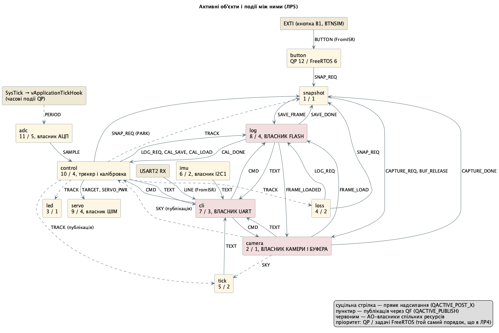

| AO | QP / FreeRTOS пріоритет | Черга | Стек, Б (зарезервовано / використано, S3) | CPU у S3 | Що робить | Чому такий пріоритет (PRD) |
|---|---|---|---|---|---|---|
| `button` | 12 / 6 | 8 | 512 / 192 | < 0,1 % | реакція на B1, запит знімка | реакція на подію ≤ 50 мс — найжорсткіша вимога |
| `adc` | 11 / 5 | 4 | 512 / 208 | 1,9 % | власник АЦП, квадрант кожні 10 мс | FR-01: період 10 мс без пропусків |
| `control` | 10 / 4 | 16 | 1280 / 620 | 0,6 % | трекер, режими, калібровка | FR-02…06: рішення за свіжим виміром |
| `servo` | 9 / 4 | 8 | 512 / 192 | 0,3 % | власник ШІМ, крок 20 мс | FR-03, 04: плавний рух |
| `cli` | 8 / 3 | 32 | 1536 / 908 | 17,9–18,5 % | **власник UART**: команди і весь вивід | FR-09: відповідь ≤ 100 мс |
| `log` | 7 / 2 | 16 | 1280 / 640 | 12,4–13,1 % | **власник SPI-flash**: журнал, кадри, калібровка | вищий за тих, хто чекає його відповіді (snapshot, camera), але не вищий за cli та imu (проблема 35) |
| `imu` | 6 / 2 | 8 | 1024 / 372 | 0,7 % | власник I²C1, MPU-6050 кожні 100 мс | FR-17: I²C може чекати тайм-аут |
| `tick` | 5 / 2 | 32 | 1280 / 600 | < 0,1 % | рядок стану раз на секунду | FR-18, лише діагностика |
| `loss` | 4 / 2 | 32 | 768 / 236 | < 0,1 % | втрата сигналу | FR-14: процес 2 с |
| `led` | 3 / 1 | 32 | 512 / 172 | < 0,1 % | індикація режиму | FR-10, без вимог до часу |
| `camera` | 2 / 1 | 8 | 1280 / 364 | 22,0–25,7 % | **власник камери і буфера кадру** | FR-11, 12, 16: кадр 0,4–1,4 с — довга операція |
| `snapshot` | 1 / 1 | 32 | 768 / 268 | < 0,1 % | операція «знімок у flash» (лише події) | FR-11, 14, 15: поступається всім |
| IDLE | — / 0 | — | 512 / 48 | 38,6–43,3 % | простій | — |

QP вимагає унікальний пріоритет кожного AO, а FreeRTOS дозволяє однакові. Тому QP-пріоритети 1…12, а пріоритет задачі FreeRTOS задано явно (`QF_prioSpec(qp, os)`) таким самим, як у ЛР4: різниця в метриках тоді показує модель AO, а не інший розподіл пріоритетів.

Повна таблиця подій (сигнал, хто надсилає, кому, як, параметри) — `docs/qp-design.md`, розділ 2. Коротко: з переривань приходять `BUTTON` і `LINE` (`QACTIVE_POST_X_FROM_ISR` із запасом); періоди — одноразові часові події `PERIOD`, які AO перезапускає на наступний ідеальний тік; `adc` → `control` — `SAMPLE`; `control` публікує `TRACK` (10 Гц), `camera` — `SKY`; знімок — ланцюжок запит–відповідь `SNAP_REQ` → `CAPTURE_REQ`/`CAPTURE_DONE` → `SAVE_FRAME`/`SAVE_DONE` → `BUF_RELEASE`; записи журналу — `LOG_REQ`; рядки для UART — `TEXT`; команди CLI до власників даних — `CMD`.

**Пули подій** (за зростанням розміру, як вимагає QP): малі 64 × 28 Б, середні 24 × 60 Б, рядки 32 × 144 Б. Черги підписників `TRACK` (32) більші за пул, з якого беруться ці події (24), тому публікація не може їх переповнити.

**Переривання і QP.** QP викликають лише три ISR: EXTI кнопки (`BUTTON`), USART2 RX (`LINE`, рядок збирається в ISR) і SysTick через хук тіку (`QTIMEEVT_TICK_FROM_ISR`). Їх пріоритет NVIC 6 при `configMAX_SYSCALL_INTERRUPT_PRIORITY` 5, група NVIC 4 — як у ЛР4.

## 5. Заміна механізмів ЛР4

| ЛР4 | ЛР5 |
|---|---|
| 12 задач з нескінченним циклом | 12 AO; цикл задачі — у порті QP, застосунок пише лише обробники станів |
| `vTaskDelayUntil` | одноразова `QTimeEvt`, перезапуск на наступний ідеальний тік (`ao_period`) |
| м'ютекс `flash_mx` | AO `log` — єдиний власник flash (`LOG_REQ`, `SAVE_FRAME`, `CAL_*`, `FRAME_LOAD`) |
| м'ютекс `frame_mx` | AO `camera` — власник буфера; буфер позичається і повертається подією `BUF_RELEASE` |
| м'ютекс `print_mx` | AO `cli` — єдиний власник UART; інші надсилають `TEXT` |
| черга `q_log` | подія `LOG_REQ` + кільце записів у `log` |
| черга `q_btn` з ISR | `BUTTON` з ISR |
| stream buffer `sb_rx` | рядок збирається в ISR, у `cli` йде `LINE` |
| сповіщення `snapshot` | подія `SNAP_REQ` (статична) |
| спільні `trk`, `q`, `sky`, `servos_on` | поля AO; копії — подіями `SAMPLE`, `TRACK`, `SKY`, `TARGET` |
| `vTaskDelay(1)` в опитуванні flash | стан `busy` і часова подія `POLL` (1 мс) |
| змінні режиму і прапорці | явні стани (розділ 7) |

Повна таблиця з файлами — `docs/qp-design.md`, розділ 3.

## 6. AO-власники ресурсів і перевірка п. 4.4

**Flash — `log`.** Клієнти: `control` (зміни режиму, калібровка), `loss` (втрата сигналу), `snapshot` (кадри), `cli` (`LOG`, `FRAMES`). Протокол: запит — подія з параметрами, відповідь — подія тому, хто чекає (`SAVE_DONE`, `CAL_DONE`, `FRAME_LOADED`); записи журналу відповіді не чекають. Робота: одна коротка операція flash на крок (стирання сектора або до 64 Б у межах сторінки), далі `POLL` кожну 1 мс перевіряє BUSY; записи журналу вклинюються між кроками кадру; великі запити під час роботи відкладаються (`QActive_defer`, 6 місць). Пріоритет 2 — вище за тих, хто чекає відповіді (`snapshot`, `camera`, пріоритет 1); вище не ставили, бо кроки опитувального SPI забирали процесор у `cli` та `imu` (проблема 35, виміряно обидва варіанти). Збій: три помилки поспіль → стан `fault`, усі запити одразу отримують відповідь з помилкою, раз на секунду перевірка JEDEC ID, після відповіді — назад у роботу (перевірено, розділ 9.10).

**Буфер кадру і камера — `camera`.** Клієнти: `snapshot`, `cli` (`FRAMES n`). Буфер не копіюється: `camera` позичає його (стан `lent`) і не пише в нього, доки не отримає `BUF_RELEASE` або `FRAME_LOADED`. Якщо буфер зайнятий, `CAPTURE_REQ` одразу отримує відповідь з помилкою. Періодичний кадр неба в `lent` пропускається і рахується в `missed`.

**UART — `cli`.** Друкує лише `cli`; обгортка `printf` рахує виклики з інших задач (`g_print_foreign`) — 0 у всіх прогонах.

**I²C1 (`imu`), АЦП (`adc`), ШІМ (`servo`)** — по одному користувачу, окремий протокол не потрібен.

**Перевірка п. 4.4.**

```
grep -rnE 'xSemaphore|xQueue|vTaskDelay|TaskNotify|EventGroup|xTimer' firmware/App --include='*.c' --exclude=bsp.c --exclude=main.c
grep -rn 'HAL_Delay' firmware/App
```

Обидві команди нічого не знаходять. Те саме правило перевіряє `scripts/check_deps.py` при кожній збірці в CI. У прикладному шарі: м'ютексів і семафорів 0, спільних змінних між AO 0 (крім вимірювальних лічильників).

**Винятки** (`docs/qp-design.md`, розділ 6): захоплення кадру — один довгий крок 0,4–1,4 с (OV7670 віддає рядки безперервно, і їх не можна читати між іншими подіями), тому `camera` має найнижчий пріоритет; друк `cli` чекає UART (драйвер з ЛР3 не міняли); службові команди `CAM EXP`, `LOG ERASE`, самоперевірки ЛР2; сценарії `TEST` навмисно порушують модель, але лише через функції `Core`, а не викликами FreeRTOS у файлах AO.

## 7. Діаграми станів

Джерела — `docs/statecharts/*.puml`, рисунки — `*.png`. `python3 tools/check_statecharts.py` перевіряє, що кожен стан на діаграмі є функцією-обробником, а кожен сигнал, який обробляє AO, є на його діаграмі: «Statecharts match code: 5 machines with states + 7 flat AO, 28 signals». Скрипт ми перевірили, навмисно видаливши стан із діаграми — він помилку знайшов. Разом 26 станів і 25 переходів (+12 початкових).

**`log` — власник flash** (ієрархія `serving { idle, working { busy, reading } }`, `fault`):

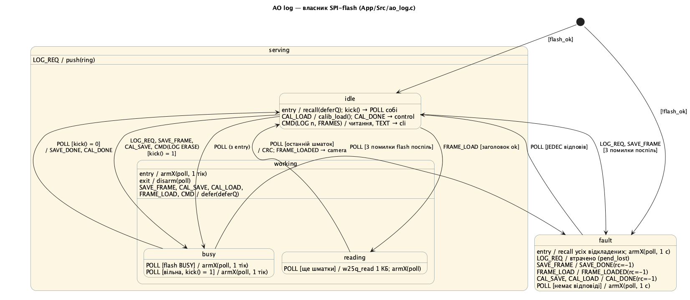

Суперстан `serving` обробляє `LOG_REQ` (кладе запис у кільце) для всіх вкладених станів — без нього ця обробка повторювалась би в `idle`, `busy` і `reading`. Суперстан `working` один раз описує відкладення `SAVE_FRAME`, `CAL_*`, `FRAME_LOAD`, `CMD` для `busy` і `reading`; при вході в `idle` вони повертаються.

**`snapshot`** (`idle`, `busy { capturing, saving }`): таймаут операції `OP_TIMEOUT` запускається в entry `busy` і зупиняється в exit, тож він діє на обидва вкладені стани. Запізнілі `CAPTURE_DONE` і `SAVE_DONE` в `idle` явно обробляються: буфер повертається камері, нічого не вважається кінцем знімка.

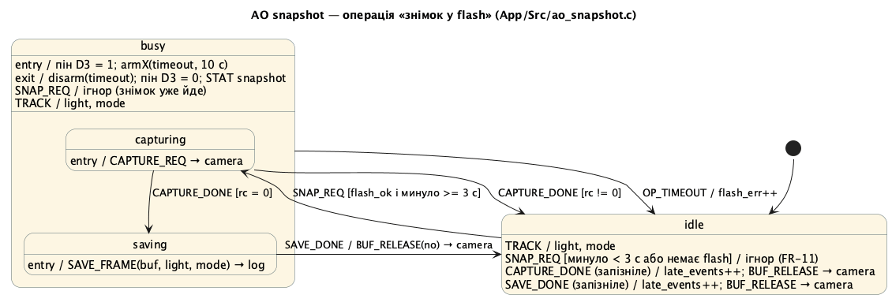

**`camera`** (`ready { free, lent }`), **`servo`** (`powered { off, on }`), **`imu`** (`polling { ok, fault }`):

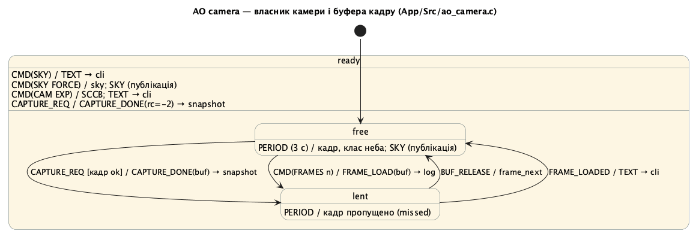

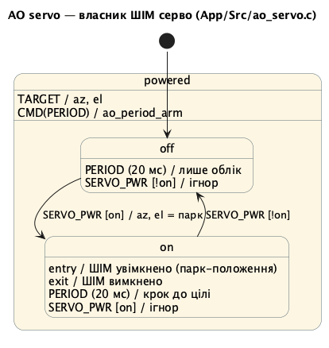

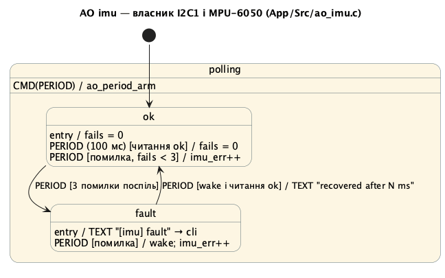

**Плоскі AO** (`button`, `adc`, `control`, `cli`, `tick`, `loss`, `led`) — один стан, перелік подій і ігнорованих подій:

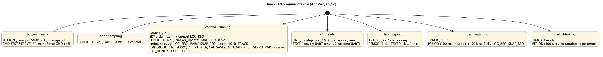

## 8. Діаграма послідовності S3 і логічний аналізатор

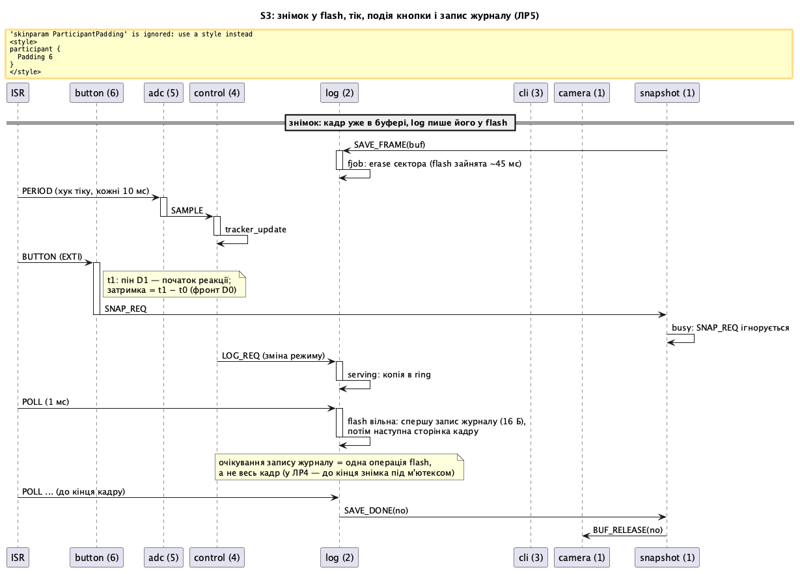

На діаграмі: `log` пише кадр кроками; приходить подія кнопки — `button` (6) одразу витісняє `log` (2), реагує і надсилає `SNAP_REQ`; тік будить `adc` (5) і `control` (4), які теж витісняють `log`; потім `log` продовжує запис з того самого кроку.

Підтвердження аналізатором (D0 — B1, D1 — PB3 початок реакції `button`, D2 — PB5 кадр, D3 — PB6 знімок; 1 МГц; студент натискав B1 раз на секунду в S3, `docs/captures/lab5_button_latency.sr`):

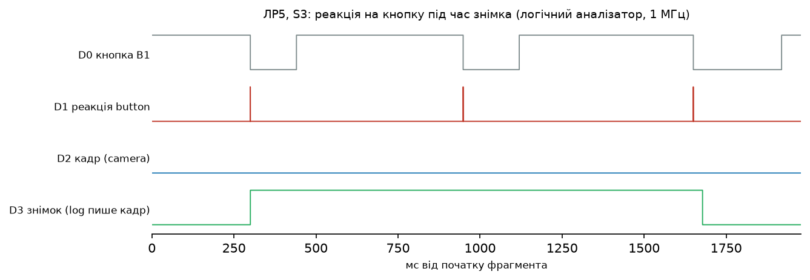

Реакція (D1) з'являється посеред знімка (D3). За 75 с: 164 натискання, 149 реакцій, затримка від натискання медіана 19 мкс, max 873 мкс (p99 607 мкс); 73 реакції припали на знімок, 7 — на кадр. У ЛР3 на такому самому записі жодна реакція не потрапила всередину кадру чи знімка (медіана 343 мс, max 2346 мс), у ЛР4 — 84 і 37 (max 0,88 мс). Деталі — `docs/comparison.md`, розділ 6.

## 9. Вимірювання

### 9.1 Методика

Ті самі сценарії, команди і тривалість, що в ЛР3–ЛР4 (`tools/measure_all.py --fw lr3|lr4|lr5`), по 60 с, S2 і S3 по три повтори, подія кнопки — таймер `BTNSIM 700`. Час міряє прошивка (DWT), хост лише збирає рядки. Нове в ЛР5: `QSTAT` (найбільше заповнення черг, найменше вільних блоків пулів, втрачені події), `flash_wait` (від надсилання `LOG_REQ` до кінця запису у flash) і `late_events` (запізнілі відповіді у сценарії SNAPTO). `QActive_getQueueMin()` у порті FreeRTOS не працює (повертає 0, бо черга — це черга FreeRTOS), тому заповнення черг рахуємо самі: макрос `traceQUEUE_RECEIVE` у `FreeRTOSConfig.h` перед кожним читанням з черги AO записує, скільки в ній повідомлень (`meas_queue_rx`).

### 9.2 Фінальна таблиця (головні рядки)

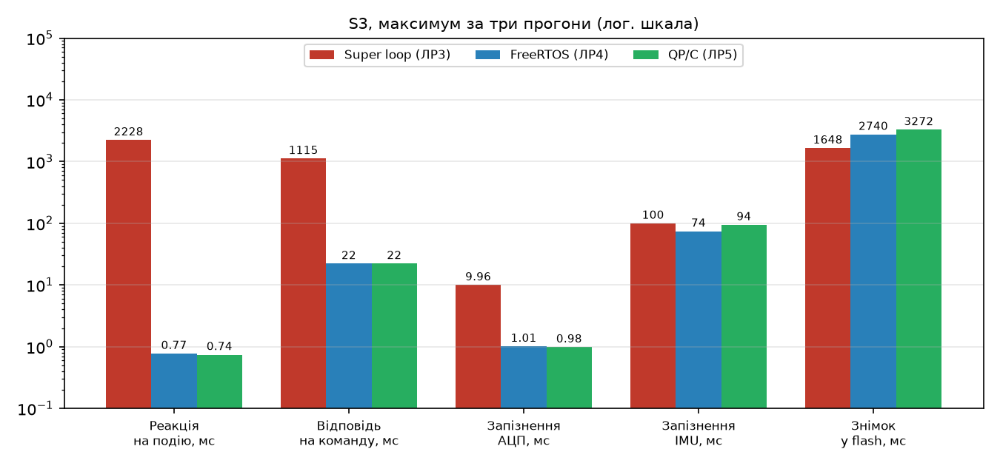

Повна таблиця (п. 9.4) з інструментом і логами кожного рядка — `docs/comparison.md`, розділ 2. S3, максимум за три повтори:

| Метрика | ЛР3 | ЛР4 | ЛР5 | Вимога | Кращий |
|---|---|---|---|---|---|
| Реакція на подію кнопки | 2228,4 мс | 0,772 мс | 0,741 мс | ≤ 50 мс | FreeRTOS ≈ QP/C |
| Подій кнопки втрачено | 90 | 0 | 0 | 0 | FreeRTOS, QP/C |
| Запізнення АЦП / пропущено за 60 с | 9,96 мс / 6078 | 1,01 мс / 0 | 0,985 мс / 0 | ≤ 2 мс / 0 | FreeRTOS ≈ QP/C |
| Запізнення IMU / пропущено | 99,6 мс / 560 | 74,0 мс / 5 | 94,1 мс / 5 | ≤ 2 мс / 0 | жоден |
| Відповідь на команду | 1114,7 мс | 22,1 мс | 22,1 мс | ≤ 100 мс | FreeRTOS ≈ QP/C |
| Очікування flash при записі кожні 50 мс | — | 956,8 мс (м'ютекс) | 71,8 мс | — | QP/C |
| Втрачені байти UART | 136 | 271 | 182 | 0 | жоден |
| Знімок у flash | 1648 мс | 2740 мс | 3272 мс | — | super loop |
| CPU, S2 / S3 | 25 / 82 % | 26 / 73 % | 26 / 63 % | — | ≈ / QP/C |
| Flash / RAM статично | 49,2 / 25,6 КБ | 68,7 / 63,0 КБ | 76,7 / 63,9 КБ | 512 / 128 КБ | super loop |
| Старт до `ready` | 711–715 мс | 715–717 мс | 710–716 мс | — | ≈ |
| Рядків оркестрації | 516 | 848 | 1697 | — | super loop |
| М'ютексів / спільних змінних | 0 / 5 | 3 / 7 | 0 / 0 | — | QP/C |

Різниця: реакція ЛР3 → ЛР5 −2227,7 мс (у ≈ 3000 разів), ЛР4 → ЛР5 у межах розкиду; відповідь на команду ЛР3 → ЛР5 у 50 разів; очікування flash м'ютекс → власник −885 мс (у 13 разів); знімок ЛР4 → ЛР5 +532 мс (+19 %).

### 9.3 Завантаження за AO

`TASKS`, S3, три прогони: `camera` 22,0–25,7 %, `cli` 17,9–18,5 %, `log` 12,4–13,1 %, `adc` 1,8–1,9 %, `imu` 0,7 %, `control` 0,6 %, `servo` 0,3 %, решта < 0,1 %, IDLE 38,6–43,3 %. Порівняно з ЛР4: там знімок у flash писала задача `snapshot` і займала 26,9 %, тепер ту саму роботу робить `log` за 12–13 %, а `snapshot` лише керує подіями. У S2 (без знімків і потоку команд) IDLE 73,9 %.

Накладні витрати: хук тіку в ЛР5 — 598 тактів у середньому кожну мілісекунду (≈ 0,6 % CPU) проти 184 у ЛР4: у ньому QP перебирає свої часові події. Перемикання контексту і вибір задачі — ті самі, що в ЛР4.

### 9.4 Стеки, черги, пули, пам'ять

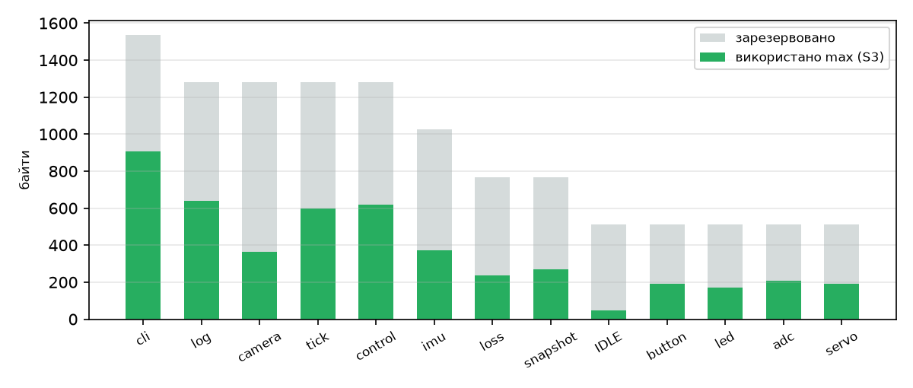

* **Стеки** (`STACK`, S3): зарезервовано 11 776 Б (12 AO + IDLE), використано max 4 820 Б. Найменший запас — `led` і `servo` (71 слово з 128 за годину, 55 %), `adc` (76 з 128). У `cli` вільно 157 слів з 384 (41 %; у ЛР4 — 26 %). Після S3 і за годину вільно не менше 41 % стека в кожного AO; `tick` з 96 словами переповнюється на старті (розділ 9.6).
* **Черги** (`QSTAT`): 228 місць у 12 чергах; у S3 найбільше заповнення 5 (`tick`, `loss`, `led`, `snapshot` — підписники `TRACK`), `log` 2 / 16, `cli` 2 / 32. За годину — те саме, втрат 0.
* **Пули**: S3 найменше вільних 60 / 64, 19 / 24, 31 / 32. Найбільше одночасно існуючих динамічних подій — у сценаріях, де AO нижчого пріоритету довго не отримують процесор: тоді події `TRACK` накопичуються в їхніх чергах (пул 2 — до 14 зайнятих у `onestep` і `flashfail`, до 22 у потоці команд `qflood`).
* **Пам'ять** (`arm-none-eabi-size`): flash 76 720 Б (+8,0 КБ до ЛР4; з них код QP/C ≈ 7,6 КБ), RAM статично 63 904 Б (+0,9 КБ). Склад RAM змінився: heap FreeRTOS 24 КБ → 1 КБ, натомість статичні стеки 11,3 КБ, черги 0,9 КБ, пули 7,8 КБ, буфер кадру 19,2 КБ (як і раніше), діагностика (хронологія, облік) ≈ 13 КБ. Деталі — `docs/qp-design.md`, розділ 7, `docs/metrics/memory_lr5.txt`.

### 9.5 Очікування ресурсу

Очікування запису журналу (`flash_wait`) у S3: середнє 2–3 мс, max 14,0 / 62,0 / 23,8 мс у трьох прогонах; за годину — середнє 2,3 мс, max 202,8 мс (один раз). Від чого залежить: запис чекає поточну операцію flash, яку `log` уже запустив (крок 64 Б ≈ 1,3 мс або стирання сектора — найдовша частина, кілька десятків мс), плюс час, коли `log` витісняють AO вищого пріоритету; найдовше з них — `cli`, що друкує `STATS` 0,3 с. Що саме дало 202,8 мс, ми окремо не з'ясували. Порівняння з м'ютексом — розділ 9.6.

### 9.6 Сценарії п. 9.2 і 9.3

Повні таблиці — `docs/comparison.md`, розділ 4; логи `docs/metrics/lr5_auto_*`, `lr5mx_auto_*`, `lr5_*`.

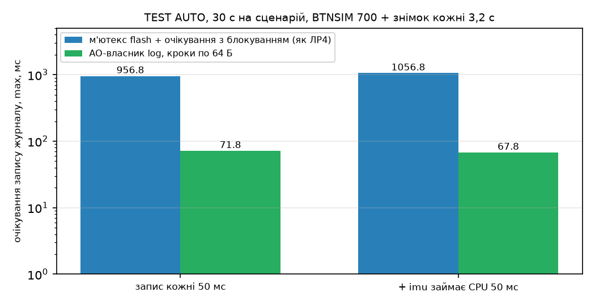

| Сценарій | Що зробили | Результат |
|---|---|---|
| Інверсія пріоритетів / м'ютекс проти власника (9.2, 9.3.1) | збірка `-DLR5_FLASH_MUTEX` (кадр пише snapshot під м'ютексом, як ЛР4), запис журналу кожні 50 мс, окремо + imu займає CPU 50 мс кожні 100 мс | очікування запису 956,8 / 1056,8 мс з м'ютексом проти 71,8 / 67,8 мс з власником; з м'ютексом черга `log` 14 / 16 і 41 / 7 втрачених записів, з власником 2 / 16 і 0; у звичайному S3 різниця мала (відповідь 18,1 мс, imu 4 пропуски) |
| Пріоритет власника (п. 5.8) | `-DLOG_OWNER_HIGH`: `log` на пріоритеті 4 | S3: відповідь 74,7 мс, imu 58 пропусків проти 22,1 мс і 5 (проблема 35) |
| Блокування в обробнику (9.3.2) | `TEST BLOCK 1`: `while (busy) vTaskDelay(1)` в обробнику `log`; `TEST OWNER 5`: 5 мс роботи в кожному кроці | крок `log` 20,5 → 67,8 мс, очікування запису 72 → 126 мс; adc, imu, кнопка без змін; з `OWNER 5` знімок до 5,5 с, camera пропустила 7 кадрів |
| Довгий RTC-крок (9.3.3) | `TEST ONESTEP 1`: кадр одним кроком; `TEST CTRL 30`: 30 мс у `control` на кожен 10-й `SAMPLE` | `ONESTEP`: крок 1258 мс, очікування запису 1254 мс, черга `log` 14 / 16, 112 записів втрачено; `CTRL 30`: `control` пропустив 600 з 3003 періодів, CPU 97 %; реакція на кнопку в обох ≤ 0,18 мс |
| Переповнення черги (9.2, 9.3.4) | 50 рядків команд без пауз; окремо збірка без запасу в черзі (`-DLR5_RX_NO_MARGIN`) | 31 відповідь з 50, черга `cli` 29 / 32, 18 рядків відкинуто з лічильником, бо скінчився пул 2 (2 / 24); без запасу — те саме, `Q_onError` немає: межа — пул |
| Вичерпання пулу (9.2, 9.3.5) | `TEST POOL`: `Q_NEW` без повернення | `FATAL Q_onError qf_dyn 630`, перезапуск |
| Переповнення стека (9.2) | стек `tick` 96 слів | `FATAL stack overflow in tick` на старті, перезапуск |
| Голодування (9.2) | `TEST STARVE 1500`: `button` 1,5 с шле подію собі | `adc` і `control` по 149 пропусків, `servo` 74, `imu` 19 — як у ЛР4 (149) |
| Частота тіку (9.2) | 200 Гц, `BSP_TICKS_PER_SEC` 200 | джитер АЦП той самий (1,0 мс), реакція 0,14 мс, хук тіку 1194 такти раз на 5 мс; `POLL` раз на 5 мс — очікування запису 8 мс у середньому, знімків за 60 с 5 замість 19–20; лишили 1000 Гц |
| Неочікувана подія (9.3.6) | `TEST SNAPTO 1000` (таймаут коротший за знімок) | 4 таймаути, 4 запізнілі відповіді в `idle` відкинуто (буфер повернуто), жоден не прийнято за кінець наступного знімка |
| Відмова сенсора (9.3.7) | MPU-6050 від'єднали в S2 | `fault` після 3 помилок (300 мс), невдале читання 0,33 мс, adc і control без пропусків; після підключення — «recovered after 14 111 ms» (стільки `imu` пробув у `fault`) |
| Збій шини (9.3.8) | `TEST FLASHFAIL 1` на 3 с | `log` → `fault`, 31 запис одразу відхилено з помилкою, ніхто не завис; після вимкнення збою — «flash recovered» |

### 9.7 Точка зламу, година, обрив живлення

* **Точка зламу.** АЦП 10 → 1 мс: ЛР5 0 пропусків до 2 мс, на 1 мс — 3 з 12 202 (ЛР4 — 0, ЛР3 — 2857; проблема 40). Камера 3000 → 1000 мс: 0 пропусків АЦП (ЛР3 — до 2986).
* **Година** (`lr5_long1h_*.log`): 0 перезапусків, АЦП 364 431 запуск, 0 пропусків, запізнення max 1,02 мс; 1215 кадрів, `cam_err` 0, `flash_err` 0; пули і черги не ростуть, втрат подій 0; IMU 50 пропусків (друк `STATS`, як у ЛР4 — 43).
* **Обрив живлення** (`lr5_powerloss.txt`): журнал відкрився без помилок, останні 16 записів підряд, CRC 20 з 20 кадрів, калібровка ціла — як у ЛР3 і ЛР4.

## 10. Статус вимог PRD для трьох підходів

Вердикт за максимумом у найгіршому сценарії.

| FR | Вимога (скорочено) | ЛР3 | ЛР4 | ЛР5 | Доказ ЛР5 |
|---|---|---|---|---|---|
| FR-01 | АЦП ≥ 100 Гц | **не виконана**: 6078 пропусків за 60 с у S3 | виконана: 0 | виконана: 0 в S1–S3, 0 за годину; на періоді 1 мс — 3 пропуски | `lr5_s3*`, `lr5_long1h_*` |
| FR-02…06, 13 | трекер, межі, PARK, OVERCAST | виконані | виконані | виконані (ті самі модулі `tracker.c`, хостові тести; з лампою — режими TRACK / OVERCAST у рядку `tick`) | `tests/`, `lr5_long1h_*` |
| FR-07 | журнал у W25Q64 | виконана | виконана | виконана: `pend_lost` 0 у S1–S3; при збої шини записи відхиляються з лічильником | `lr5_s3*`, `lr5_auto_flashfail_*` |
| FR-08 | журнал переживає вимкнення | виконана | виконана | виконана | `lr5_powerloss.txt` |
| FR-09 | CLI, відповідь ≤ 100 мс | **не виконана**: 1115 мс у S3 | виконана: 22,1 мс; байти губляться | виконана: 22,1 мс; байти губляться (182 за три S3) | `lr5_s3*` |
| FR-10 | LED за режимом | виконана | виконана | виконана (AO `led`, той самий код) | візуально |
| FR-11 | кадр не частіше 1 за 3 с | виконана | виконана | виконана (перевірка в `snapshot.idle`) | `ao_snapshot.c` |
| FR-12 | клас неба ≤ 10 с | виконана | виконана | виконана (`SKY` кожні 3 с) | рядок `tick` |
| FR-14, 15 | втрата сигналу, кільце 20 кадрів | виконані | виконані | виконані: кадри читаються з flash, CRC 20 з 20 | `lr5_powerloss.txt` |
| FR-17 | нахил з MPU-6050 | з обмеженням (запізнення 99,6 мс) | з обмеженням (74 мс, 5 пропусків) | з обмеженням (94 мс, 5 пропусків); відмова датчика — явний `fault` з відновленням | `lr5_s3*`, `lr5_fail_imu_*` |
| FR-18 | лог 115200 | виконана | виконана | виконана | рядок `tick` |
| — | реакція на подію ≤ 50 мс | **не виконана**: 2228 мс | виконана: 0,77 мс | виконана: 0,74 мс; аналізатор max 0,87 мс | `lr5_s3*`, `lab5_button_latency.sr` |

## 11. Перевірка висновків ЛР4

Повна версія у форматі методички (що було, механізм QP/C, результат, вердикт, ціна) — `docs/comparison.md`, розділ 9.

| Висновок ЛР4 | Механізм QP/C | ЛР4 → ЛР5 | Вердикт |
|---|---|---|---|
| Інверсія на flash, запис журналу чекає весь кадр | AO-власник, кроки по 64 Б | 956,8 → 71,8 мс (м'ютекс → власник, запис кожні 50 мс) | зникла |
| `imu` голодує, поки `cli` друкує | — (драйвер UART той самий) | 5 → 5 пропусків, 74 → 94 мс | не змінилась |
| Тайм-аут HAL при витісненні (flash, камера) | короткі кроки flash і `POLL` | `flash_err` 0 → 0; `cam_err` 1 → 1 | для flash зникла (без збільшення тайм-ауту), для камери не змінилась |
| Неатомарний друк, спільні змінні | власник UART `cli`, дані в полях AO | 3 м'ютекси і 7 спільних змінних → 0 і 0 | зникла |
| Нова задача — правки в кількох місцях | — | 5 → 5 | не змінилась |
| Нові класи помилок ОС | — | ті самі + переповнення черги часовими подіями, вичерпання пулу, пастка старту (проблеми 34, 37) | з'явились нові |

Реєстр обмежень ЛР3: реакцію під час довгої операції і пропуски АЦП розв'язала FreeRTOS (ЛР5 зберегла); модель AO додатково розв'язала очікування спільного ресурсу і спільні змінні; втрату байтів UART і джитер IMU не розв'язав жоден підхід — обидва від драйвера UART з ЛР3, який за умовами роботи однаковий у трьох прошивках.

## 12. Проблеми та їх вирішення

Повний журнал — `docs/problems.md`, проблеми 34–40 (формат: симптом → причина → рішення → коміт). Специфічні для QP/C: 34, 35, 37, 40.

#### Проблема 34: `Q_onError qf_port 630` після команди `FRAMES n` (QP/C)
Хук тіку накопичував події `PERIOD` у черзі `imu`, поки `log` 0,4 с читав кадр одним кроком; черга переповнилась при надсиланні з ISR без запасу. Рішення: одноразові часові події з перезапуском (у черзі не більше однієї `PERIOD`), читання кадру шматками по 1 КБ, черги підписників `TRACK` більші за пул. Коміт `34ecace`.

#### Проблема 35: власник flash з високим пріоритетом забирав процесор у `cli` та `imu` (QP/C)
За порадою «власник вище за клієнтів» `log` мав пріоритет 4; опитувальний SPI робив кожен крок роботою процесора, і в S3 відповідь на команду доходила до 193 мс, imu пропускав 84 періоди. Рішення: кроки по 64 Б і пріоритет 2 (вище за тих, хто чекає відповіді); відповідь 17–22 мс, imu 5 пропусків; обидва варіанти виміряно. Коміти `3f59dfe`, `415eb87`.

#### Проблема 36: ST-Link перестає приймати команди
macOS пише службовий файл `._lr5.bin` на диск ST-Link після кожної прошивки; зв'язок «комп'ютер → плата» іноді зависав і посеред сценаріїв. Рішення частково: перевірка відповіді плати після прошивки, `TEST AUTO`, у якому прошивка проганяє сценарії сама. Не вирішено до кінця.

#### Проблема 37: зависання на старті в `HAL_Delay` після `QF_init` (QP/C на FreeRTOS)
До запуску планувальника критичні секції FreeRTOS лишають переривання вимкненими, SysTick не йде, і `HAL_Delay` драйвера flash чекає вічно. Рішення: усе читання flash на старті — у `Log_boot()` до `QF_init`. Коміт `34ecace`.

#### Проблема 38: журнал показує більше записів, ніж уміщує
Лічильник `valid` не зменшується при стиранні старого сектора (помилка з ЛР3). Самі записи цілі; не виправлено.

#### Проблема 39: сценарій голодування в `TEST AUTO` не показував пропусків `adc`
Статистика скидалась після запуску сценарію, а `button` витісняла `cli` одразу після надсилання події. Рішення: скидати до запуску; окремий прогін — 149 пропусків, як у ЛР4.

#### Проблема 40: на періоді 1 мс `adc` пропускає періоди (QP/C)
Перезапуск часової події «на наступний ідеальний тік» пропускає тік, якщо крок закінчився пізніше; `vTaskDelayUntil` у ЛР4 у такому разі запускає задачу із запізненням. На робочому періоді 10 мс пропусків немає; не змінювали.

## 13. Висновок

Для нашого продукту ми обрали б **QP/C поверх FreeRTOS**, але з умовою, яку показали виміри: власник ресурсу з опитувальним драйвером не можна ставити вище за всіх. Аргументи з фінальної таблиці:

1. Вимоги до реакції (≤ 50 мс), АЦП (FR-01) і відповіді на команду (FR-09) ЛР5 виконує так само, як ЛР4, із запасом: 0,74 мс, 0 пропусків, 22,1 мс. Super loop не виконує жодну з трьох (2228 мс, 6078 пропусків, 1115 мс).
2. Спільні ресурси: при частому записі журналу очікування flash 72 мс проти 957 мс з м'ютексом, втрат записів 0 проти 41. Наш продукт якраз пише журнал, кадри і калібровку в одну flash з кількох джерел.
3. Прикладний шар без м'ютексів і спільних змінних (3 і 7 у ЛР4), стани явні і перевіряються проти діаграм. Відмови сенсора і flash стали явними станами з відновленням, а не тайм-аутами в кожному циклі.
4. Ціна прийнятна: +8 КБ flash з 512, RAM майже як у ЛР4, хук тіку ≈ 0,6 % CPU; знімок довший на 0,5 с, але вимоги на його тривалість немає.

Чого QP/C сама по собі не дала: джитер IMU і прийом UART без втрат (вимоги не виконує жоден з трьох підходів — причина в драйвері UART, який за умовами роботи однаковий), а знімок став найдовшим із трьох.

**Коли вибір змінився б.**
* FreeRTOS без QP — якщо в продукті немає спільних ресурсів з довгими операціями (немає запису кадрів у ту саму flash, що журнал) або команда не знає моделі AO: реакція і періоди ті самі, коду вдвічі менше (848 проти 1697 рядків), поріг входу нижчий.
* Super loop — якщо лишаються лише короткі періодичні задачі без подій з дедлайном і без довгих операцій (АЦП, трекер, серво): RAM 26 КБ замість 64 КБ, 516 рядків, без ризиків стека і черг. Як тільки з'являється кадр 0,7 с або знімок 1,6 с і подія з дедлайном 50 мс, super loop вимогу не виконує.
* Якби був потрібен якнайкоротший знімок, а не реакція, — super loop (1,65 с проти 3,27 с).

## 14. Відповіді на контрольні питання

**1. Що таке активний об'єкт? Чим AO на FreeRTOS відрізняється від задачі ЛР4, якщо обидва в задачі з власним стеком?**
AO — об'єкт з власною чергою подій, власним потоком і машиною станів; ззовні з ним можна лише обмінюватися подіями, його дані ніхто інший не читає. Задача ЛР4 сама вирішує, де чекати: на черзі, м'ютексі, `vTaskDelay`, у будь-якому місці коду. AO чекає лише в одному місці — на своїй черзі в циклі порту QP, а обробник події виконується до кінця і повертається. Тому стан AO — це явний стан машини, а не місце в коді, де задача заблокувалась. У нас кожен AO — задача FreeRTOS з тим самим пріоритетом, що в ЛР4, тому витіснення і пріоритети ті самі.

**2. Що означає run-to-completion? Чому RTC не суперечить витісненню?**
RTC — подія обробляється повністю, перш ніж той самий AO візьме наступну; посеред обробки AO не перемикається на іншу свою подію і не бачить свій стан напівзміненим. Інший AO вищого пріоритету може витіснити його посеред кроку — це інша задача з іншими даними, і стану першого AO вона не торкається, бо даних спільних немає. На аналізаторі видно саме це: `button` реагує посеред запису кадру (73 реакції всередині знімка), а `log` після неї продовжує той самий крок.

**3. Чому обробник не повинен блокуватися, хоча FreeRTOS дозволяє `vTaskDelay`? Що показав сценарій 2?**
Поки обробник чекає, AO не бере нові події з черги, тобто для всіх клієнтів він «завис», хоча процесор вільний. `TEST BLOCK 1` (`while (busy) vTaskDelay(1)` в `log`): крок `log` виріс з 20,5 до 67,8 мс, очікування запису журналу — з 72 до 126 мс, бо запити стоять у черзі весь час стирання сектора. AO вищого пріоритету цього не відчули: блокування не займає процесор. FreeRTOS про модель AO нічого не знає, для неї це звичайна задача в `vTaskDelay`.

**4. Що замінило м'ютекс шини? Чому власник має бути вищим за клієнтів? Чи можлива інверсія?**
М'ютекс `flash_mx` замінив AO `log` — єдиний, хто працює з flash; клієнти надсилають запити. Власник має бути вищим за тих, хто **чекає** його відповіді: інакше клієнт чекає, поки власник отримає процесор від AO між ними — це та сама інверсія. У нас `log` (2) вищий за `snapshot` і `camera` (1). Вищим за `cli` та `imu` ми його не ставили: вони не чекають `log`, а опитувальний SPI забирав у них процесор (193 мс відповідь, 84 пропуски imu — проблема 35). Класична інверсія (високий чекає ресурс, захоплений низьким) неможлива: ресурс ніхто не захоплює. Але якщо поставити власника нижче за клієнта, що чекає, і між ними буде зайнятий AO, клієнт чекатиме і його.

**5. Від чого залежить найдовше очікування клієнта власника? Як виміряли, як порівнюється з м'ютексом?**
Від найдовшої операції, яку власник уже почав (у нас стирання сектора flash, десятки мс; крок запису 64 Б — 1,3 мс), черги запитів перед клієнтом і часу, коли власника витісняють AO вищого пріоритету. Міряли DWT від надсилання `LOG_REQ` (мітка в події) до кінця запису у flash (`flash_wait`). S3: max 62 мс; запис кожні 50 мс: 71,8 мс з власником проти 956,8 мс з м'ютексом — з м'ютексом чекали весь кадр.

**6. Що відбувається з подією, яку стан не обробляє? Приклад суперстану.**
QP передає її суперстану; якщо її не обробляє ніхто аж до `QHsm_top`, подія тихо відкидається. Приклад: у `log` суперстан `serving` обробляє `LOG_REQ` для `idle`, `busy` і `reading`, а `working` — відкладення великих запитів для `busy` і `reading`; без них той самий код був би у двох-трьох станах. У `snapshot` суперстан `busy` обробляє `OP_TIMEOUT` і `SNAP_REQ` для `capturing` і `saving`.

**7. У якому порядку QP виконує дію переходу, exit і entry? Чим відрізняється від UML?**
У QP дія переходу виконується в обробнику **до** того, як він поверне `Q_TRAN`, тобто до exit-дій вихідного стану; потім exit від вихідного стану до спільного предка, потім entry вниз до цільового. В UML порядок інший: спершу exit, потім дія переходу, потім entry. На практиці це означає, що в дії переходу не можна покладатися на те, що exit уже виконано (у нас, наприклад, таймер знімка зупиняється в exit `busy`, після дії переходу).

**8. Статична і динамічна подія. Коли динамічна повертається в пул? Чому після `QACTIVE_POST` її не можна читати?**
Статична — константна, без параметрів, не з пулу (у нас `SNAP_REQ`, `CAPTURE_REQ`). Динамічна береться з пулу `Q_NEW` і має лічильник посилань; QP повертає її в пул, коли всі отримувачі закінчили обробку (для публікації — після останнього підписника). Після `QACTIVE_POST` подія належить отримувачу: AO вищого пріоритету може обробити її і повернути в пул ще до того, як відправник виконає наступний рядок, і блок уже буде зайнятий іншою подією.

**9. `QACTIVE_POST` і `QACTIVE_POST_FROM_ISR`. Що буде, якщо викликати задачний варіант з переривання?**
`_FROM_ISR` використовує функції FreeRTOS `...FromISR` (не блокуються, повідомляють про потребу перемикання) і критичну секцію для переривань. Задачний варіант з ISR викличе критичну секцію задачі і функцію черги не з ISR — у кращому разі спрацює `configASSERT` (ядро перевіряє, що задачні API не кличуть з переривань), у гіршому зіпсує стан ядра. У нас з ISR кличемо лише `QACTIVE_POST_X_FROM_ISR` і `Q_NEW_X_FROM_ISR` (кнопка, USART2 RX) і `QTIMEEVT_TICK_FROM_ISR` (хук тіку).

**10. Як часові події QP пов'язані з тіком FreeRTOS? Роздільна здатність і похибка першого спрацювання? Чому запускати в entry і зупиняти в exit?**
Хук тіку FreeRTOS (`vApplicationTickHook`) викликає `QTIMEEVT_TICK_FROM_ISR`, тому роздільна здатність — тік: 1 мс при 1000 Гц, 5 мс при 200 Гц (`MS(1)` дає 5 мс). Перше спрацювання — від 0 до 1 тіку раніше заданого, бо поточний тік уже частково минув. Таймер, запущений в entry і зупинений в exit того самого стану, діє рівно поки AO в цьому стані: у `snapshot` таймаут `OP_TIMEOUT` запускається в entry `busy` і зупиняється в exit, тож не може спрацювати в `idle` після нормального кінця знімка.

**11. Коли `QACTIVE_POST`, а коли `QACTIVE_POST_X`? Що при нестачі місця?**
`QACTIVE_POST` (без запасу) — коли місце гарантоване і нестача означає помилку програми: QP викликає `Q_onError` (`qf_port 630` у проблемі 34). `QACTIVE_POST_X` із запасом — коли подію можна загубити: повертає false, і ми рахуємо втрату. У нас: з ISR (`BUTTON`, `LINE`) — `_X` із запасом 1; `LOG_REQ`, `TEXT` — запас 2; запити до власників — запас 1; відповіді власників — `_X` із запасом 0 (якщо черга клієнта повна, відповідь губиться з лічильником, а не аварія). `QACTIVE_POST` без запасу — лише коли AO надсилає подію сам собі (`POLL` у `log`, сценарій голодування).

**12. Навіщо відкладати події? Що буде, якщо черга відкладених заповниться?**
Щоб не відкидати запит, який AO зараз не може виконати, і не ускладнювати стан: `log` у `working` відкладає `SAVE_FRAME`, `CAL_*`, `FRAME_LOAD` і повертає їх при вході в `idle`. Якщо черга відкладених (у нас 6 місць) повна, `QActive_defer` повертає false; тоді `log` одразу відповідає клієнту помилкою (`SAVE_DONE`, `FRAME_LOADED` або `CAL_DONE` з кодом −1), щоб ніхто не чекав вічно, і рахує втрату. У вимірах черга відкладених не заповнювалась (`DEFER log max_used=0`).

**13. Чому `QActive_getQueueMin()` не працює в порті FreeRTOS і як виміряли заповненість?**
У порті FreeRTOS черга AO — це черга FreeRTOS, і QP не веде для неї мінімум вільних місць; функція повертає 0. Ми додали в `FreeRTOSConfig.h` макрос `traceQUEUE_RECEIVE`, який перед кожним читанням з черги записує кількість повідомлень у ній, і по дескриптору черги знаходимо AO (`meas_queue_rx`, рядки `QUEUE ... max_used` у `QSTAT`).

**14. Які переривання викликають QP? NVIC і чому?**
EXTI15_10 (кнопка B1 і програмна подія `BTNSIM`), USART2 (рядок команди), SysTick (через хук тіку — часові події). Їх пріоритет 6 при `configMAX_SYSCALL_INTERRUPT_PRIORITY` 5: лише переривання з пріоритетом, числово не меншим за межу, можуть кликати API ядра і QP; група NVIC 4 (усі біти — на пріоритет витіснення). PendSV і SysTick — 15, як вимагає порт.

**15. Для якого продукту обрали б кожен підхід?**
Super loop — лише короткі періодичні задачі без подій з дедлайном і довгих операцій (RAM 26 КБ, 516 рядків; але вже з кадром 0,7 с реакція 2228 мс). FreeRTOS — події з дедлайном і довгі операції без спільних ресурсів між ними (реакція 0,77 мс, 848 рядків). QP/C на FreeRTOS — те саме плюс кілька джерел, що ділять повільний ресурс (запис flash: 72 мс проти 957 мс), і потреба в явних станах і відмовах (`fault` з відновленням), ціною +8 КБ flash і вдвічі більшого коду.

## 15. Матеріали та посилання

* Репозиторій: `https://github.com/Ripper-del/heliostat-sky-cam`, тег `lab5` (ЛР5), `lab4`, `lab3`; прошивка ЛР3 для порівняння — гілка `lab3-measure`
* Дизайн AO, події, власники, пам'ять: `docs/qp-design.md`; діаграми: `docs/statecharts/`; порівняння трьох підходів: `docs/comparison.md`; журнал проблем: `docs/problems.md`
* Логи: `docs/metrics/lr3_*`, `lr4_*`, `lr5_*` (матриця 24.11, одне світло), `lr5_auto_*` і `lr5mx_auto_*` (сценарії), `lr5_long1h_*`, `lr5_powerloss.txt`; попередні версії ЛР5 — `docs/metrics/lr5_v1/`, `lr5_v2/`
* Запис аналізатора: `docs/captures/lab5_button_latency.sr`
* Рисунки: `docs/lab_5/img/`; скрипти: `tools/measure_all.py`, `tools/compare_all.py`, `tools/lr5_auto.py`, `tools/make_figures_lr5.py`, `tools/check_statecharts.py`, `scripts/check_deps.py`
* Ліцензія QP/C — GPLv3 (навчальна робота)

## 16. Відеозвіт (3–4 хв)

Посилання на відео: _буде додано_
