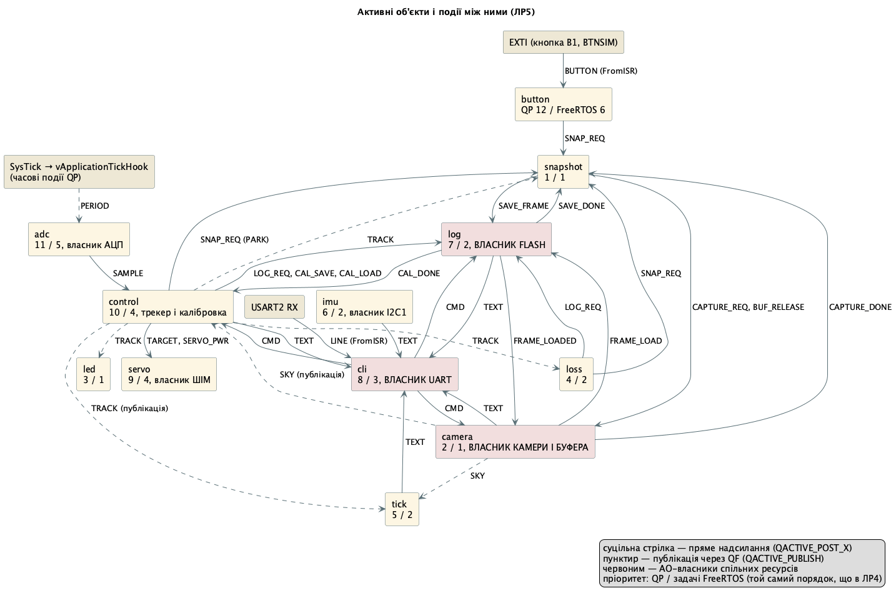

# ЛР5: продукт на QP/C поверх FreeRTOS — активні об'єкти, події, ресурси

Ядро — той самий FreeRTOS V11.1.0, що в ЛР4 (тік 1000 Гц, витіснення, ті самі пріоритети переривань). Поверх нього QP/C 8.1.6 (submodule `firmware/Middlewares/qpc`, тег `v8.1.6`) з портом `ports/freertos`. Вбудовані ядра QP (QV, QK, QXK) не підключені. Кожна задача ЛР4 стала активним об'єктом (AO) з тим самим ім'ям: рядки `STAT name=...` у логах ті самі, тому `tools/` працюють без змін.

Ліцензія QP/C — GPLv3 (навчальна робота); для закритого продукту потрібна комерційна ліцензія Quantum Leaps.

## 1. Активні об'єкти і пріоритети

| AO | QP-пріоритет | Пріоритет задачі FreeRTOS (як у ЛР4) | Черга | Стек, слів | Що робить | Чому такий пріоритет (PRD) |
|---|---|---|---|---|---|---|
| `button` | 12 | 6 | 8 | 128 | реакція на кнопку B1, запит знімка | FR-11: реакція на подію — найжорсткіша вимога (≤ 50 мс) |
| `adc` | 11 | 5 | 4 | 128 | власник АЦП: квадрант кожні 10 мс | FR-02: період 10 мс без пропусків |
| `control` | 10 | 4 | 16 | 320 | трекер, режими, калібровка | FR-03…06: режим за 10 мс після відліку |
| `servo` | 9 | 4 | 8 | 128 | власник ШІМ серво, крок 20 мс | FR-04: плавний рух, 20 мс |
| `cli` | 8 | 3 | 32 | 384 | **власник UART**: команди і весь вивід | FR-09: відповідь ≤ 100 мс |
| `log` | 7 | 2 | 16 | 320 | **власник SPI-flash**: журнал, кадри, калібровка | вищий за клієнтів, що чекають його відповіді (snapshot, camera); див. нижче |
| `imu` | 6 | 2 | 8 | 256 | власник I2C1 і MPU-6050, 100 мс | FR-07: нахил раз на 100 мс |
| `tick` | 5 | 2 | 32 | 320 | рядок стану раз на секунду | лише діагностика |
| `loss` | 4 | 2 | 32 | 192 | втрата сигналу (FR-14) | 100 мс, м'яка вимога |
| `led` | 3 | 1 | 32 | 128 | індикація режиму | без вимог до часу |
| `camera` | 2 | 1 | 8 | 320 | **власник камери і буфера кадру** | довга операція 0,4–1,4 с — найнижчий пріоритет |
| `snapshot` | 1 | 1 | 32 | 192 | операція «знімок у flash» | довга операція, лише керує подіями |

QP вимагає унікальний пріоритет кожного AO, а FreeRTOS дозволяє кілька задач з однаковим пріоритетом. Тому QP-пріоритети — 1…12, а пріоритет задачі FreeRTOS задано явно через `QF_prioSpec(qp, os)` таким самим, як у ЛР4: порівняння з ЛР4 показує ефект моделі AO, а не іншого розподілу пріоритетів. **Пріоритет власника flash.** Методичка радить ставити AO-власника вище за всіх клієнтів (п. 5.8). Ми спершу так і зробили (log — 4), і виміряли в S3: відповідь на команду до 193 мс (вимога FR-09 — 100 мс), imu пропустив 84 періоди з 600. Причина в тому, що драйвер SPI опитувальний і повільний (390 кГц, налаштування периферії ті самі для трьох прошивок): під час запису кадру власник flash займає процесор на 1,3–5,4 мс у кожному кроці, і AO нижче за нього (cli, imu) майже не отримують часу. У ЛР4 той самий запис робила задача snapshot з пріоритетом 1, і її витісняли всі. Клієнти log, що чекають відповіді, — лише snapshot і camera (пріоритет 1); control і loss тільки надсилають записи і нічого не чекають. Тому ми повернули log на пріоритет задачі ЛР4 (2): він вищий за тих, хто чекає його відповіді, але не забирає процесор у cli і imu. Порівняння двох варіантів (`-DLOG_OWNER_HIGH`) — у `docs/comparison.md` і журналі проблем.

`configMAX_PRIORITIES` збільшено з 8 до 16, бо порт QP вимагає `configMAX_PRIORITIES >= QF_MAX_ACTIVE` (12). Інші налаштування ядра — як у ЛР4. Heap FreeRTOS зменшено з 24 КБ до 1 КБ: черги, стеки і задача простою виділяються статично (`configSUPPORT_STATIC_ALLOCATION = 1`, вимога порту).

Черги підписників `TRACK` (`tick`, `loss`, `led`, `snapshot`) мають 32 місця — більше за кількість блоків пулу, з якого беруться події `TRACK` (24). Тому публікація не може переповнити їхні черги, навіть коли AO довго не отримує процесор (довгий друк `cli`).

## 2. Взаємодія



| Подія | Від | До | Спосіб | Параметри |
|---|---|---|---|---|
| `BUTTON` | EXTI (B1 або `BTNSIM`) | button | `QACTIVE_POST_X_FROM_ISR`, запас 1 | моменти DWT: вхід у ISR, сама подія |
| `LINE` | USART2 RX | cli | `QACTIVE_POST_X_FROM_ISR`, запас 1 | рядок команди, зібраний у ISR |
| `PERIOD` | хук тіку (часова подія QP) | періодичні AO | одноразова `QTimeEvt`, яку AO перезапускає на наступний ідеальний тік | — |
| `POLL` | хук тіку | log | одноразова `QTimeEvt` (1 мс) | — |
| `OP_TIMEOUT` | хук тіку | snapshot | одноразова `QTimeEvt` (10 с) | — |
| `SAMPLE` | adc | control | пряме, запас 1 | 4 канали квадранта |
| `TARGET`, `SERVO_PWR` | control | servo | пряме | цілі серво, увімкнено |
| `TRACK` | control | tick, loss, led, snapshot | публікація, 10 Гц | квадрант, світло, зсув, режим |
| `SKY` | camera | control, tick | публікація, раз на 3 с | клас неба, середня яскравість |
| `SNAP_REQ` | button, control, loss, cli | snapshot | пряме, статична подія | — |
| `CAPTURE_REQ` / `CAPTURE_DONE` | snapshot / camera | camera / snapshot | запит — відповідь | буфер кадру (позичається) |
| `SAVE_FRAME` / `SAVE_DONE` | snapshot / log | log / snapshot | запит — відповідь | буфер, світло, режим; номер кадру, код |
| `BUF_RELEASE` | snapshot | camera | пряме | буфер знову вільний, номер кадру |
| `FRAME_LOAD` / `FRAME_LOADED` | camera / log | log / camera | запит — відповідь | `FRAMES n` |
| `LOG_REQ` | control, loss, cli | log | пряме, запас 2 | запис журналу, момент надсилання |
| `CAL_SAVE`, `CAL_LOAD` / `CAL_DONE` | control / log | log / control | запит — відповідь | калібровка |
| `CMD` | cli | власник даних | пряме | код команди і аргументи |
| `TEXT` | будь-який AO | cli | пряме, запас 2 | рядок для UART |

Діаграма послідовності для фрагмента S3 — `statecharts/seq_s3.png`.

## 3. Заміна механізмів ЛР4

| Що було в ЛР4 | Що стало в ЛР5 | Де |
|---|---|---|
| 12 задач з нескінченним циклом | 12 AO; цикл задачі в порті QP (`qf_port.c`), застосунок пише лише обробники станів | `App/Src/ao_*.c` |
| `vTaskDelayUntil` у періодичних задачах | одноразова `QTimeEvt`, перезапуск на наступний ідеальний тік (`ao_period`) — та сама семантика: без накопичення похибки, пропущені періоди не наздоганяються | `App/Src/ao_util.c`, `Core/Src/meas.c` |
| м'ютекс `flash_mx` (журнал, кадри, калібровка) | AO `log` — єдиний власник flash, запити `LOG_REQ`, `SAVE_FRAME`, `CAL_*`, `FRAME_LOAD` | `ao_log.c` |
| м'ютекс `frame_mx` (буфер кадру) | AO `camera` — власник буфера; буфер позичається snapshot → log і повертається подією `BUF_RELEASE` | `ao_camera.c` |
| м'ютекс printf | AO `cli` — єдиний власник UART; інші надсилають `TEXT` | `ao_cli.c`, `ao_util.c` |
| черга `q_log` | подія `LOG_REQ` з параметрами + власна черга записів log | `ao_log.c` |
| черга `q_btn` з ISR | `BUTTON` з ISR (`Q_NEW_X_FROM_ISR` + `QACTIVE_POST_X_FROM_ISR`) | `Core/Src/bsp.c` |
| stream buffer UART RX | рядок збирається в ISR, у cli йде подія `LINE` | `bsp.c` |
| сповіщення задачі `snapshot` | подія `SNAP_REQ` | `ao_util.c` |
| спільні змінні `trk`, `q`, `sky`, `servos_on` | дані — поля AO; копії приходять подіями `SAMPLE`, `TRACK`, `SKY`, `TARGET` | усі AO |
| `vTaskDelay(1)` в опитуванні flash | стан `busy` і часова подія `POLL` (1 мс) | `ao_log.c` |
| змінна режиму і прапорці в циклі | стани: `snapshot` (idle / busy {capturing, saving}), `camera` (free / lent), `servo` (off / on), `imu` (ok / fault), `log` (idle / working {busy, reading} / fault) | `docs/statecharts/` |

## 4. AO-власники ресурсів

**Flash (log).** Клієнти: control (зміни режиму, калібровка), loss (втрата сигналу), snapshot (кадри), cli (`LOG n`, `LOG ERASE`, `FRAMES`). Протокол: запит з параметрами і `replyTo` неявний (кожен тип запиту має одного отримувача відповіді). Запис іде короткими кроками (`fjob`): одна операція — стирання сектора або запис до 64 Б у межах сторінки (≈ 1,3 мс передачі при SPI 390 кГц; сторінка цілком — 5,4 мс, це забирало процесор у cli та imu), далі `POLL` кожну 1 мс перевіряє BUSY. Поки flash стирає сектор (десятки мс), процесор вільний для інших AO. Записи журналу вклинюються між кроками кадру, тому очікування запису журналу — одна операція flash, а не весь кадр. Великі запити під час роботи відкладаються (`QActive_defer`, 6 місць) і повертаються в `idle`. Збій: три помилки flash поспіль — стан `fault`, на всі запити одразу відповідь з помилкою, раз на секунду перевірка JEDEC ID, після відповіді — назад у роботу.

**Буфер кадру і камера (camera).** Клієнт — snapshot (знімок) і cli (`FRAMES n`). Буфер не копіюється: camera позичає його (стан `lent`) і не пише в нього, доки не отримає `BUF_RELEASE` або `FRAME_LOADED`. Якщо буфер зайнятий, `CAPTURE_REQ` одразу отримує відповідь з помилкою.

**UART (cli).** У UART друкує лише cli. Перевірка: обгортка `printf` рахує виклики з інших задач (`g_print_foreign`, `Core/Src/rtos_port.c`).

**I2C1 (imu), АЦП (adc), ШІМ (servo)** — по одному користувачу, тому окремого протоколу немає.

## 5. Перевірка п. 4.4

```
grep -rnE 'xSemaphore|xQueue|vTaskDelay|TaskNotify|EventGroup|xTimer' firmware/App --include='*.c' --exclude=bsp.c --exclude=main.c
grep -rn 'HAL_Delay' firmware/App
```

Обидві команди нічого не знаходять. Те саме правило ми додали в `scripts/check_deps.py` (запускається при кожній збірці в CI): у шарі `App` заборонені ці API, а також `xStreamBuffer`, `taskENTER_CRITICAL`, `vTaskSuspendAll`. Відповідність діаграм коду перевіряє `tools/check_statecharts.py`: кожен стан на діаграмі є функцією-обробником, кожен сигнал, який обробляє AO, є на його діаграмі.

У прикладному шарі: м'ютексів і семафорів — 0, спільних змінних між AO — 0 (крім вимірювальних лічильників у `meas.c`, дозволених п. 4.1).

## 6. Винятки і відхилення від рекомендацій

* **Захоплення кадру — один довгий крок (0,4–1,4 с).** OV7670 віддає рядки безперервно, і читати кадр шматками між іншими подіями не можна: рядки, що прийшли поки AO не працював, втрачаються. Тому camera має найнижчий пріоритет; її витісняють усі інші AO у вікнах між рядками (як у ЛР4). Рекомендацію «крок ≤ 1 мс» тут не виконано.
* **Друк cli чекає UART (блокуючий драйвер ЛР3).** Налаштування периферії мають бути однакові для трьох прошивок, тому драйвер UART не змінено. Довгий вивід (`STATS`, `TRACE DUMP`) займає cli на сотні мс, і AO з нижчим пріоритетом цей час не отримують процесор — та сама проблема 27, що в ЛР4.
* **`CAM EXP`, `LOG ERASE`, односимвольні самоперевірки ЛР2** — службові команди: SCCB чекає паузами драйвера (≈ 15 мс), відкриття журналу після стирання читає 16 КБ одним кроком, самоперевірки працюють із залізом напряму. У сценаріях вимірювань вони не використовуються.
* **Сценарії п. 9.3** (`TEST ...`, `Core/Src/qp_tests.c`) навмисно порушують модель (блокування в обробнику, довгий крок, м'ютекс). Порушення йдуть через функції `Core`, а не через виклики FreeRTOS у файлах AO, і діють лише при ввімкненому сценарії або в окремій збірці (`-DLR5_FLASH_MUTEX`).

## 7. Пам'ять (статична)

| Складова | Розмір |
|---|---|
| Стеки 12 AO | 2 816 слів = 11 264 Б |
| Черги 12 AO (вказівники по 4 Б) | 228 місць = 912 Б |
| Черга відкладених подій log | 6 × 4 = 24 Б (у структурі AO log, 988 Б разом із кільцем записів і завданнями flash) |
| Пул 1 (малі події, 64 блоки × 28 Б) | 1 792 Б |
| Пул 2 (середні події, 24 × 60 Б) | 1 440 Б |
| Пул 3 (рядки для UART, 32 × 144 Б) | 4 608 Б |
| Таблиця підписників | 12 Б |
| AO camera з буфером кадру | 19 440 Б |
| Heap FreeRTOS (AO його не використовують) | 1 024 Б |

Розміри взято з таблиці символів зібраної прошивки (`arm-none-eabi-nm -S`). Точні значення секцій — з map-файла, `docs/metrics/memory_lr5.txt`.
