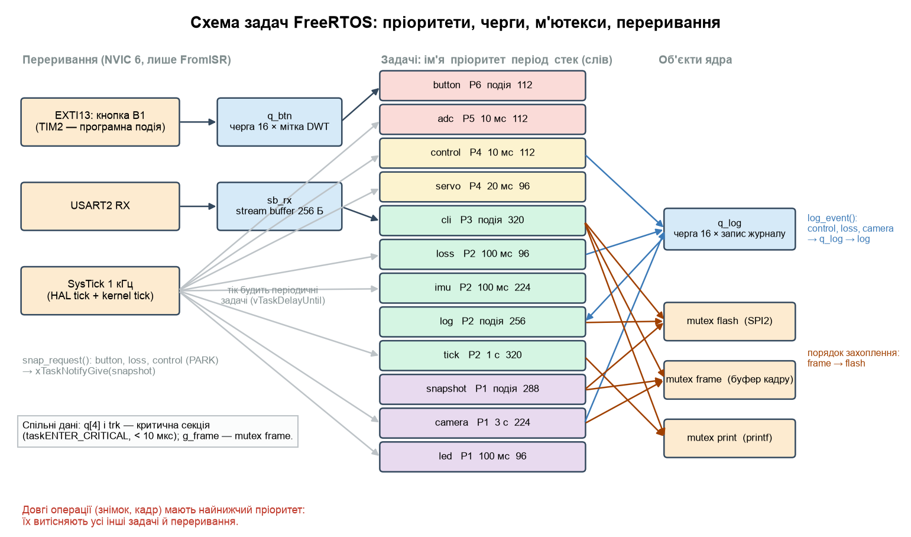

# Продукт на FreeRTOS: задачі, пріоритети, механізми взаємодії (ЛР4)

Той самий продукт, що в ЛР3 (`git tag lab3`), але виконання організовано задачами ОС. Логіка (трекер, клас неба, журнал, кадри, калібровка, CLI) — ті самі модулі `firmware/App/`; перенесено лише організацію виконання. Код ОС: `firmware/Core/Src/product_rtos.c` (задачі), `rtos_port.c` (хуки, printf, облік перемикань), `rtos_tests.c` (сценарії п. 7.2), `firmware/Core/Inc/FreeRTOSConfig.h`.

## 1. Версія ядра і спосіб підключення

| Параметр | Значення |
|---|---|
| Ядро | FreeRTOS-Kernel **V11.1.0**, тег `V11.1.0`, коміт `dbf70559b27d39c1fdb68dfb9a32140b6a6777a0` |
| Звідки | `https://github.com/FreeRTOS/FreeRTOS-Kernel`, скопійовано файли ядра без змін у `firmware/Middlewares/FreeRTOS/` (запис версії — `VERSION.txt` там і в `docs/versions.md`) |
| Порт | `portable/GCC/ARM_CM4F` (Cortex-M4 з FPU) |
| Схема heap | `heap_4` (злиття вільних блоків), `configTOTAL_HEAP_SIZE` = 24 КБ, статичний масив у `.bss` |
| Обгортка CMSIS-RTOS | не використовується, прямий API FreeRTOS; усі метрики п. 6 доступні без обгортки |
| Збираються | `tasks.c queue.c list.c stream_buffer.c port.c heap_4.c`; програмні таймери і групи подій вимкнено |

## 2. Задачі і пріоритети

Правило, з якого починали: чим жорсткіший дедлайн, тим вищий пріоритет; довгі операції на найнижчому. Пріоритети — числа FreeRTOS (більше = важливіше), `configMAX_PRIORITIES = 8`.

| Задача | Запуск | Пріоритет | Стек, слів (байт) | FR | Чому так |
|---|---|---|---|---|---|
| `button` | сповіщення черги `q_btn` від ISR кнопки | **6** | 112 (448) | FR-10 | найжорсткіша вимога часу реакції (≤ 50 мс, реєстр ЛР3 № 1); робота — кілька мікросекунд |
| `adc` | `vTaskDelayUntil`, 10 мс | **5** | 112 (448) | FR-01 | жорсткий період ≥ 100 Гц (реєстр № 2); виконується 155 мкс |
| `control` | 10 мс | 4 | 112 (448) | FR-02…06, 13 | рішення про режим за свіжими вимірами; 8 мкс |
| `servo` | 20 мс | 4 | 96 (384) | FR-03, 04 | плавний рух; 3 мкс |
| `cli` | `stream buffer` `sb_rx` від ISR USART2 | 3 | 320 (1280) | FR-09, 18 | людина чекає відповіді (≤ 100 мс), але не мікросекунди |
| `loss` | 100 мс | 2 | 96 (384) | FR-14 | детектор падіння світла за 2 с — повільний процес |
| `imu` | 100 мс | 2 | 224 (896) | FR-17 | блокувальний I²C (до сотень мс у разі відмови шини) — не повинен впливати на вищі задачі (реєстр № 4) |
| `log` | черга `q_log` | 2 | 256 (1024) | FR-07, 08 | запис у flash можна відкласти |
| `tick` | 1 с | 2 | 320 (1280) | FR-18 | рядок лога блокує UART на 18 мс (реєстр № 4) |
| `snapshot` | сповіщення (`xTaskNotifyGive`) | **1** | 288 (1152) | FR-11, 14, 15 | довга операція: кадр + стирання і запис 19 КБ (реєстр № 5) — має поступатись усім |
| `camera` | 3 с | **1** | 224 (896) | FR-11, 12, 16 | захоплення кадру 0,4–0,8 с — теж довга операція |
| `led` | 100 мс | 1 | 96 (384) | FR-10 | індикація, некритична |
| IDLE | автоматично | 0 | 128 (512) | — | простій; частка IDLE = вільний CPU |

Сума зарезервованих стеків задач: 2 256 слів = 9 024 байти. Реально використаний максимум кожної задачі після найгіршого сценарію S3 — у `docs/comparison-lr3-lr4.md` і на рисунку `lab_4/img/fig_stacks.png`; розміри вибрано за виміряним `usStackHighWaterMark`. Найменший запас у `cli` (після S3 вільно 83 слова з 320, тобто 26 %), бо вона форматує довгі відповіді `printf`; у решти задач вільно від 55 % (`led`) до 90 % (`IDLE`).

Чому дванадцять задач, а не менше: щоб STAT-рядки (`STAT name=adc …`) мали ті самі імена, що в ЛР3, і скрипти аналізу та таблиці порівнювали одне з одним. Ціна — окремий стек на кожну задачу.

## 3. Механізми взаємодії

| Від → до | Механізм | Що передається | Чому цей механізм |
|---|---|---|---|
| ISR кнопки → `button` | черга `q_btn` (16 × `uint32_t`) | мітка DWT фронту | кілька подій поспіль не зливаються (у ЛР3 один слот губив 28 з 48 натискань); мітка кожної події зберігається |
| ISR USART2 → `cli` | stream buffer `sb_rx` (256 Б) | прийняті байти | один записувач (ISR), один читач |
| тік ОС → періодичні задачі | `vTaskDelayUntil` | пробудження без накопичення похибки | зберігає період, не залежить від часу виконання |
| `control`, `loss`, `camera` → `log` | черга `q_log` (16 × запис 16 Б) | копія структури події | швидкі задачі не пишуть у flash самі |
| `button`, `loss`, `control` → `snapshot` | сповіщення задачі `xTaskNotifyGive` | «зроби знімок» | отримувач відомий, сповіщення легше за семафор |
| `log`, `snapshot`, `cli` ↔ SPI2/W25Q64 | м'ютекс `flash_mx` (успадкування пріоритету) | право на шину | flash-пам'ять одна, запис триває сотні мс |
| `camera`, `snapshot`, `cli` ↔ `g_frame` | м'ютекс `frame_mx` | право на буфер кадру 19 200 Б | один буфер (економить 19 КБ RAM, проблема 17 ЛР3) |
| `tick`, `cli` та інші ↔ UART | м'ютекс `print_mx` у `__wrap_printf` | право на виведення | `printf` (newlib) не реентерабельний |
| `adc` → `control`, `tick` | `q[4]` у критичній секції (`taskENTER_CRITICAL`, < 10 мкс) | вимір квадранта | чотири слова копіюються атомарно |
| `control` → решта | `trk` (режим) у критичній секції на запис | стан трекера | читання скалярів атомарне |

Порядок захоплення м'ютексів фіксований: `frame_mx` → `flash_mx` (знімок і показ кадру), що виключає взаємне блокування. Усі виклики з таймаутом `portMAX_DELAY` там, де відмова недопустима; помилка в кожному місці означає баг, а не штатну ситуацію.

## 4. Переривання (п. 4.10 методички)

| Джерело | Пріоритет NVIC | Дія в ISR | Що робить задача |
|---|---|---|---|
| SysTick | 15 (мінімальний, `configKERNEL_INTERRUPT_PRIORITY`) | `HAL_IncTick()` і `xPortSysTickHandler()`; час обробника міряється DWT | — |
| PendSV, SVC | 15, 0 | перемикання контексту і запуск першої задачі (порт) | — |
| EXTI15_10 (кнопка), TIM2 (імітатор) | **6** | `xQueueSendFromISR(q_btn)` | `button` |
| USART2 | **6** | `xStreamBufferSendFromISR(sb_rx)` | `cli` |
| HardFault | — | друкує `FATAL HardFault` прямо в регістр USART, перезапуск (проблема 30) | — |

* `configLIBRARY_MAX_SYSCALL_INTERRUPT_PRIORITY = 5`: ISR, що викликають API ядра, мають пріоритет числово не менший за 5; у нас 6. У ЛР3 вони мали 1, тому довелось перенастроїти.
* `HAL_Init()` встановлює `NVIC_PRIORITYGROUP_4`: усі 4 біти — пріоритет (`configPRIO_BITS = 4`), підгруп немає. Без цього `configASSERT` порту зупиняє програму.
* **HAL і SysTick.** HAL і ядро хочуть один таймер. Ми не переводили HAL на інший таймер, а лишили спільний SysTick: у `SysTick_Handler` викликаємо `HAL_IncTick()` і, коли планувальник запущено, `xPortSysTickHandler()`. `HAL_GetTick()`, `platform_millis()` і всі блокувальні виклики HAL (таймаути) працюють без змін. Ціна: обробник тіка трохи довший (виміряно в `OSCOST`), а ISR HAL і ядра ділять один рівень пріоритету 15.
* Сценарій тіка в камері: коли переривання вимкнені на час захоплення кадру, тік губиться. Рішення описано в розділі 6.

## 5. Конфігурація ядра: параметри, змінені відносно типових

| Параметр | Значення | Навіщо |
|---|---|---|
| `configTICK_RATE_HZ` | 1000 (також перевірено 100) | роздільна здатність таймаутів 1 мс; впливає на джитер і накладні витрати (п. 7.2) |
| `configUSE_PREEMPTION`, `configUSE_TIME_SLICING` | 1, 1 | витіснення — головна мета переходу; задачі одного пріоритету ділять процесор |
| `configUSE_PORT_OPTIMISED_TASK_SELECTION` | 1 | вибір задачі за `CLZ` (Cortex-M4), час вибору не залежить від кількості задач |
| `configMAX_PRIORITIES` | 8 | пріоритети 0…7, задіяно 0…6 |
| `configMINIMAL_STACK_SIZE` | 128 слів | стек idle-задачі |
| `configTOTAL_HEAP_SIZE`, схема | 24 КБ, `heap_4` | задачі, черги, м'ютекси, stream buffer; використано менше половини (див. `HEAP`) |
| `configSUPPORT_STATIC_ALLOCATION` | 0 | усе створюється при ініціалізації динамічно; створення і видалення під час роботи лише в сценаріях `TEST` (п. 7.2) |
| `configUSE_NEWLIB_REENTRANT` | 0 | окрема структура reent для кожної задачі коштувала б ~1 КБ на задачу; замість цього `printf`/`puts`/`putchar` загорнуто в м'ютекс (`-Wl,--wrap`) |
| `configUSE_MUTEXES`, `…_COUNTING_SEMAPHORES`, `…_TASK_NOTIFICATIONS`, `…_STREAM_BUFFERS` | 1 | потрібні механізми з таблиці розділу 3 |
| `configUSE_TIMERS`, `configUSE_EVENT_GROUPS` | 0 | не потрібні: усі періоди робить `vTaskDelayUntil` у задачах; економить RAM (немає Tmr Svc) і код |
| `configCHECK_FOR_STACK_OVERFLOW` | 2 | перевірка шаблоном на кожному перемиканні; хук виводить назву задачі і перезапускає плату |
| `configUSE_MALLOC_FAILED_HOOK` | 1 | сигнал про вичерпання heap ОС |
| `configASSERT` | `rtos_assert_failed` | зупинка з файлом і рядком в UART (без printf) |
| `configUSE_TRACE_FACILITY`, `configGENERATE_RUN_TIME_STATS`, `configUSE_STATS_FORMATTING_FUNCTIONS` | 1 | `uxTaskGetSystemState`, лічильник DWT; **власний облік** часу за задачами в `traceTASK_SWITCHED_IN` (64-бітний, без переповнення 43 с) |
| `traceTASK_SWITCHED_IN` | `rtos_trace_switch_in()` | облік CPU за задачами, журнал перемикань (1024 події), служебний пін PB2 = «працює idle» |
| `configLIBRARY_MAX_SYSCALL_INTERRUPT_PRIORITY` | 5 | межа пріоритетів ISR, що викликають API ядра |
| `INCLUDE_xTaskAbortDelay` | 1 | команда `PERIOD` змінює період і негайно перериває старий сон |
| `vPortSVCHandler`, `xPortPendSVHandler` | перейменовано на `SVC_Handler`, `PendSV_Handler` | вектори startup-файлу |

## 6. Захоплення кадру камери без вимкнення всіх переривань

У ЛР3 `platform_cam_capture` вимикав переривання на весь кадр (0,4–0,8 с): пропадали тіки SysTick (лічильник `uwTick` доганявся), байти UART і події кнопки. На FreeRTOS це знищило б сенс витіснення. У ЛР4 введено режим 1 (`platform_cam_set_irq_mode(1)`):

* кадр складається з 120 рядків; період рядка ≈ 3,1 мс, а активна частина (HREF = 1) триває ≈ 640 мкс;
* переривання вимикаються лише на ~250 мкс до початку рядка і до його кінця (вікно 0,9–1,2 мс за `CAMDIAG` і `OSCOST`, тобто близько тіка 1 мс), решту часу ISR і задачі працюють;
* якщо задачу витіснили і вікно проґавлено, наступний рядок чекає HREF з увімкненими перериваннями; якщо кадр скінчився раніше (VSYNC піднявся), хвіст добирається повтором останнього рядка;
* лічильники діагностики: `cam_irq_off_max_us`, `cam_short_frames`, `cam_lines_lost` у команді `OSCOST`.

Режим 0 (як у ЛР3) лишено: `CAMIRQ 0` вмикає його, а `xTaskCatchUpTicks` доганяє втрачені тіки. Оцінка внеску цього режиму — в `docs/comparison-lr3-lr4.md`: частина виграшу ЛР4 дає саме він, а не лише ОС.

## 7. Нові місця, де щось може піти не так

| Ризик | Де проявляється | Захист |
|---|---|---|
| Переповнення стека задачі | `cli` викликає глибокі функції (`printf`, flash) | `configCHECK_FOR_STACK_OVERFLOW = 2`, `STACK`, сценарій `TEST STK` |
| Інверсія пріоритетів на SPI2/flash | `snapshot` (P1) тримає `flash_mx` 1+ с, `log` (P2) і `cli` (P3) чекають | м'ютекс із успадкуванням; сценарій `TEST INV` порівнює з двійковим семафором |
| Голодування | задача високого пріоритету без блокування | сценарій `TEST STARVE` |
| Вичерпання черги | `q_log` 16 записів | `pend_lost`, `btn_lost`; сценарій `TEST QFLOOD` |
| Вичерпання heap ОС | `pvPortMalloc` | `vApplicationMallocFailedHook`; сценарій `TEST HEAP` |
| Втрата тіків при вимкнених перериваннях | захоплення кадру | вікна ≈ 1 мс (розділ 6) |
| Втрата байтів UART при вимкнених перериваннях | захоплення кадру, прийом по RXNE | не закрито: драйвер UART як у ЛР3; лічильник `uart_rx_overflow` (проблема 32) |
| Тайм-аут HAL при витісненні | обмін по SPI у `snapshot` (P1), яку витісняють | тайм-аут HAL рахується за годинником, тому для SPI взято 1 с замість 100 мс; код помилки — `flash_last_rc` у `LOAD` (проблема 29) |
| Задача крутиться в очікуванні периферії | друк через `HAL_UART_Transmit` у `cli` (P3) | не закрито: драйвер UART як у ЛР3, тому `imu`, `loss`, `led` голодують під час друку `STATS`; видно в `missed` (проблема 27) |

## 8. Додані команди (старі не змінено)

`TASKS` (частка CPU, пріоритет, стан, запас стека кожної задачі), `STACK`, `HEAP`, `OSCOST` (вартість тіка, кількість перемикань, діагностика захоплення), `TRACE ARM|DUMP [n]` (хронологія перемикань), `BTNSIM ms` (програмні події кнопки), `FAULT SDA 1|0` (замкнути SDA на землю), `CAMIRQ 0|1`, `TEST INV [SEM] | STK | STARVE ms | QFLOOD n ms | HEAP | CTX n | CAMDIAG ms`. Формат рядків `STAT`, `LOAD`, `MEM` лишився тим самим, тому `tools/analyze_stats.py` і `tools/run_scenario.py` обробляють обидві прошивки.
